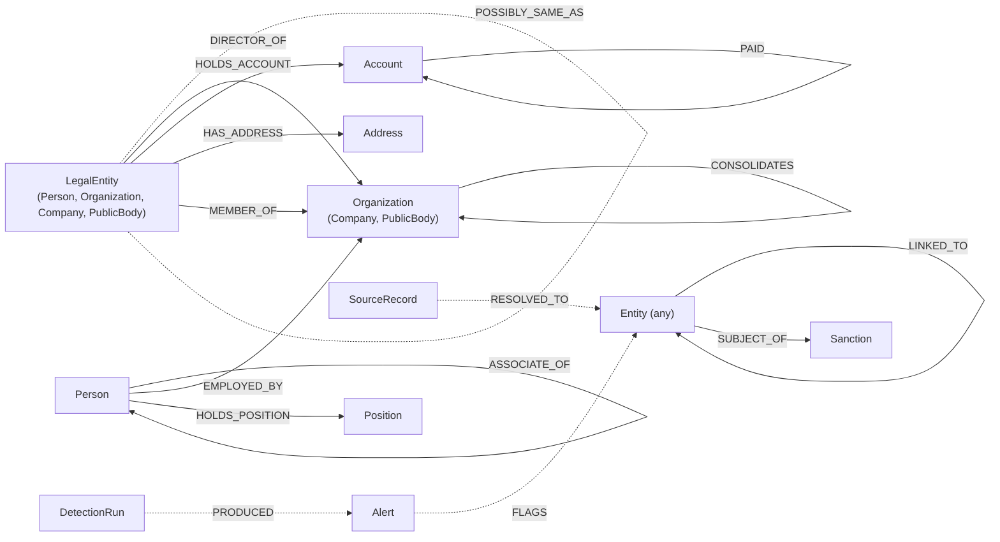

# C2: Graph schema v1.2.0

How C1 records become nodes and relationships in Neo4j 5.26 Community (Cypher 5), and the constraints and indexes that hold them. Every loader, detector, API query and copilot template reads the graph through this schema.

- Status: version 1.2.0, **not frozen yet**: 1.0.0 plus the additive entity resolution changes in [Changes in 1.1.0](#changes-in-110) (contract-change issue #52, `docs/build/PHASE-2.md` 5.2) and the additive overlay and detection changes in [Changes in 1.2.0](#changes-in-120) (contract-change issue #70, `docs/build/PHASE-3.md` 5.2). The tech lead freezes the four contracts at Gate 1 with the tag `contracts-v1.0.0`, tags `contracts-v1.1.0` after Phase 2's contract changes and `contracts-v1.2.0` after Phase 3's (`docs/build/PHASE-1.md` sections 5.0 and 8, `docs/build/PHASE-2.md` 5.0, `docs/build/PHASE-3.md` 5.0). After that, changes need an approved contract-change issue and, when constraints or indexes change, a new migration file; an applied migration is never edited.
- Code: `neonradar_contracts.graph` (the mapping as data), `neonradar_graph.mapping` (records to loader rows, no database), `neonradar_graph.migrate` (the migration runner), and from 1.2.0 `graph/src/neonradar_graph/queries/verify_overlay.cypher` (invariants I15 to I17).
- Schema: `graph/schema/migrations/0001_init.cypher` (22 uniqueness constraints and 7 indexes) and `0002_resolution.cypher` (1.1.0: one more constraint, two more indexes, the full-text index rebuilt). 1.2.0 adds no migration.
- Command: `uv run neonradar graph migrate`.
- Source: `docs/build/PHASE-1.md` section 5.2, `docs/build/PHASE-2.md` section 5.2 and `docs/build/PHASE-3.md` section 5.2, with the decisions in [Mapping decisions](#mapping-decisions) and in [CHANGELOG.md](CHANGELOG.md).

## Picture

Labels mirror the FtM hierarchy, so `MATCH (x:LegalEntity)` finds people and organisations alike. Every node built from an FtM thing also has `:Entity` (left out of the picture).



Dotted relationships are written by entity resolution (Phase 2) and detection runs, not built from records. `POSSIBLY_SAME_AS` (1.1.0) is an unconfirmed possible match between two separate nodes, read as undirected; it merges nothing and carries no flag.

## Node labels

| FtM schema | Labels | Schema-specific properties (snake_case) |
|---|---|---|
| `Person` | `:Entity:LegalEntity:Person` | `birth_date`, `nationalities`, `gender` |
| `Company` | `:Entity:LegalEntity:Organization:Company` | `registration_number`, `jurisdiction`, `lei`, `status`, `legal_form`, `sector`, `incorporation_date`, `dissolution_date`; from 1.1.0 `psc_statements` (LIST<STRING>), `accounts_category` |
| `Organization` | `:Entity:LegalEntity:Organization` | as Company where present, without the two 1.1.0 properties |
| `PublicBody` | `:Entity:LegalEntity:Organization:PublicBody` | as Organization |
| `LegalEntity` | `:Entity:LegalEntity` | `registration_number`, `jurisdiction`, `lei`, `status`, `sector` |
| `Address` | `:Entity:Address` | `full`, `street`, `city`, `postal_code`, `region`, `country`, `address_key` (normalised key, Phase 2) |
| `BankAccount` | `:Entity:Account` | `account_number`, `bank_name`, `currency`, `account_type`, `account_kind`, `opening_date`, `closing_date` |
| `Position` | `:Entity:Position` | `country` |
| `Sanction` | `:Sanction` | `authority`, `program`, `program_id`, `listing_date`, `start_date`, `end_date`, `reason`, `country`; from 1.2.0 `provisions` (LIST<STRING>, empty when the source gives none) |

The FtM property behind each graph property is in `neonradar_contracts.graph.NODE_MAPPINGS` (for example `leiCode` becomes `lei`, `nationality` becomes `nationalities`, `nr.account_kind` becomes `account_kind`).

Support nodes (not `:Entity`): `:SourceRecord` (entity resolution evidence, Phase 2), `:Alert` (C4), `:DetectionRun`, `:SchemaMigration`.

| Support label | Properties |
|---|---|
| `:Alert` | `alert_id` (unique), `typology`, `typology_version`, `priority`, `pattern_strength` (FLOAT), `headline`, `created_at` (UTC ISO string), `run_id`, `wording_class`, `involves_real_entities` (BOOLEAN), `synthetic_activity` (BOOLEAN), `payload` (STRING: the complete C4 alert as JSON); from 1.2.0 `evidence_node_ids`, `evidence_edge_ids` (LIST<STRING>, [Changes in 1.2.0](#changes-in-120)) |
| `:DetectionRun` | `run_id` (unique), `started_at`, `finished_at` (UTC ISO strings), `typologies` (LIST<STRING>), `detectors` (STRING: JSON list of name and version), `alert_count` (INTEGER), `status` (`ok` or `failed`); from 1.2.0 `profile`, `params_sha256`, `summary`, `window_start`, `window_end` (STRING, [Changes in 1.2.0](#changes-in-120)) |
| `:SchemaMigration` | `id`, `checksum`, `applied_at` |
| `:SourceRecord` | `id` (unique), `dataset`, `schema`, `caption`, `names`, `topics`, `canonical_id`, `synthetic`, `retrieved_at`, `source_url`, `run_id` (1.1.0; see [Changes in 1.1.0](#changes-in-110)) |

The API reads alerts only from Neo4j: it filters on the scalar properties and parses `payload` for `AlertDetail`. The files in `data/runs/<run_id>/` are the run's audit copy, not an API source.

## Flag labels

Set by the loader from source data only, never from detections:

| Flag | On | Set when |
|---|---|---|
| `:Synthetic` | every `:Entity` and `:Sanction` node | the record's dataset is synthetic (`contracts/datasets.yaml`); mirrors `synthetic = true` (invariant I2) |
| `:Sanctioned` | `:Entity` | `topics` contains exactly `sanction` (`sanction.linked`, `sanction.control` and `sanction.counter` do not set it) |
| `:PEP` | `:Entity` | `topics` contains `role.pep` or a sub-topic `role.pep.*` (for example `role.pep.natl`, `role.pep.frmr`) |
| `:RCA` | `:Entity` | `topics` contains `role.rca` or a sub-topic `role.rca.*` |

A flag says what a source published about an entity. It is a fact about the source, not a finding of NeonRadar. Synthetic records may carry only the topics `sanction`, `role.pep` and `role.rca` (C1 R9); real records may carry sub-topics.

## Common properties on every `:Entity` and `:Sanction` node

| Property | Type | Rule |
|---|---|---|
| `id` | STRING | Unique. The record id in Phase 1; the canonical id after entity resolution (Phase 2) |
| `schema` | STRING | FtM schema name |
| `caption` | STRING | The record's `caption` if it has one, else FtM's caption (the first property in the schema's caption list that has a value; for names FtM picks a representative value, preferring Latin script), else the schema label such as `Sanction`, so it is never empty |
| `names` | LIST<STRING> | Every value of `name`, `alias`, `previousName`, `abbreviation` (and `full` for addresses), in original scripts, without duplicates |
| `names_text` | STRING | `names` joined with `" \| "`, for the full-text index |
| `countries` | LIST<STRING> | Lower-case ISO codes from every country-typed property (normalised with FtM's country type, so `GB` becomes `gb`), sorted, without duplicates. Country-typed schema properties (`jurisdiction`, `country`, `nationalities`) are normalised the same way |
| `topics` | LIST<STRING> | FtM topics |
| `datasets` | LIST<STRING> | Dataset slugs |
| `referents` | LIST<STRING> | Record ids merged into this node (Phase 1: `[id]`) |
| `synthetic` | BOOLEAN | Equals the dataset's `synthetic` flag; mirrors the `:Synthetic` label |
| `first_seen`, `last_seen` | STRING | ISO datetimes when the source provides them |
| `source_url` | STRING | Optional, from FtM `sourceUrl` |
| `cluster_size`, `resolution`, `names_latin`, `names_latin_text` | INTEGER, STRING, LIST<STRING>, STRING | `:Entity` only, 1.1.0: computed by the resolution-aware loader (M2.11), see [Changes in 1.1.0](#changes-in-110) |

Dates on entities and relationships are ISO 8601 strings and may be partial. Only transaction timestamps (`PAID.ts`) are Neo4j `DATETIME` values in UTC.

## Relationships

| Type | From | To | Built from | Specific properties |
|---|---|---|---|---|
| `OWNS` | `LegalEntity` | `LegalEntity` | `Ownership` whose asset is not a `BankAccount` and without `nr.consolidation` | `share_pct_min`, `share_pct_max` (FLOAT), `percentage_raw`, `ownership_type`, `role`, `natures_of_control`, `start_date`, `end_date`, `status`; from 1.1.0 `share_min_exclusive`, `share_max_exclusive`, `is_nominee` (BOOLEAN, `false` when absent) |
| `CONTROLS` | `LegalEntity` | `LegalEntity` | `Control` | `control_type`, `legal_basis`, `natures_of_control`, `start_date`, `end_date`; from 1.1.0 the voting-rights band `share_pct_min`, `share_pct_max` (FLOAT, null when absent) and `share_min_exclusive`, `share_max_exclusive` (BOOLEAN, `false` when absent) |
| `CONSOLIDATES` | `Organization` (parent) | `Organization` (child) | `Ownership` with `nr.consolidation` | `level` (`direct` or `ultimate`), `start_date`, `end_date`, `status` |
| `DIRECTOR_OF` | `LegalEntity` | `Organization` | `Directorship` | `role`, `is_nominee`, `start_date`, `end_date` |
| `HOLDS_ACCOUNT` | `LegalEntity` | `Account` | `Ownership` whose asset is a `BankAccount` | `role`, `start_date`, `end_date` |
| `PAID` | `Account` | `Account` | `Payment` (payerAccount to beneficiaryAccount) | `amount` (FLOAT, major units), `currency`, `ts` (DATETIME, UTC), `channel`, `purpose` |
| `HAS_ADDRESS` | `LegalEntity` | `Address` | `addressEntity` property | `role` from `nr.address_roles`, default `unknown` |
| `REPRESENTS` | `LegalEntity` | `LegalEntity` | `Representation` (agent to client) | `role` (ICIJ intermediaries use `intermediary`) |
| `FAMILY_OF` | `Person` | `Person` | `Family` (person to relative) | `relationship` |
| `ASSOCIATE_OF` | `Person` | `Person` | `Associate` | `relationship` |
| `MEMBER_OF` | `LegalEntity` | `Organization` | `Membership` | `role`, `start_date`, `end_date` |
| `EMPLOYED_BY` | `Person` | `Organization` | `Employment` (employee to employer) | `role`, `start_date`, `end_date` |
| `LINKED_TO` | `Entity` | `Entity` | `UnknownLink` | `role` |
| `SUCCEEDED_BY` | `LegalEntity` | `LegalEntity` | `Succession` (predecessor to successor) | `date` |
| `HOLDS_POSITION` | `Person` | `Position` | `Occupancy` (holder to post) | `status`, `start_date`, `end_date` |
| `SUBJECT_OF` | `Entity` | `Sanction` | `Sanction.entity` | none |
| `RESOLVED_TO` | `SourceRecord` | `Entity` | Entity resolution (Phase 2) | `match_probability`, `method`, `resolver_version`, `decided_at`; from 1.1.0 `rule`, `run_id`, `features` |
| `POSSIBLY_SAME_AS` | `LegalEntity` | `LegalEntity` | Entity resolution (1.1.0): a line of `candidates.jsonl` | `id`, `match_probability`, `match_weight`, `method`, `rule`, `reasons`, `features`, `run_id`, `resolver_version`, `datasets`, `synthetic` |
| `FLAGS` | `Alert` | `Entity` | Alert subjects: one per alert and subject entity (`MERGE` on the pair, `SET` the `role`); a re-run removes `FLAGS` to entities that are no longer subjects | `role` |
| `PRODUCED` | `DetectionRun` | `Alert` | Detection runs | none |

Common relationship properties (all types except `RESOLVED_TO`, `POSSIBLY_SAME_AS`, `FLAGS`, `PRODUCED`; `POSSIBLY_SAME_AS` has its own `id`, `datasets` and `synthetic`, and no `source_url`): `id` (STRING, unique per type: the FtM interval entity id, or `<record id of the entity>|addr|<address record id>` for `HAS_ADDRESS`, or `<record id of the entity>|sanction|<sanction record id>` for `SUBJECT_OF`), `datasets`, `synthetic`, `source_url` (optional).

Relationship ids are unique across all types and never equal a node id (derived ids contain `|`, which the C1 id alphabet excludes). The ids of relationships built from records (including the derived `HAS_ADDRESS` and `SUBJECT_OF` ids, built from record ids) do not change after entity resolution; a `POSSIBLY_SAME_AS` id (1.1.0) is built from the two node ids, which are canonical ids after resolution.

Every edge schema runs in FtM's edge direction (`schema.edge_source` to `schema.edge_target`), except `PAID`, which joins the two accounts of a `Payment` rather than its payer and beneficiary.

## Migrations

`graph/schema/migrations/0001_init.cypher` (Neo4j 5.26 Community, Cypher 5; one statement per line ending with `;`) creates the 1.0.0 schema:

- 6 node uniqueness constraints: `:Entity(id)`, `:Sanction(id)`, `:SourceRecord(id)`, `:Alert(alert_id)`, `:DetectionRun(run_id)`, `:SchemaMigration(id)`;
- 16 relationship uniqueness constraints, one on `id` for every type built from records (`owns_id` to `subject_of_id`);
- 6 range indexes: `Company.registration_number`, `LegalEntity.lei`, `Address.address_key`, `Account.account_number`, `PAID.ts`, `Alert.typology`;
- 1 full-text index `entity_names` on `names_text` of `:LegalEntity` and `:Address` (analyzer `standard-no-stop-words`).

`graph/schema/migrations/0002_resolution.cypher` (1.1.0) adds the constraint `possibly_same_as_id` on `POSSIBLY_SAME_AS.id`, the range indexes `source_record_canonical_id` and `source_record_dataset`, and rebuilds `entity_names` (same name, same analyzer) over `names_text` and `names_latin_text`, so the API's search query does not change. Every statement is idempotent: the index is dropped with `IF EXISTS` and created with `IF NOT EXISTS`.

A uniqueness constraint creates its own backing index, so no separate index on `id` is needed. Community Edition has no existence, type or key constraints; the loader, the mapping and the invariant tests enforce required properties instead. After 0001 and 0002, `SHOW INDEXES` lists 34 rows on a migrated database: the 23 constraint-backed indexes, the 9 own indexes (8 range, 1 full-text) and the 2 built-in lookup indexes.

**Runner** (`neonradar graph migrate`, `neonradar_graph.migrate`):

1. Reads `graph/schema/migrations/NNNN_<name>.cypher` in number order. A statement is one line ending with `;`; `//` lines and blank lines are skipped. The checksum is the SHA-256 of the file text with line endings normalised to LF.
2. Reads the applied migrations from the `:SchemaMigration` nodes. If an applied migration's checksum changed, it stops with "add a new migration; never edit an applied one"; if the database has a migration the folder lacks, it stops too. In both cases nothing is applied.
3. Applies each pending migration one statement per auto-commit transaction, waits for the indexes to come online (`db.awaitIndexes`), then records `(:SchemaMigration {id, checksum, applied_at})` (`id` is the file name without `.cypher`, `applied_at` a UTC ISO string).
4. Re-running is a no-op ("nothing to apply").

Every statement must be idempotent (`IF NOT EXISTS`): DDL cannot be rolled back, so a run that fails half-way keeps the statements before the failure, and the next run applies the file again.

## Loader rules

`neonradar graph load` (M1.9a) builds on `neonradar_graph.mapping`:

1. Validate every record (C1) first; nothing is written if validation fails in strict mode. In a non-strict load, a record that fails C1 is skipped, never mapped: the mapping trusts C1's types (for example `nr.is_nominee` is a boolean, not the string `"false"`).
2. Load nodes before relationships, in batches of 5,000 rows with `UNWIND $rows AS row`, through `driver.execute_query(..., database_="neo4j")`.
3. Labels come only from the fixed mapping, written into the query text per schema; data values are never interpolated into Cypher. Flag labels use `FOREACH (_ IN CASE WHEN row.flags.PEP THEN [1] ELSE [] END | SET n:PEP)`, and a flag that is false is removed the same way (`... WHEN NOT row.flags.PEP ... | REMOVE n:PEP`), so a reload of a record whose source dropped a topic also drops the flag.
4. Nodes: `MERGE (n:Entity {id: row.id})` (`:Sanction` for sanctions), then set labels, then `SET n += row.props`.
5. Relationships: `MATCH (s:Entity {id: row.source}) WHERE s:<From>` and the same for the target, using `:Sanction` instead of `:Entity` for a Sanction end (`RelationshipRow.endpoint_keys`, with the From and To labels in `endpoint_labels`), so the uniqueness index is used; a label-only `MATCH (s:<From> {id: ...})` scans every node with that label. Then `MERGE` the relationship on its `id` and `SET r += row.props`. Count rows whose endpoints were not found and report them as dangling.
6. `PAID.ts`: the row carries `<record date>Z` in `row.ts` and the query sets `r.ts = datetime(row.ts)`.
7. Loading the same files twice leaves the graph unchanged. Loading changed files is an upsert: mapped properties a record no longer has are removed, and a relationship whose end or type changed (an Ownership between `OWNS`, `CONSOLIDATES` and `HOLDS_ACCOUNT`) is moved; records no longer in the files and relationships from dropped `addressEntity` or `Sanction.entity` values stay, so invariants I1 to I5 are guaranteed after `neonradar graph wipe --yes` followed by a load.
8. In strict mode, any `MappingIssue` (below) fails the load.

`to_node_rows(records)` and `to_relationship_rows(records)` take the whole load as a sequence (a list, never a one-shot iterator: the relationship mapping reads it twice, because the Ownership case and the endpoint checks need the schema of referenced records). Each returns its rows and a list of skipped records or references (`MappingIssue`). Record-level issues (not a C1 record, duplicate id) appear in both lists; `MappingIssue` is hashable, so merge them with `dict.fromkeys`. `NodeRow.as_param()` and `RelationshipRow.as_param()` give the parameter row for `UNWIND`.

## Mapping decisions

C1 accepts some records that the C2 tables do not cover one to one. The mapping decides them as follows; each is listed for tech lead sign-off at Gate 1 in [CHANGELOG.md](CHANGELOG.md).

1. **Ownership order.** An `Ownership` becomes `HOLDS_ACCOUNT` when its asset is a `BankAccount` in the load, else `CONSOLIDATES` when `nr.consolidation` is set, else `OWNS`. So an account holding wins over consolidation, and its `nr.consolidation` is not stored. Share bands (`nr.share_pct_*`) of an `Ownership` are stored only on `OWNS`; from 1.1.0 the voting-rights band of a `Control` is stored on `CONTROLS`, which the ownership endpoint never traverses (a voting-rights band is control, not a share).
2. **One value per property.** A graph property of type STRING or FLOAT takes the first value of the FtM property, in FtM's stored value order (the order of the record's list). LIST properties (`names`, `countries`, `topics`, `datasets`, `nationalities`, `natures_of_control`; from 1.2.0 `Sanction.provisions`) keep every value. Absent values are left out, not set to null, except `Sanction.provisions` (1.2.0), which is an empty list when the record has none (`NodeMapping.empty_lists`).
3. **Person properties** are exactly the three in the node table; LegalEntity properties such as `registration_number` are not copied onto persons.
4. **Flags** follow the table above: `:PEP` and `:RCA` include sub-topics, `:Sanctioned` does not, and `:Synthetic` is also set on `:Sanction` nodes.
5. **PAID** keeps no payer or beneficiary: the holders are found through `HOLDS_ACCOUNT`. C1 does not check that the payer holds the payer account.
6. **Skipped with a `MappingIssue`** (a strict load fails):
   - an edge record with more or fewer than one value for its source or target property (C1 forces single values only on `Payment`);
   - an endpoint in the load whose schema does not carry the required label, for example `CONSOLIDATES` with a `Person` owner, or `LINKED_TO` pointing at an `Ownership` record;
   - `addressEntity` on a record that is not a `LegalEntity` (FtM allows it on every thing; `HAS_ADDRESS` starts at a `LegalEntity`); the node itself is kept;
   - a duplicate id in the load (C1 R4 already rejects it; the first record is kept).
7. **Endpoints outside the load** are not checked by the mapping; the loader's label-checked `MATCH` counts them as dangling. An `Ownership` whose asset is outside the load is treated as `OWNS`.
8. **Not mapped in v1** (C1 accepts them, C2 stores nothing): the references `parent`, `riskSource`, `BankAccount.bank`, `Position.organization`, `Payment.payer`, `Payment.beneficiary`, `Payment.contract`, `Payment.project` and `proof`; on `HOLDS_ACCOUNT` and `CONSOLIDATES`, the Ownership's `percentage`, `ownershipType`, `nr.natures_of_control`, `nr.share_pct_*` and (1.1.0) `nr.is_nominee` (they are stored only on `OWNS`); every other FtM property that `neonradar_contracts.graph` does not name; the record keys `last_change` and `referents`; and `nr.v`, `nr.synthetic`, `nr.source_ref`, `nr.synthetic_kind` and (1.1.0) `nr.ch_person_number`. Records stay unchanged in their files (C1 R10); from 1.1.0 a `:SourceRecord` keeps only the properties in [Changes in 1.1.0](#changes-in-110), and only for members of merged entities.
9. **Not set in Phase 1:** `Address.address_key` (Phase 2 computes it), and `account_kind` or `DIRECTOR_OF.is_nominee` when the record has no `nr` value for them (no default is invented). From 1.1.0, `OWNS.is_nominee` and the bound flags of `OWNS` and `CONTROLS` are `false` when the record has no value (PHASE-2.md 5.2); `DIRECTOR_OF.is_nominee` keeps the 1.0.0 rule.

## Graph invariants

Integration tests run them against the demo-mini load (M1.9a and M1.9b):

| Invariant | Check |
|---|---|
| I1 | Every `:Entity` has non-null `id`, `schema`, `caption`, `datasets`, `synthetic`. |
| I2 | A node has the `:Synthetic` label if and only if `synthetic = true`. |
| I3 | Every `PAID` goes from an `:Account` to an `:Account`, has `amount > 0`, a three-letter `currency`, and a `DATETIME` `ts`. |
| I4 | Every `:Account` has at least one incoming `HOLDS_ACCOUNT`. |
| I5 | Every `OWNS` with share bounds has `0 <= share_pct_min <= share_pct_max <= 100`. |
| I6 | No `:Alert` with `wording_class = 'synthetic_scenario'` flags a node where `synthetic = false`. |

Invariants I7 to I14 (1.1.0) are in [Changes in 1.1.0](#changes-in-110), and I15 to I17 (1.2.0) in [Changes in 1.2.0](#changes-in-120).

## Changes in 1.1.0

Additive (`docs/build/PHASE-2.md` 5.2, contract-change issue #52): every graph valid under 1.0.0 stays valid, no property or type is renamed or removed, and a load without a resolution run (L8) behaves as in 1.0.0, except that `OWNS` and `CONTROLS` now carry their `false` defaults and companies carry the two new properties when a record has their `nr` keys (C1 1.1.0). M2.1b changes the schema, the mapping data (`neonradar_contracts.graph`) and the record mapping (`neonradar_graph.mapping`); the resolution-aware loader (L8 to L17), `neonradar graph verify` and the tests of I7 to I14 come with M2.11.

In `neonradar_contracts.graph`: `SUPPORT_NODES["SourceRecord"]`, `SUPPORT_RELATIONSHIPS["RESOLVED_TO"]` and `["POSSIBLY_SAME_AS"]` (with `POSSIBLY_SAME_AS_ID_INFIX`), `RELATIONSHIP_ENDPOINTS["POSSIBLY_SAME_AS"]`, `ENTITY_RESOLUTION_PROPERTIES`, the value sets `ENTITY_RESOLUTIONS`, `RESOLVED_TO_METHODS`, `POSSIBLY_SAME_AS_METHODS` and `CERTAIN_METHODS`, `NULLABLE_PROPERTIES`, the company mapping of `nr.psc_statements` and `nr.accounts_category`, and the `OWNS` and `CONTROLS` mappings with their `defaults`. `POSSIBLY_SAME_AS` is a support relationship (written by entity resolution, not built from records), so C3's record-built relationship types stay the 16 of 1.0.0. C3 1.1.0 shows it as a seventeenth type: the network returns it like any other relationship, `/paths` uses it when asked for, and its edges carry the `<a>|psa|<b>` id with `source` the smaller id (C3-api.md, Changes in 1.1.0).

Migration 0002 changes no data. Relationships loaded under 1.0.0 get the new `OWNS` and `CONTROLS` flags only when they are loaded again, so a query that may meet a graph loaded under 1.0.0 reads them with `coalesce(r.share_min_exclusive, false)` (likewise `share_max_exclusive` and `is_nominee`). `graph load` refuses a database until `neonradar graph migrate` has applied 0002.

**`:SourceRecord`** (one node per member of an entity merged from two or more records; never for single-record entities):

| Property | Type | Rule |
|---|---|---|
| `id` | STRING | the record id (unique, constraint from 0001) |
| `dataset`, `schema`, `caption` | STRING | from the record |
| `names` | LIST<STRING> | the record's names, original scripts |
| `topics` | LIST<STRING> | the record's own topics (invariant I11 recomputes flags from these) |
| `canonical_id` | STRING | the id of the entity it resolved to (indexed) |
| `synthetic` | BOOLEAN | the dataset's flag |
| `retrieved_at`, `source_url` | STRING | when the source provides them |
| `run_id` | STRING | the resolution run |

**`RESOLVED_TO`** (from `:SourceRecord` to `:Entity`; Phase 1 defined `match_probability`, `method`, `resolver_version`, `decided_at`): `method` takes the values `anchor`, `deterministic`, `probabilistic`, `human`; `match_probability` is 1.0 for `anchor`, `deterministic` and `human`; adds `rule` (STRING, D rule or null), `run_id` (STRING) and `features` (STRING: the `features` column of `canonical.csv`, a JSON object of comparison name to level label for the link through which the record joined; probabilistic links only, else null). The loader reads everything from `canonical.csv` (PHASE-2.md 7.1.8) and never needs `pairs.parquet`.

**`POSSIBLY_SAME_AS`** (new relationship type):

| From | To | Built from | Properties |
|---|---|---|---|
| `LegalEntity` | `LegalEntity` | a line of `candidates.jsonl` whose two records are of class `person`, `org` or `legal_entity` (L14); stored from the node with the smaller id to the node with the larger id, read as undirected | `id` (`<a>\|psa\|<b>`), `match_probability` (FLOAT, or null for `deterministic` and `source_hint` possible matches), `match_weight` (FLOAT or null), `method` (`probabilistic`, `deterministic`, `source_hint`), `rule` (STRING or null: the D rule of a `deterministic` possible match, for example `D1` when two records share a UK company number but their names differ), `reasons` (LIST<STRING>), `features` (STRING, JSON), `run_id`, `resolver_version`, `datasets` (LIST<STRING>, the union of both nodes' datasets), `synthetic` (BOOLEAN) |

It carries no other meaning. Detectors (Phase 3) never traverse it; the API's network endpoint returns it like any other relationship, and the UI draws it as unconfirmed. Queries that sort possible matches put null probabilities last (`ORDER BY p.match_probability IS NULL, p.match_probability DESC`).

**New node properties.**

| Label | Property | Type | Rule |
|---|---|---|---|
| `:Entity` (all) | `cluster_size` | INTEGER | number of source records (1 for single-record entities) |
| `:Entity` (all) | `resolution` | STRING | `identity`, `deterministic`, `probabilistic`, `human` or `mixed` |
| `:Entity` (all) | `names_latin` | LIST<STRING> | Latin-script forms of `names` from `neonradar_keys.names.latin_forms` (search aid; never shown as a name) |
| `:Entity` (all) | `names_latin_text` | STRING | `names_latin` joined with `" \| "` (full-text index) |
| `:Company` | `psc_statements` | LIST<STRING> | from `nr.psc_statements` |
| `:Company` | `accounts_category` | STRING | from `nr.accounts_category` |

**New relationship properties.**

| Type | Property | Type | Rule |
|---|---|---|---|
| `OWNS` | `share_min_exclusive`, `share_max_exclusive` | BOOLEAN | from `nr.share_pct_min_exclusive` and `nr.share_pct_max_exclusive`; `false` when absent |
| `OWNS` | `is_nominee` | BOOLEAN | from `nr.is_nominee` on the `Ownership`; `false` when absent |
| `CONTROLS` | `share_pct_min`, `share_pct_max` | FLOAT | from `nr.share_pct_min` and `nr.share_pct_max` on the `Control` (the voting-rights band); null when absent |
| `CONTROLS` | `share_min_exclusive`, `share_max_exclusive` | BOOLEAN | from the two exclusive flags on the `Control`; `false` when absent |

PHASE-1.md invariant I5 is unchanged; I14 checks the `CONTROLS` bounds the same way. The ownership endpoint still traverses only `OWNS` (PHASE-2.md 5.3): a voting-rights band is control, not a share.

`Address.address_key`, declared in 1.0.0, is now always set by the loader (`neonradar_keys.addresses.address_key`).

**Migration `graph/schema/migrations/0002_resolution.cypher`** (one statement per line):

```cypher
// 0002_resolution: NeonRadar graph schema v1.1.0 (entity resolution)
CREATE CONSTRAINT possibly_same_as_id IF NOT EXISTS FOR ()-[r:POSSIBLY_SAME_AS]-() REQUIRE r.id IS UNIQUE;
CREATE INDEX source_record_canonical_id IF NOT EXISTS FOR (n:SourceRecord) ON (n.canonical_id);
CREATE INDEX source_record_dataset IF NOT EXISTS FOR (n:SourceRecord) ON (n.dataset);
DROP INDEX entity_names IF EXISTS;
CREATE FULLTEXT INDEX entity_names IF NOT EXISTS FOR (n:LegalEntity|Address) ON EACH [n.names_text, n.names_latin_text] OPTIONS { indexConfig: { `fulltext.analyzer`: 'standard-no-stop-words' } };
```

After 0001 and 0002: 23 constraints, and 9 indexes that are neither constraint-backed nor token lookups (`SHOW INDEXES YIELD type, owningConstraint WHERE owningConstraint IS NULL AND type <> 'LOOKUP' RETURN count(*)`). The full-text index keeps its name, so the API's search query does not change. Both Neo4j instances (L17) get the same migrations.

**Loader rules added** (numbered after PHASE-1.md 5.2 rules 1 to 7):

- L8. `neonradar graph load PATH... --resolution RUN_DIR` reads `canonical.csv` into a map from record id to canonical id. Without `--resolution`, every record is its own entity, exactly as in Phase 1.
- L9. A load with a resolution run first removes what that run replaces, in batches with `CALL (n) { DETACH DELETE n } IN TRANSACTIONS OF 10000 ROWS` sent through `session.run()`: on the real-data instance (L17), every `:Entity`, `:Sanction` and `:SourceRecord` with their relationships; on the default instance, every synthetic `:Entity` and `:SourceRecord` whose `id` or `referents` include a record id of this load (the nodes an earlier resolution of the same records left behind, so I13 holds after a re-run); on both, every `:Alert` and `:DetectionRun` (detections are re-run after a load). `--no-replace` skips this for additive loads (for example Phase 3's overlay against an already loaded resolution).
- L10. Member records are grouped by canonical id and merged into one node row with the rules in PHASE-2.md 7.1.6; labels come from the merged schema and flags from the merged topics.
- L11. For every entity with two or more members, one `:SourceRecord` per member and one `RESOLVED_TO` from it to the entity, with properties from `canonical.csv` (`method`, `rule`, `match_probability`, `features`).
- L12. Every entity reference in a relationship record is re-pointed through the map. A relationship whose two ends land on the same node is not loaded and is counted as `self_loops_dropped`.
- L13. A reference that is neither a loaded entity id nor in the map is looked up in the database as `(:SourceRecord {id: $ref})-[:RESOLVED_TO]->(e)` before it counts as dangling. This is what lets Phase 3's overlay, which references record ids, load against a resolved graph.
- L14. One `POSSIBLY_SAME_AS` per line of `candidates.jsonl`. A line whose records are not of class `person`, `org` or `legal_entity` in `canonical.csv` stops the load (exit 1): an address never has a possible match (PHASE-2.md 7.1).
- L15. `names_latin`, `names_latin_text` and `Address.address_key` are computed at load time with `neonradar_keys`; records are never changed (C1 R10).
- L16. Loading the same records with the same resolution run twice leaves every count unchanged (tested).
- L17. Real data lives in its own Neo4j instance: the Compose service `neo4j-real` (profile `real`, bolt on `127.0.0.1:7688`, its own volume `neo4j-real-data`), reached through `NR_NEO4J_REAL_URI` (its only database is `realdata`). A load with any non-synthetic record goes there; the loader refuses (exit 2) to write a non-synthetic record to the default instance (`NEO4J_URI`), and refuses a load that mixes synthetic and non-synthetic records. The default instance, which the API on port 8000, the UI, the end-to-end tests and the Neo4j MCP server use, therefore only ever holds synthetic data.

PHASE-1.md rule 6 still holds through the generic relationship query of M2.11: `PAID.ts` is written as a `DATETIME` in UTC (the loader passes a timezone-aware datetime).

**Invariants added** (integration tests in `graph/tests/test_invariants.py`, and `neonradar graph verify`):

| Invariant | Check |
|---|---|
| I7 | Every `:SourceRecord` has exactly one outgoing `RESOLVED_TO`, to an `:Entity` whose `id` starts with `nr-` and whose `referents` contain the source record's `id` |
| I8 | Every `:Entity` with `cluster_size >= 2` has exactly `cluster_size` incoming `RESOLVED_TO` and `size(referents) = cluster_size`; every other `:Entity` has `referents = [id]` |
| I9 | No `:Entity` has source records whose `synthetic` values differ from its own |
| I10 | Every `POSSIBLY_SAME_AS` joins two different `:LegalEntity` nodes with the same `synthetic` value, from the smaller id to the larger, and no two nodes have more than one |
| I11 | For every merged entity, `topics` equals the union of its source records' `topics`; for every entity, the flag labels are exactly those its `topics` imply (PHASE-1.md 5.2) |
| I12 | No `OWNS` or `CONTROLS` relationship starts and ends at the same node |
| I13 | No `:Entity` has an `id` equal to the `id` of a `:SourceRecord` (a record that joined a merged entity has no node of its own left over) |
| I14 | Every `CONTROLS` with share bounds has `0 <= share_pct_min <= share_pct_max <= 100` |

## Changes in 1.2.0

Additive (`docs/build/PHASE-3.md` 5.2, contract-change issue #70): every graph valid under 1.1.0 stays valid, nothing is renamed or removed, and no constraint or index changes, so there is no migration (after 0001 and 0002 still 23 constraints and 9 own indexes). M3.1 changes this document, the mapping data (`neonradar_contracts.graph`), the record mapping (`Sanction.provisions` in `neonradar_graph.mapping`) and adds `verify_overlay.cypher` with its tests; the overlay loader (L18) and the wiring of I15 to I17 into `neonradar graph verify` come with PHASE-3.md M3.4, and the detection store (L19 and the two `:Alert` properties) with M3.2.

Synthetic payments now sit next to real companies: an overlay attaches synthetic accounts and payments to the organisations of a loaded base (synthetic or real). Overlay records are ordinary C1 1.1.0 records of the dataset `nr_synthetic` whose ids start `syn-ov-` (`OVERLAY_ID_PREFIX`, `OVERLAY_DATASET`). 1.2.0 says what an overlay load may write, which relationship may join a synthetic and a non-synthetic node (`BRIDGE_RELATIONSHIP`), and what a detection run records.

**New node properties.**

| Label | Property | Type | Rule |
|---|---|---|---|
| `:Sanction` | `provisions` | LIST<STRING> | every value of FtM `Sanction.provisions`, as published (for example `Asset freeze`, `Travel ban`); the UK sanctions test counts only asset-freeze designations (PHASE-3.md 7.3.10). Empty when the source gives none |
| `:DetectionRun` | `profile` | STRING | the profile the run belongs to, or null for a run without one |
| `:DetectionRun` | `params_sha256` | STRING | SHA-256 of the parameters every detector actually used, as canonical JSON (`runner.params_sha256`); may be absent (below) |
| `:DetectionRun` | `window_start`, `window_end` | STRING | the detection window, UTC ISO datetimes; may be absent (below) |
| `:DetectionRun` | `summary` | STRING | the run summary as JSON (PHASE-3.md 7.5.3): per typology the findings, alerts, duplicates, withheld counts by reason and the detector's own counts; the totals. Counts only, on every profile |
| `:Alert` | `evidence_node_ids`, `evidence_edge_ids` | LIST<STRING> | the alert's `evidence.node_ids` and `evidence.edge_ids` (C4), so that I17 can check the evidence of every alert without parsing `payload` |

`profile`, `params_sha256`, `window_start` and `window_end` may be absent (null in Neo4j; `NULLABLE_PROPERTIES["DetectionRun"]`): a run without a profile, a failed run, a run on a graph with no window to read (for example a registry-only graph without `PAID`), and every `:DetectionRun` written under 1.1.0. `summary` is set by every 1.2.0 detection load.

No migration and no data change: `:Sanction` nodes loaded under 1.1.0 get `provisions` only when they are loaded again, so a query that may meet a graph loaded under 1.1.0 reads it with `coalesce(s.provisions, [])`. Likewise `:Alert` nodes written under 1.1.0 have no evidence lists until detection runs again: read them with `coalesce(a.evidence_node_ids, [])` and `coalesce(a.evidence_edge_ids, [])`, as I17 does.

**Loader rules added** (numbered after L8 to L17):

- **L18. Overlay loads.** `neonradar graph load --overlay DIR` (or `--profile NAME --overlay latest`) loads one overlay folder onto the base already loaded for its profile:
  1. Before connecting: every record's id starts with `syn-ov-` and its dataset is `nr_synthetic`; `overlay.json` names the profile; and the bridge check passes on the records: the only records that name a non-overlay id are `Ownership` records with role `account holder` whose asset is an overlay `BankAccount`, and `Payment` records whose `payer` or `beneficiary` is the holder of the account the payment names (C1 R7; `PAID` joins the accounts, so these names create no relationship); and no `Payment` joins two accounts whose holders are both non-overlay ids. Otherwise exit 2, nothing written.
  2. The target is the base's instance: the default instance for synthetic profiles, `neo4j-real` for real profiles. This is the one exception to L17's rule that the real-data instance refuses synthetic records, and it holds only for profiles in `access.real_overlay_profiles` (exit 3 otherwise, before connecting) and after the real-data gate of PHASE-2.md M2.2.
  3. Every reference to a non-overlay id (account holders, and the payers and beneficiaries that are those holders) must resolve in the target, directly or through `:SourceRecord` (L13): `overlay_unresolved.cypher` counts the ones that do not, and a non-zero count stops the load (exit 1) before anything is written. For C1 R4 and R8 the base counts as part of the same load.
  4. `overlay_purge.cypher` then removes the previous overlay (every `:Entity` and `:Sanction` whose id starts with `syn-ov-`, with its relationships) and every `:Alert` and `:DetectionRun`. This purge takes the place of L9's removal: an overlay load never runs L9 and never removes a base node (L9's `--no-replace` note).
  5. Nodes, then relationships, through the Phase 2 queries; the account holdings go through the resolving query of L13, so a holding of a merged record lands on its canonical node.
  6. After the load, I15 and I16 hold, and loading the same overlay twice leaves every count unchanged.
  7. A base load invalidates the overlay: on the real-data instance L9 removes every `:Entity`, the overlay's included; on the default instance a superseded base node takes its account holdings with it. `make load` therefore always loads the overlay after the base, and an overlay is reloaded, never patched.
- **L19. Detection loads.** `neonradar detect run` on Neo4j (the default engine) writes the run folder first (`alerts.jsonl`, `summary.json`, `run.json`), then replaces the detection results on the instance it read; with `--engine memory` it writes the run folder only and opens no database. The load deletes every `:Alert` and `:DetectionRun` (detections are a function of the graph; `--keep-previous` keeps them, for comparisons), then MERGEs the `:DetectionRun` with its 1.2.0 properties, the `:Alert` nodes with their two 1.2.0 properties, `FLAGS` and `PRODUCED`, as in 1.0.0. After the load I6 and I17 hold. On a real profile the alerts stay in the real-data instance and `data/cache/real/runs/`; what is printed and written to `data/cache/reports/` is the counts-only summary.

The overlay purge seeks `syn-ov-` ids through the existing uniqueness constraints (a range index answers `STARTS WITH`), so no index is added.

**Invariants added** (`graph/src/neonradar_graph/queries/verify_overlay.cypher`, three statements, each returning one row with a `violations` count that must be 0; integration tests in `graph/tests/test_invariants.py`; `neonradar graph verify` runs them after I1 to I14 from PHASE-3.md M3.4):

| Invariant | Check |
|---|---|
| I15 | The only relationship between a synthetic and a non-synthetic node is `HOLDS_ACCOUNT` from a non-synthetic `:Organization` to a synthetic `:Account` (the bridge rule; support nodes have no `synthetic` property and never count) |
| I16 | No `PAID` joins two accounts that are both held by non-synthetic entities |
| I17 | No `:Alert` names a non-synthetic person (a `:LegalEntity` that is not an `:Organization`) through `FLAGS` or among its `evidence_node_ids`, and no `:Alert` with `involves_real_entities` has a `PAID` among its `evidence_edge_ids` (PHASE-3.md G12, rule R-REAL) |

A person, for I17, is any `:LegalEntity` that is not an `:Organization`, because some sources do not state what kind of entity a record is. I15 makes a `POSSIBLY_SAME_AS` between a synthetic and a non-synthetic node a violation, which I10 already excludes. Of the support nodes, `:Alert` and `:DetectionRun` have no `synthetic` property, so `FLAGS` and `PRODUCED` never count for I15. `:SourceRecord` carries `synthetic` (1.1.0); `RESOLVED_TO` never crosses because I9 keeps a record's `synthetic` equal to its entity's.

**What the detectors read.** Detection queries read only labels, types and properties defined in C2. Of the ones they read, all exist in 1.1.0 except `:Sanction.provisions`.

## Cypher conventions

Neo4j 5.26, Cypher 5, written so that it still runs on Cypher 25 later:

- Always pass parameters; never build Cypher from data.
- Use the variable-scope subquery form `CALL (x) { ... }`, not an importing `WITH` inside `CALL`.
- Use `elementId()`, never `id()`.
- Variable-length traversals use quantified relationships or quantified path patterns, for example `(a:Account)-[t:PAID]->{2,6}(a)` or `((x)-[:OWNS]->(y)){1,6}`, not `[*1..6]`. Bound every traversal (at most 8 hops) and every result (`LIMIT`).
- Shortest paths use `SHORTEST 1` or `ANY SHORTEST` path selectors.
- Large writes use `CALL (row) { ... } IN TRANSACTIONS OF 10000 ROWS` in an auto-commit query, never `apoc.periodic.iterate`.
- No `SET n = r` with a node or relationship on the right side, no `indexProvider` options, no cross-entity property references inside one `MERGE`.
- GDS procedures run with `concurrency: 4` (the Community limit).
- Detection queries read only labels, relationship types and properties defined in C2.

## Example: an ownership chain

Who owns a company, up to six hops, with the share bands on each hop (`$company_id` is a record id such as `syn-co-0001`; `:Entity {id}` uses the uniqueness constraint):

```cypher
MATCH p = (owner:LegalEntity)-[:OWNS]->{1,6}(:Entity {id: $company_id})
RETURN [n IN nodes(p) | n.caption] AS chain,
       [r IN relationships(p) | [r.share_pct_min, r.share_pct_max]] AS shares
LIMIT 25
```
