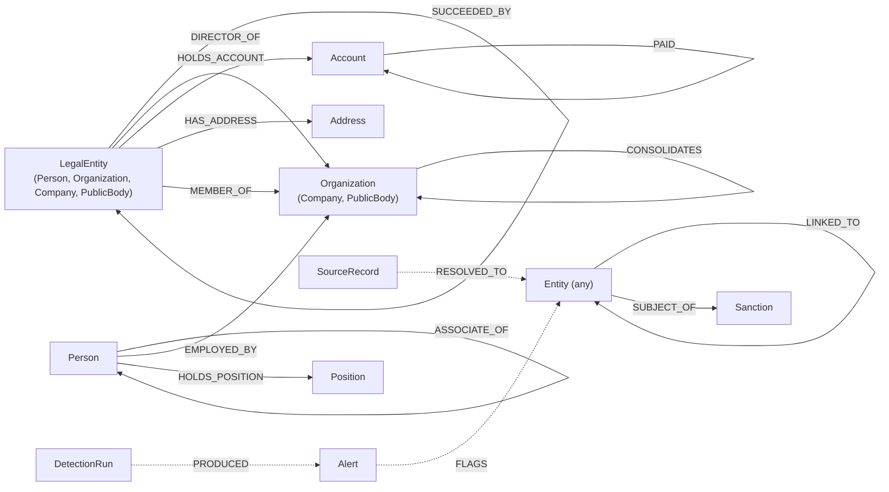

# C2: Graph schema v1.0.0

How C1 records become nodes and relationships in Neo4j 5.26 Community (Cypher 5), and the constraints and indexes that hold them. Every loader, detector, API query and copilot template reads the graph through this schema.

- Status: version 1.0.0, **not frozen yet**. The tech lead freezes the four contracts at Gate 1 with the tag `contracts-v1.0.0` (`docs/build/PHASE-1.md` sections 5.0 and 8). After that, changes need an approved contract-change issue and a new migration file; an applied migration is never edited.
- Code: `neonradar_contracts.graph` (the mapping as data), `neonradar_graph.mapping` (records to loader rows, no database), `neonradar_graph.migrate` (the migration runner).
- Schema: `graph/schema/migrations/0001_init.cypher` (22 uniqueness constraints and 7 indexes).
- Command: `uv run neonradar graph migrate`.
- Source: `docs/build/PHASE-1.md` section 5.2, with the decisions in [Mapping decisions](#mapping-decisions) and in [CHANGELOG.md](CHANGELOG.md).

## Picture

Labels mirror the FtM hierarchy, so `MATCH (x:LegalEntity)` finds people and organisations alike. Every node built from an FtM thing also has `:Entity` (left out of the picture).



Dotted relationships are written by entity resolution (Phase 2) and detection runs, not built from records.

## Node labels

| FtM schema | Labels | Schema-specific properties (snake_case) |
|---|---|---|
| `Person` | `:Entity:LegalEntity:Person` | `birth_date`, `nationalities`, `gender` |
| `Company` | `:Entity:LegalEntity:Organization:Company` | `registration_number`, `jurisdiction`, `lei`, `status`, `legal_form`, `sector`, `incorporation_date`, `dissolution_date` |
| `Organization` | `:Entity:LegalEntity:Organization` | as Company where present |
| `PublicBody` | `:Entity:LegalEntity:Organization:PublicBody` | as Organization |
| `LegalEntity` | `:Entity:LegalEntity` | `registration_number`, `jurisdiction`, `lei`, `status`, `sector` |
| `Address` | `:Entity:Address` | `full`, `street`, `city`, `postal_code`, `region`, `country`, `address_key` (normalised key, Phase 2) |
| `BankAccount` | `:Entity:Account` | `account_number`, `bank_name`, `currency`, `account_type`, `account_kind`, `opening_date`, `closing_date` |
| `Position` | `:Entity:Position` | `country` |
| `Sanction` | `:Sanction` | `authority`, `program`, `program_id`, `listing_date`, `start_date`, `end_date`, `reason`, `country` |

The FtM property behind each graph property is in `neonradar_contracts.graph.NODE_MAPPINGS` (for example `leiCode` becomes `lei`, `nationality` becomes `nationalities`, `nr.account_kind` becomes `account_kind`).

Support nodes (not `:Entity`): `:SourceRecord` (entity resolution evidence, Phase 2), `:Alert` (C4), `:DetectionRun`, `:SchemaMigration`.

| Support label | Properties |
|---|---|
| `:Alert` | `alert_id` (unique), `typology`, `typology_version`, `priority`, `pattern_strength` (FLOAT), `headline`, `created_at` (UTC ISO string), `run_id`, `wording_class`, `involves_real_entities` (BOOLEAN), `synthetic_activity` (BOOLEAN), `payload` (STRING: the complete C4 alert as JSON) |
| `:DetectionRun` | `run_id` (unique), `started_at`, `finished_at` (UTC ISO strings), `typologies` (LIST<STRING>), `detectors` (STRING: JSON list of name and version), `alert_count` (INTEGER), `status` (`ok` or `failed`) |
| `:SchemaMigration` | `id`, `checksum`, `applied_at` |
| `:SourceRecord` | defined in Phase 2 |

The API reads alerts only from Neo4j: it filters on the scalar properties and parses `payload` for `AlertDetail`. The files in `data/runs/<run_id>/` are the run's audit copy, not an API source.

## Flag labels

Set by the loader from source data only, never from detections:

| Flag | On | Set when |
|---|---|---|
| `:Synthetic` | every `:Entity` and `:Sanction` node | the record's dataset is synthetic (`contracts/datasets.yaml`); mirrors `synthetic = true` (invariant I2) |
| `:Sanctioned` | `:Entity` | `topics` contains exactly `sanction` (`sanction.linked`, `sanction.control` and `sanction.counter` do not set it) |
| `:PEP` | `:Entity` | `topics` contains `role.pep` or a sub-topic `role.pep.*` (for example `role.pep.natl`, `role.pep.frmr`) |
| `:RCA` | `:Entity` | `topics` contains `role.rca` or a sub-topic `role.rca.*` |

A flag says what a source published about an entity. It is a fact about the source, not a finding of NeonRadar. Synthetic records may carry only the topics `sanction`, `role.pep` and `role.rca` (C1 R9); real records may carry sub-topics.

## Common properties on every `:Entity` and `:Sanction` node

| Property | Type | Rule |
|---|---|---|
| `id` | STRING | Unique. The record id in Phase 1; the canonical id after entity resolution (Phase 2) |
| `schema` | STRING | FtM schema name |
| `caption` | STRING | The record's `caption` if it has one, else FtM's caption (the first caption property, else the schema label such as `Sanction`), so it is never empty |
| `names` | LIST<STRING> | Every value of `name`, `alias`, `previousName`, `abbreviation` (and `full` for addresses), in original scripts, without duplicates |
| `names_text` | STRING | `names` joined with `" \| "`, for the full-text index |
| `countries` | LIST<STRING> | Lower-case ISO codes from every country-typed property, sorted, without duplicates |
| `topics` | LIST<STRING> | FtM topics |
| `datasets` | LIST<STRING> | Dataset slugs |
| `referents` | LIST<STRING> | Record ids merged into this node (Phase 1: `[id]`) |
| `synthetic` | BOOLEAN | Equals the dataset's `synthetic` flag; mirrors the `:Synthetic` label |
| `first_seen`, `last_seen` | STRING | ISO datetimes when the source provides them |
| `source_url` | STRING | Optional, from FtM `sourceUrl` |

Dates on entities and relationships are ISO 8601 strings and may be partial. Only transaction timestamps (`PAID.ts`) are Neo4j `DATETIME` values in UTC.

## Relationships

| Type | From | To | Built from | Specific properties |
|---|---|---|---|---|
| `OWNS` | `LegalEntity` | `LegalEntity` | `Ownership` whose asset is not a `BankAccount` and without `nr.consolidation` | `share_pct_min`, `share_pct_max` (FLOAT), `percentage_raw`, `ownership_type`, `role`, `natures_of_control`, `start_date`, `end_date`, `status` |
| `CONTROLS` | `LegalEntity` | `LegalEntity` | `Control` | `control_type`, `legal_basis`, `natures_of_control`, `start_date`, `end_date` |
| `CONSOLIDATES` | `Organization` (parent) | `Organization` (child) | `Ownership` with `nr.consolidation` | `level` (`direct` or `ultimate`), `start_date`, `end_date`, `status` |
| `DIRECTOR_OF` | `LegalEntity` | `Organization` | `Directorship` | `role`, `is_nominee`, `start_date`, `end_date` |
| `HOLDS_ACCOUNT` | `LegalEntity` | `Account` | `Ownership` whose asset is a `BankAccount` | `role`, `start_date`, `end_date` |
| `PAID` | `Account` | `Account` | `Payment` (payerAccount to beneficiaryAccount) | `amount` (FLOAT, major units), `currency`, `ts` (DATETIME, UTC), `channel`, `purpose` |
| `HAS_ADDRESS` | `LegalEntity` | `Address` | `addressEntity` property | `role` from `nr.address_roles`, default `unknown` |
| `REPRESENTS` | `LegalEntity` | `LegalEntity` | `Representation` (agent to client) | `role` (ICIJ intermediaries use `intermediary`) |
| `FAMILY_OF` | `Person` | `Person` | `Family` (person to relative) | `relationship` |
| `ASSOCIATE_OF` | `Person` | `Person` | `Associate` | `relationship` |
| `MEMBER_OF` | `LegalEntity` | `Organization` | `Membership` | `role`, `start_date`, `end_date` |
| `EMPLOYED_BY` | `Person` | `Organization` | `Employment` (employee to employer) | `role`, `start_date`, `end_date` |
| `LINKED_TO` | `Entity` | `Entity` | `UnknownLink` | `role` |
| `SUCCEEDED_BY` | `LegalEntity` | `LegalEntity` | `Succession` (predecessor to successor) | `date` |
| `HOLDS_POSITION` | `Person` | `Position` | `Occupancy` (holder to post) | `status`, `start_date`, `end_date` |
| `SUBJECT_OF` | `Entity` | `Sanction` | `Sanction.entity` | none |
| `RESOLVED_TO` | `SourceRecord` | `Entity` | Entity resolution (Phase 2) | `match_probability`, `method`, `resolver_version`, `decided_at` |
| `FLAGS` | `Alert` | `Entity` | Alert subjects | `role` |
| `PRODUCED` | `DetectionRun` | `Alert` | Detection runs | none |

Common relationship properties (all types except `RESOLVED_TO`, `FLAGS`, `PRODUCED`): `id` (STRING, unique per type: the FtM interval entity id, or `<entity id>|addr|<address id>` for `HAS_ADDRESS`, or `<entity id>|sanction|<sanction id>` for `SUBJECT_OF`), `datasets`, `synthetic`, `source_url` (optional).

Every edge schema runs in FtM's edge direction (`schema.edge_source` to `schema.edge_target`), except `PAID`, which joins the two accounts of a `Payment` rather than its payer and beneficiary.

## Migrations

`graph/schema/migrations/0001_init.cypher` (Neo4j 5.26 Community, Cypher 5; one statement per line ending with `;`) creates:

- 6 node uniqueness constraints: `:Entity(id)`, `:Sanction(id)`, `:SourceRecord(id)`, `:Alert(alert_id)`, `:DetectionRun(run_id)`, `:SchemaMigration(id)`;
- 16 relationship uniqueness constraints, one on `id` for every type built from records (`owns_id` to `subject_of_id`);
- 6 range indexes: `Company.registration_number`, `LegalEntity.lei`, `Address.address_key`, `Account.account_number`, `PAID.ts`, `Alert.typology`;
- 1 full-text index `entity_names` on `names_text` of `:LegalEntity` and `:Address` (analyzer `standard-no-stop-words`).

A uniqueness constraint creates its own backing index, so no separate index on `id` is needed. Community Edition has no existence, type or key constraints; the loader, the mapping and the invariant tests enforce required properties instead. `SHOW INDEXES` lists 31 rows on a migrated database: the 22 constraint-backed indexes, the 7 above and the 2 built-in lookup indexes.

**Runner** (`neonradar graph migrate`, `neonradar_graph.migrate`):

1. Reads `graph/schema/migrations/NNNN_<name>.cypher` in number order. A statement is one line ending with `;`; `//` lines and blank lines are skipped. The checksum is the SHA-256 of the file text with line endings normalised to LF.
2. Reads the applied migrations from the `:SchemaMigration` nodes. If an applied migration's checksum changed, it stops with "add a new migration; never edit an applied one"; if the database has a migration the folder lacks, it stops too. In both cases nothing is applied.
3. Applies each pending migration one statement per auto-commit transaction, waits for the indexes to come online (`db.awaitIndexes`), then records `(:SchemaMigration {id, checksum, applied_at})` (`id` is the file name without `.cypher`, `applied_at` a UTC ISO string).
4. Re-running is a no-op ("nothing to apply").

Every statement must be idempotent (`IF NOT EXISTS`): DDL cannot be rolled back, so a run that fails half-way keeps the statements before the failure, and the next run applies the file again.

## Loader rules

`neonradar graph load` (M1.9a) builds on `neonradar_graph.mapping`:

1. Validate every record (C1) first; nothing is written if validation fails in strict mode.
2. Load nodes before relationships, in batches of 5,000 rows with `UNWIND $rows AS row`, through `driver.execute_query(..., database_="neo4j")`.
3. Labels come only from the fixed mapping, written into the query text per schema; data values are never interpolated into Cypher. Flag labels use `FOREACH (_ IN CASE WHEN row.flags.PEP THEN [1] ELSE [] END | SET n:PEP)`.
4. Nodes: `MERGE (n:Entity {id: row.id})` (`:Sanction` for sanctions), then set labels, then `SET n += row.props`.
5. Relationships: `MATCH` both endpoints by `id` and by the From and To labels (`RelationshipRow.endpoint_labels`), `MERGE` the relationship on its `id`, `SET r += row.props`. Count rows whose endpoints were not found and report them as dangling.
6. `PAID.ts`: the row carries `<record date>Z` in `row.ts` and the query sets `r.ts = datetime(row.ts)`.
7. Loading the same files twice leaves the graph unchanged.
8. In strict mode, any `MappingIssue` (below) fails the load.

`to_node_rows(records)` and `to_relationship_rows(records)` return the rows and a list of skipped records or references (`MappingIssue`). `NodeRow.as_param()` and `RelationshipRow.as_param()` give the parameter row for `UNWIND`. The functions read the whole load, because the Ownership case and the endpoint checks need the schema of referenced records.

## Mapping decisions

C1 accepts some records that the C2 tables do not cover one to one. The mapping decides them as follows; each is listed for tech lead sign-off at Gate 1 in [CHANGELOG.md](CHANGELOG.md).

1. **Ownership order.** An `Ownership` becomes `HOLDS_ACCOUNT` when its asset is a `BankAccount` in the load, else `CONSOLIDATES` when `nr.consolidation` is set, else `OWNS`. So an account holding wins over consolidation, and its `nr.consolidation` is not stored. Share bands (`nr.share_pct_*`) are stored only on `OWNS`.
2. **One value per property.** A graph property of type STRING or FLOAT takes the first value of the FtM property, in FtM's stored value order (the order of the record's list). LIST properties (`names`, `countries`, `topics`, `datasets`, `nationalities`, `natures_of_control`) keep every value. Absent values are left out, not set to null.
3. **Person properties** are exactly the three in the node table; LegalEntity properties such as `registration_number` are not copied onto persons.
4. **Flags** follow the table above: `:PEP` and `:RCA` include sub-topics, `:Sanctioned` does not, and `:Synthetic` is also set on `:Sanction` nodes.
5. **PAID** keeps no payer or beneficiary: the holders are found through `HOLDS_ACCOUNT`. C1 does not check that the payer holds the payer account.
6. **Skipped with a `MappingIssue`** (a strict load fails):
   - an edge record with more or fewer than one value for its source or target property (C1 forces single values only on `Payment`);
   - an endpoint in the load whose schema does not carry the required label, for example `CONSOLIDATES` with a `Person` owner, or `LINKED_TO` pointing at an `Ownership` record;
   - `addressEntity` on a record that is not a `LegalEntity` (FtM allows it on every thing; `HAS_ADDRESS` starts at a `LegalEntity`); the node itself is kept;
   - a duplicate id in the load (C1 R4 already rejects it; the first record is kept).
7. **Endpoints outside the load** are not checked by the mapping; the loader's label-checked `MATCH` counts them as dangling. An `Ownership` whose asset is outside the load is treated as `OWNS`.
8. **Not mapped in v1** (C1 accepts them, C2 stores nothing): the references `parent`, `subsidiaries`, `BankAccount.bank`, `Position.organization`, `Payment.payer`, `Payment.beneficiary`, `Payment.contract`, `Payment.project` and `proof`; the record keys `last_change` and `referents`; `nr.source_ref` and `nr.synthetic_kind`. Phase 2's `:SourceRecord` keeps the full record.
9. **Not set in Phase 1:** `Address.address_key` (Phase 2 computes it), and `account_kind` or `is_nominee` when the record has no `nr` value for them (no default is invented).

## Graph invariants

Integration tests run them against the demo-mini load (M1.9a and M1.9b):

| Invariant | Check |
|---|---|
| I1 | Every `:Entity` has non-null `id`, `schema`, `caption`, `datasets`, `synthetic`. |
| I2 | A node has the `:Synthetic` label if and only if `synthetic = true`. |
| I3 | Every `PAID` goes from an `:Account` to an `:Account`, has `amount > 0`, a three-letter `currency`, and a `DATETIME` `ts`. |
| I4 | Every `:Account` has at least one incoming `HOLDS_ACCOUNT`. |
| I5 | Every `OWNS` with share bounds has `0 <= share_pct_min <= share_pct_max <= 100`. |
| I6 | No `:Alert` with `wording_class = 'synthetic_scenario'` flags a node where `synthetic = false`. |

## Cypher conventions

Neo4j 5.26, Cypher 5, written so that it still runs on Cypher 25 later:

- Always pass parameters; never build Cypher from data.
- Use the variable-scope subquery form `CALL (x) { ... }`, not an importing `WITH` inside `CALL`.
- Use `elementId()`, never `id()`.
- Variable-length traversals use quantified relationships or quantified path patterns, for example `(a:Account)-[t:PAID]->{2,6}(a)` or `((x)-[:OWNS]->(y)){1,6}`, not `[*1..6]`. Bound every traversal (at most 8 hops) and every result (`LIMIT`).
- Shortest paths use `SHORTEST 1` or `ANY SHORTEST` path selectors.
- Large writes use `CALL (row) { ... } IN TRANSACTIONS OF 10000 ROWS` in an auto-commit query, never `apoc.periodic.iterate`.
- No `SET n = r` with a node or relationship on the right side, no `indexProvider` options, no cross-entity property references inside one `MERGE`.
- GDS procedures run with `concurrency: 4` (the Community limit).
- Detection queries read only labels, relationship types and properties defined in C2.

## Example: an ownership chain

Who owns a company, up to six hops, with the share bands on each hop (`$company_id` is a record id such as `syn-co-0001`; `:Entity {id}` uses the uniqueness constraint):

```cypher
MATCH p = (owner:LegalEntity)-[:OWNS]->{1,6}(:Entity {id: $company_id})
RETURN [n IN nodes(p) | n.caption] AS chain,
       [r IN relationships(p) | [r.share_pct_min, r.share_pct_max]] AS shares
LIMIT 25
```
