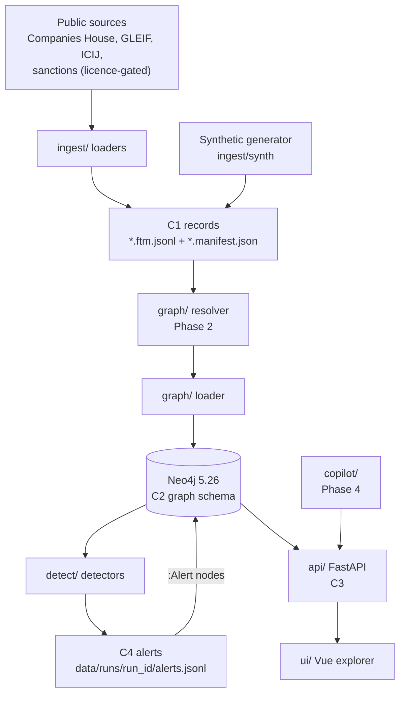

# Architecture overview

NeonRadar loads public registers and synthetic payments into a Neo4j graph, runs detectors that look for the graph patterns of money laundering typologies, and serves the results to an explorer and, later, a local copilot. This page shows the parts, the four contracts between them, where everything lives in the repository and who owns it. It follows section 4 of the build spec, [PHASE-1.md](../build/PHASE-1.md), adjusted where a merged contract or an operator decision changed the spec (noted inline).

## Components and data flow



The arrows are the contracts. A squad builds its box against the contract and a synthetic fixture, without waiting for the box upstream. In Phase 1 the graph loader reads C1 records directly; entity resolution (the resolver) arrives in Phase 2.

| Box | Directory and package | What it does | Built in |
|---|---|---|---|
| Loaders and spikes | `ingest/` (`neonradar_ingest`) | Fetch a source and write C1 records. Phase 1 has spikes that fetch a small slice of each source (`neonradar spike <source>`, reports in [docs/data/spikes/](../data/spikes/)) on a shared HTTP client | Spikes M1.8a to M1.8d; production loaders Phase 2 |
| Synthetic generator | `ingest/` | Seeded synthetic companies, people, accounts and payments: background activity for existing registry entities, and typology scenarios planted only among synthetic (`syn-`) entities (guardrail G1) | M1.8e; full generator Phase 3 |
| Record contract | `contracts/` (`neonradar_contracts`) | Models, validators, JSON Schemas, the dataset registry and golden examples for all four contracts | M1.7a to M1.7d |
| Graph | `graph/` (`neonradar_graph`) | Migrations (`neonradar graph migrate`), the mapping from records to nodes and relationships, the loader and the Neo4j client | M1.7b, M1.9a; resolver Phase 2 |
| Detection | `detect/` (`neonradar_detect`) | The typology catalog (`detect/typologies/`), detectors and the alert writer | M1.9b (circular flow); nine more in Phase 3 |
| API | `api/` (`neonradar_api`) | Read-only FastAPI service on `127.0.0.1` | M1.7d (skeleton), M1.9c |
| Copilot | `copilot/` (`neonradar_copilot`) | Placeholder until Phase 4; proposed design in [ADR-0010](../decisions/0010-copilot-local-template-first.md) | Phase 4 |
| Explorer | `ui/` | Vue 3 app with Cytoscape.js | M1.9d (shell); Phase 5 |
| Command line | `cli/` (`neonradar_cli`) | The `neonradar` command: `doctor`, `contracts`, `docs`, `graph`, `onboarding`, `spike`, with more groups as milestones add them | M1.3 onwards |

## The four contracts

The contracts are the agreements between squads. Each has a document, pydantic models and a version (`neonradar_contracts.versions`), and `make contracts-check` tests the merged ones. They are version 1.0.0 and **not frozen yet**: the tech lead freezes all four at Gate 1 by creating the tag `contracts-v1.0.0`, a human decision ([operator decision OD-5](../build/operator-decisions.md)). After the freeze, a change needs an approved contract-change issue (CLAUDE.md rule 7). Where a merged contract document and PHASE-1.md differ, the contract document wins (OD-17).

| Contract | Document | What it fixes | State on 21 October 2026 |
|---|---|---|---|
| C1 Record | [contracts/C1-record.md](../../contracts/C1-record.md) | The FollowTheMoney record format every loader and the generator write, the `nr` extension, rules R1 to R10, manifests and the dataset registry ([contracts/datasets.yaml](../../contracts/datasets.yaml)) | merged |
| C2 Graph schema | [contracts/C2-graph-schema.md](../../contracts/C2-graph-schema.md) | Labels, flag labels, relationships, properties, the mapping from records, and `graph/schema/migrations/` (`0001_init.cypher`: 22 uniqueness constraints and 7 indexes; `0002_resolution.cypher`, C2 1.1.0: entity resolution, 23 constraints and 9 indexes after both) | merged |
| C3 API | `contracts/C3-api.md` (in review in [pull request #24](https://github.com/robotat-com/neon-radar/pull/24)); until it merges, PHASE-1.md section 5.3 | The HTTP routes under `/api/v1`, their models and limits, problem details and the OpenAPI snapshot `contracts/openapi/v1.json` | in review |
| C4 Alert | [contracts/C4-alert.md](../../contracts/C4-alert.md) | The alert every detector produces: reproducible evidence, a deterministic id, `pattern_strength`, two wording classes and the wording lint | merged |

How they connect:

- **C1 to C2.** The graph loader accepts only C1 records that pass `neonradar contracts validate-records`. Every node gets the record id as its C2 `id`; ids follow C1 rule R1 (letters, digits, dots and hyphens after the prefix, OD-11).
- **C2 to C4.** An alert's evidence lists C2 node and relationship ids and the Cypher query that finds them again. Detection runs write their alerts to `data/runs/<run_id>/alerts.jsonl` and load them as `:Alert` nodes linked to their subjects with `FLAGS`.
- **C2 and C4 to C3.** The API reads the graph and the alerts from Neo4j in READ transactions only, and serves the disclaimers, the typology catalog and the dataset registry from files in the repository.
- **Wording.** C4 carries the three disclaimers and the forbidden patterns in `contracts/wording/`; [docs/wording.md](../wording.md) explains them.

## The local stack

`make up` starts one `neo4j:5.26.32-community` server bound to `127.0.0.1`, with APOC Core from the image and Graph Data Science 2.13.4. The Community image does not include GDS, so `make plugins` downloads a GDS jar pinned by SHA-256 once, and `make up` never downloads anything (OD-13). Details: [local-stack.md](local-stack.md) and [ADR-0002](../decisions/0002-neo4j-5-26-lts.md). Community Edition has uniqueness constraints only and no role-based access control, which is why the API and the copilot enforce read-only access in code.

## Guardrails that shape the architecture

The full list is in PHASE-1.md section 2.1. Four of them decide where things live:

- **G1, synthetic scenarios only among synthetic entities.** Synthetic records carry the `syn` id prefix and the `nr_synthetic` dataset (C1 rule R6). Real registry entities may receive synthetic background activity, never a scenario role, and the C4 wording class says "synthetic scenario" only when every entity involved is synthetic.
- **G2, code and synthetic fixtures only.** `data/fixtures/` holds synthetic fixtures; spike output, caches and detection runs live in `data/cache/`, `data/import/` and `data/runs/`, which git ignores ([data/README.md](../../data/README.md)).
- **G3, nothing phones home.** No telemetry or outbound calls at runtime; only explicit spike and loader commands use the network, and the copilot will run a local model ([ADR-0010](../decisions/0010-copilot-local-template-first.md), proposed).
- **G7, licences decide what a loader may do.** Loaders follow `contracts/datasets.yaml`; OpenSanctions is gated by `access.opensanctions` in [project.yaml](../build/project.yaml), and no database that merges sources is ever published ([ADR-0006](../decisions/0006-data-licensing.md)).

## Repository layout

The tree at the end of Phase 1 (PHASE-1.md 4.2). Folders that a later milestone creates are marked with the milestone.

```text
neon-radar/
  CLAUDE.md  README.md  LICENSE  NOTICE  SECURITY.md  CODE_OF_CONDUCT.md
  CONTRIBUTING.md  CONTRIBUTORS.md  DATA_SOURCES.md  CHANGELOG.md
  Makefile  pyproject.toml  uv.lock  .python-version
  compose.yaml  .env.example          local stack (M1.4; extended in M1.9e)
  .mcp.json                           read-only Neo4j MCP server for Claude Code
  .claude/                            agent kit: settings, rules, hooks, skills, agents
  .github/                            workflows, templates, CODEOWNERS, labels
  .devcontainer/                      devcontainer and Codespaces (M1.5)
  contracts/                          C1 to C4: models, JSON Schemas, OpenAPI snapshot,
                                      datasets.yaml, examples, contract documents
  ingest/  graph/  detect/  copilot/  api/  cli/
                                      Python packages: <dir>/src/neonradar_<dir>/, tests in <dir>/tests/
  graph/schema/                       Cypher migrations (frozen at Gate 1)
  ui/                                 Vue 3 app (M1.9d)
  data/fixtures/                      synthetic fixtures only (committed)
  data/cache/  data/import/  data/runs/   working folders (ignored by git)
  docs/
    build/          build spec, project.yaml, operator decisions, progress log
    research/       verified research notes (16 October 2026)
    plan/           the project plan (an export)
    decisions/      architecture decision records
    sources/        bibliography.yaml and how to cite
    typologies/     plain-language typology explainers (M1.10b)
    learning/       learning logs (people only), reading list, case notes
    team/           assignments, roles, first queries (M1.11)
    data/           spike reports and licence notes
    architecture/   this overview, the local stack
  scripts/                            repository checks and admin helpers
```

## Ownership

`.github/CODEOWNERS` is generated from [project.yaml](../build/project.yaml) and the ownership map in PHASE-1.md 4.3 by `scripts/generate_codeowners.py`.

| Path | Owner | Required reviewer for |
|---|---|---|
| `contracts/`, `graph/schema/` | tech lead and the maintainers team | every change |
| `ingest/`, `data/fixtures/` | Data ingestion squad | loaders, generator, fixtures |
| `graph/` | Graph and entity resolution squad | loader, migrations, mapping |
| `detect/` | Typologies and detection squad | detectors, typology catalog |
| `copilot/`, `api/` | Investigation copilot squad | API and copilot |
| `ui/` | Explorer UI squad | frontend |
| `cli/`, `docs/`, root files, `.github/`, `.devcontainer/`, `Makefile` | Docs, DX and launch squad | developer experience and docs |
| `.claude/`, `CLAUDE.md`, `docs/build/` | tech lead | agent kit and build spec |
| `docs/build/PROGRESS.md` | nobody | every pull request updates its own row |
| `DATA_SOURCES.md`, `docs/data/licences/`, `contracts/datasets.yaml` | data steward (with the tech lead for `datasets.yaml`) | licence statements |
| `docs/typologies/`, `detect/typologies/` | typology researchers | AML definitions |

Squad names follow [docs/team/roles.md](../team/roles.md). Until the team joins, @robotat-com holds every named role (OD-6), and the squad teams (`@neonradar/nr-*`) take effect after the repository moves to the `neonradar` organisation (OD-7).

## Naming conventions

| Thing | Convention | Example |
|---|---|---|
| Record and node id | `<prefix>-<rest>`: the prefix comes from `contracts/datasets.yaml`; `rest` uses letters, digits, dots and hyphens and ends with a letter or digit (C1 rule R1, OD-11) | `syn-co-0001` |
| Id from a source identifier | `make_id(prefix, kind, native)` gives `<prefix>-<kind>-<native>`, or a SHA-1 form when the native id does not fit; the raw id goes in `nr.source_ref` ([C1](../../contracts/C1-record.md), "Ids and references") | `gbch-co-<company number>`, `gleif-lei-<LEI>`, `icij-node-<node id>` |
| Reserved prefixes | `syn` synthetic; `nr` canonical resolved entities (Phase 2) | |
| Edge entity ids from loaders | `<prefix>-<schema in lowercase>-<first 20 hex of a SHA-1>` | `gbch-ownership-<hash>` |
| Dataset slugs | lowercase snake case | `gb_companies_house` |
| Record files | `<dataset>-<yyyymmdd>-<part>.ftm.jsonl` with a sibling `.manifest.json` | `nr_synthetic-20261023-demo-mini.ftm.jsonl` |
| Graph labels | PascalCase singular | `Company`, `Account` |
| Relationship types | UPPER_SNAKE_CASE verbs | `OWNS`, `DIRECTOR_OF`, `PAID` |
| Properties | snake_case in the graph; records keep FollowTheMoney camelCase | `registration_number` |
| Typology slugs | lowercase snake case | `circular_flow` |
| Python packages | `neonradar-<dir>`, imported as `neonradar_<dir>` | `neonradar_graph` |
| Command line | `neonradar <group> <command>` | `neonradar graph migrate` |
| ADR files | `docs/decisions/NNNN-kebab-title.md` | `0002-neo4j-5-26-lts.md` |

## How the project is built

AI agents (Claude Code) build NeonRadar one milestone per branch and pull request, from the build spec. During the initial build the operator authorised an orchestrating agent session to merge each pull request after its acceptance commands passed, an independent agent review found nothing left that affects correctness, requirements or guardrails, and CI passed (OD-2 to OD-4). Milestone builders never merge. People review merged work and keep every human decision: freezing contracts, approving typologies, accepting ADRs and confirming licence decisions (OD-5). People also write their own learning logs, self-assessments, teach-backs, exit posts and assignment submissions. CI checks start at M1.6, and GitHub does not enforce them on this plan; the orchestrating session checks them before every merge (OD-16). The guard hook `.claude/hooks/guard_git.py` and the deny rules in `.claude/settings.json` allow only `gh pr merge <n> --merge` and block pushes to `main`, force-pushes, remote branch deletion and settings changes (OD-9). The rules and the controls that enforce them are in [ADR-0011](../decisions/0011-ai-built-workflow.md).

## Decisions

The architecture decision records are listed in [docs/decisions/](../decisions/README.md). Those that shape this overview: [0002](../decisions/0002-neo4j-5-26-lts.md) Neo4j 5.26 LTS, [0003](../decisions/0003-followthemoney-record-format.md) FollowTheMoney as the record format, [0004](../decisions/0004-graph-schema-v1.md) graph schema v1, [0006](../decisions/0006-data-licensing.md) data licensing, [0007](../decisions/0007-toolchain.md) toolchain, [0009](../decisions/0009-alert-object-and-wording.md) alert object and wording, [0010](../decisions/0010-copilot-local-template-first.md) copilot, [0011](../decisions/0011-ai-built-workflow.md) AI-built workflow and [0012](../decisions/0012-docs-site.md) documentation site. All of them are `proposed` until their deciders accept them.
