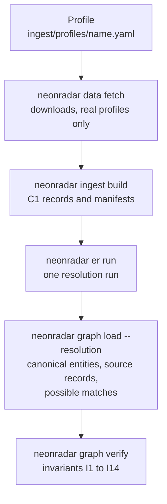
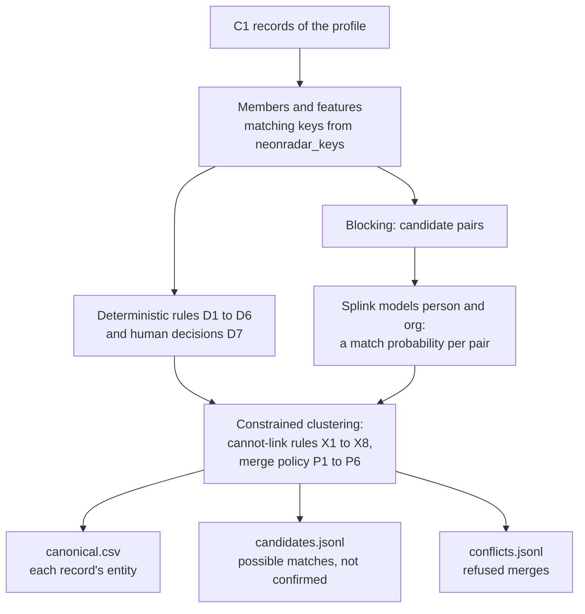
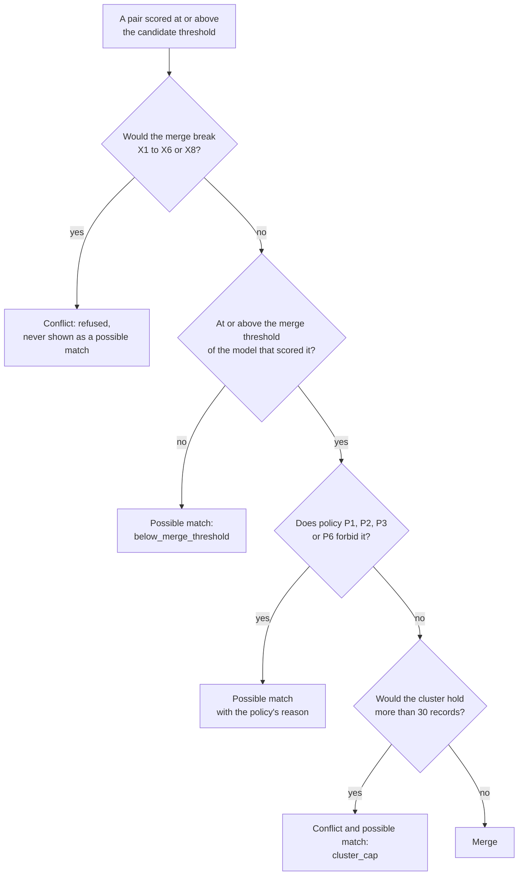

# Entity resolution

How NeonRadar decides which records describe the same person or organisation, and what it does when it is not sure. This page is for a new intern: read it before you label pairs ([Assignment 3](../team/assignment-3.md)), review a possible match or change anything under `keys/` or `resolve/`. The authority for every rule is section 7.1 of the build spec, [PHASE-2.md](../build/PHASE-2.md); this page explains it in plain words and links to the code. Terms are defined in the [glossary](../glossary.md).

| | |
|---|---|
| Code | `keys/` ([matching keys](keys.md)), `resolve/` (the resolver), `cli/src/neonradar_cli/er.py` (the `neonradar er` commands) |
| Decisions | [ADR-0014](../decisions/0014-entity-resolution-approach-and-thresholds.md) (approach and thresholds) and [ADR-0015](../decisions/0015-merge-policy-for-listed-and-leaked-records.md) (merge policy). Both are **proposed**: the deciders have not accepted them yet |
| State on 23 October 2026 | Built: the keys (M2.8), the benchmark (M2.9), the rules, the policy and the clustering (M2.10a), the Splink models and the calibration (M2.10b). Coming: review, sampling and labelling tools (M2.10c), the resolution-aware graph loader (M2.11), the resolution endpoint of the API (M2.12) and the published precision figure (M2.15). The thresholds are not frozen yet |
| Labelling | [labelling-guide.md](labelling-guide.md) |

## Why it matters

The same company appears in the register, in GLEIF, as a corporate officer of another company and perhaps on a sanctions list; the same person appears as an officer, as a person with significant control and perhaps in a leak. To see the network, NeonRadar has to join those records into one node. Joining them is not easy: sources spell names differently, give a birth month in one place and a full date in another, or give no date at all, and many different people share a name.

A wrong join is worse than a missed one. If a record from a sanctions list is joined with the wrong person, that person's node shows a sanctions flag they do not have, and if a leak record is joined with the wrong company, that company appears to be named in a leaked file. This is the harm guardrails G1 and G8 exist to prevent ([PHASE-2.md](../build/PHASE-2.md) 2.1). The authorities that publish these lists say the same about names: ICIJ warns that "many people and entities have the same or similar names" and asks users to confirm identities with addresses or other identifiable information [icij_faq]; OFSI says that a name match "does not necessarily mean" that the person is the one on the list [ofsi_general_guidance_2026]; and OFAC asks whether only the first or last name matches and whether the date of birth, identification number or nationality differs [ofac_faq_5]. So NeonRadar joins records only on evidence, keeps the evidence of each join, and shows every join it is not sure about as a possible match that is "not confirmed".

## The pipeline

Entity resolution is one step of loading a profile ([PHASE-2.md](../build/PHASE-2.md) 4.1). A profile (`ingest/profiles/<name>.yaml`) says which sources to load; synthetic profiles such as `demo` skip the download.



Inside `neonradar er run` (`resolve/src/neonradar_resolve/run.py`):



Synthetic and real records never meet: a synthetic profile reads only synthetic records, every blocking rule requires both records to be synthetic or both real, and cannot-link rule X1 refuses any cluster that would mix them. The outputs of a real profile stay under `data/cache/real/` on an approved machine ([real-data handling](../data/real-data-handling.md)).

## What gets resolved

Each record belongs to a class ([PHASE-2.md](../build/PHASE-2.md) 7.1.1):

| Class | FollowTheMoney schemata | How |
|---|---|---|
| `person` | `Person` | deterministic rules, then the Splink person model |
| `org` | `Company`, `Organization`, `PublicBody` | deterministic rules, then the Splink organisation model |
| `legal_entity` | `LegalEntity` (for example an ICIJ officer whose kind the source does not state) | compared in both pools; a merge must still have a common schema (X2) |
| `address` | `Address` | rule D6 only; addresses carry no flags and are never possible matches |
| not resolved | accounts, payments, positions, sanctions and every relationship | passed through; the graph loader points their references at the canonical entities |

Three properties of a record drive the merge policy:

- **Flag topics.** A record's `topics` that are not purely descriptive, such as `sanction`, `role.pep`, `role.rca` or `crime` (`neonradar_resolve.policy.flag_topics`). A record with at least one is **listed**. Topics such as `fin`, `gov.*` or `corp.public` only describe a record and are not flags.
- **Leaked.** A record of the ICIJ Offshore Leaks Database, or a synthetic leak-style record (`nr.synthetic_kind: leak`).
- **List source.** The list a listed record comes from, which policy P6 compares.

## Matching keys

Before anything is compared, names, addresses, countries and identifiers are turned into keys by `neonradar_keys`, pure functions shared by the loaders, the resolver and the graph loader, so a key means the same thing everywhere. A person's key folds case and accents, drops titles, joins the parts of compound Arabic names and sorts the tokens, so the benchmark's "TORYUNRIM, Kamal" and "Kamal Toryunrim" both give `kamal toryunrim`; an organisation's key drops the legal form, so "Marram Leat Catering Ltd" gives `marram leat catering`; an address key starts with the UK postcode. The full description, with examples and limits, is [keys.md](keys.md).

Keys are computed when matching and never written into records: records stay as their source published them (C1 rule R10).

## Deterministic rules

Rules that join records through an official identifier run first, in this order ([PHASE-2.md](../build/PHASE-2.md) 7.1.2). Each link records its rule id, which every output and every explanation uses.

| Rule | Joins records with | Conditions |
|---|---|---|
| D1 | the same UK company number | organisation or legal-entity records: a register record, a GLEIF record of the UK registers, a corporate officer or PSC registered in the UK, or a list entry that gives the number as a UK company number. Numbers are normalised first: capitals, no spaces, dots or hyphens, and digits padded with zeros to eight characters |
| D2 | the same LEI | after the ISO 17442 check digits |
| D3 | the same Companies House person number | officer records whose `person_number` shares its first 8 characters. A different number never keeps two records apart, because one person can hold several. The tech lead confirms this form in ADR-0014 |
| D4 | the same UN reference number | listed records from different lists |
| D5 | the same native id | two records of one dataset that carry the same source id (for example one ICIJ node in two files) |
| D6 | the same address key | `Address` records whose key has a full postcode or a street line; each links to the record with the smallest id of its key |
| D7 | a reviewer's decision | a `same` decision in the decisions file (below) |

**The name check.** An identifier can be mistyped, and a list entry can carry the number of a company's subsidiary. So a D1, D2, D3 or D4 link merges only when the two linked records also share an exact name key, or when some pair of their name keys has a Jaro-Winkler similarity of at least 0.85. When the merge would join a listed or leaked record with records that are not listed in the same way (policies P1 and P2 below), only an exact name key counts: a group's name and the same name followed by "UK" score about 0.96, and a similar name must never carry a parent's sanctions flag to its subsidiary. A link that fails the check is not merged; it becomes a possible match with the reason `identifier_name_mismatch`.

## Cannot-link rules

Some merges are refused whatever the evidence, and the refusal is written to `conflicts.jsonl` with the rule id and the record ids, never their values ([PHASE-2.md](../build/PHASE-2.md) 7.1.3).

| Rule | Refuse a cluster that would contain |
|---|---|
| X1 | a synthetic and a real record |
| X2 | schemata with no common FollowTheMoney schema, such as a `Person` and a `Company` |
| X3 | two different UK company numbers |
| X4 | two different LEIs |
| X5 | two people whose birth dates are not compatible (equal at the precision both give; a list entry with a range of years carries every year in it) |
| X6 | two entries of one list that each stand for a whole party of it, for example two OFAC entries. UK designations without an OFSI Group ID are not whole parties, because one person can hold one Unique ID per regime and newly designated persons get no Group ID [fcdo_format_guide] [fcdo_single_list_2026] |
| X7 | more than 30 records |
| X8 | two records that a reviewer marked `different` |

X1 to X6 and X8 are hard rules: two clusters that break one never become a possible match either, so a reviewer never sees them. Only X7 turns a link into a possible match (`cluster_cap`).

## The probabilistic models

Most true matches share no identifier, so after the rules two Splink 5 models, `person` and `org`, score pairs of records [splink_docs] [splink_5_release_2026]. Both follow the Fellegi and Sunter model of record linkage [fellegi_sunter_1969].

### The Fellegi-Sunter idea in plain words

Compare two records field by field and note how well each field agrees: the same birth date, the same month only, a different date, or no date on one side. Each of these outcomes is a *comparison level*. For each level the model learns two numbers [splink_docs]:

- **m**, how often that level occurs when the two records are the same entity. If sources rarely mistype birth dates, "same birth date" has a high m.
- **u**, how often that level occurs when they are not. Two random people rarely share a full birth date, so "same birth date" has a low u; two random people often share a nationality, so "a shared nationality" has a high u.

The ratio m / u says how much more likely the observation is for a true match than for a coincidence. Splink adds up log2(m / u) over the fields, plus a starting value from the prior (how likely two random records are to match), to get the pair's **match weight**, and turns the weight into a **match probability**: 2 to the power of the weight, divided by 1 plus the same [splink_docs]. A weight of 0 is a probability of 0.5, and each further point doubles the odds. The model assumes that the fields are independent of each other given the match status, which is not quite true (a person who moves changes postcode and sometimes country together), so a probability is a score to rank pairs, not a calibrated fact. That is why NeonRadar measures precision with people (below).

A worked example with invented numbers: if "same birth month" has m = 0.9 and u = 0.01, it adds log2(90), about 6.5, to the weight; if "postcodes differ" has m = 0.4 and u = 0.98, it subtracts about 1.3. The trained values differ for every run, because the models are trained on each run's own data.

### What NeonRadar compares

The levels go from the most to the least similar, and every comparison also has a level for a missing value, which adds nothing ([PHASE-2.md](../build/PHASE-2.md) 7.1.5; `resolve/src/neonradar_resolve/models.py`).

| Model | Comparison | Levels |
|---|---|---|
| person | name | same name key; forename and surname similar; same surname and initial; two name parts that match across scripts or spellings (Wikidata name groups); similar name keys; same surname; two parts with the same consonants; different |
| person | birth | same date; same month; same year; years one apart; different |
| person | countries | a nationality or country in common; none |
| person | postcode | full postcode; sector; district; area; different |
| person | linked organisations | two or more in common; one; none |
| person | identifiers | a passport or identity number in common; none |
| org | name | same name key; a name, alias or former name in common; the same under the Companies House same-name rules; very similar; similar; two words in common; different |
| org | jurisdiction | same; different |
| org | registration numbers | one in common; none |
| org | incorporation | same year; one year apart; different |
| org | postcode | as for people |
| org | legal forms | one in common; none |

The name levels are built level by level so that only the exact name-key level is adjusted for how common a name is: a shared rare name counts for more than a shared common one.

### Blocking and training

Scoring every pair of records is impossible at scale, so the models score only pairs that share a blocking key [splink_docs]: for people, the surname with the birth year, the forename with the birth month, the postcode with the surname's first letter, a linked company, a name group with the birth year, or a rare full name; for organisations, the name key, the Companies House same-name key, a registration number, an alias, or the postcode with the name's first four characters. Every blocking rule also requires both records to be synthetic or both real. If blocking would produce more than 20 million pairs, `er run` stops before training and prints the counts per rule (exit code 4).

The models are trained on each run's own records: the prior from a deterministic rule that is assumed to find 70 percent of the matches, u from 10 million random pairs, and m from two expectation-maximisation sessions. No trained model is committed: `resolve/models/*.settings.json` hold the settings only, and the trained parameters stay in the run folder.

### Thresholds

Each pair scored at or above the **candidate threshold** is kept. A pair at or above the **merge threshold** of the model that scored it may merge, if the rules and the policy below allow it; a pair between the two thresholds becomes a possible match (`below_merge_threshold`). The starting values in `resolve/config/er.yaml` are 0.99 for people, 0.995 for organisations and 0.80 for candidates ([PHASE-2.md](../build/PHASE-2.md) 7.1.7). `neonradar er calibrate --size large` measured them on the large synthetic benchmark; the table is in [docs/data/er/benchmark.md](../data/er/benchmark.md), and the tech lead and the graph mentor choose the values at the freeze and record them in ADR-0014. Thresholds come from the synthetic benchmark only: no real pair is labelled before the evaluation sample is drawn (G10).

## Constrained clustering

Splink's own clustering joins every chain of links above a threshold and cannot refuse a merge, so NeonRadar builds clusters with its own union-find, which checks the cannot-link rules and the policy before every merge (`resolve/src/neonradar_resolve/cluster.py`, [PHASE-2.md](../build/PHASE-2.md) 7.1.6). The order is fixed, so the same records, settings and seed always give byte-identical outputs:

1. Human `same` decisions (D7), with the second-reviewer rule below.
2. Deterministic links, in rule order D1 to D6, then by record ids.
3. Probabilistic pairs, highest probability first.
4. Source hints (ICIJ's own "same name as" and similar links), which only ever become possible matches.

For each probabilistic pair the clustering decides like this:



A cluster of one record keeps that record's id. A cluster of two or more gets the id `nr-<anchor record id>`, where the anchor is the member whose dataset comes first in a fixed order (Companies House, GLEIF, the UK, UN, EU and OFAC lists, UK Parliament, OpenSanctions, ICIJ, synthetic records), then the smallest record id. The graph loader builds the canonical entity from the members: the anchor's caption, every name, the union of the topics, and the most precise compatible birth date (M2.11).

## The merge policy, and why it exists

The policy decides whether an allowed link becomes a merge or only a possible match ([PHASE-2.md](../build/PHASE-2.md) 7.1.4). It is the working form of guardrail G8: **flags come only from a node's own source records**. ADR-0015 records it; it is proposed, and the data steward, the project lead and the tech lead accept it.

| Rule | When | Merges only through | Otherwise a possible match with the reason |
|---|---|---|---|
| P1 | the two clusters carry different flag topics: a listed and an unlisted cluster, or two clusters listed for different reasons (a PEP record and a sanctions record) | an identifier rule (D1 to D5) whose two linked records share an exact name key, or a confirmed human decision (D7) | `listed_unlisted` or `listed_differently` |
| P2 | a leaked record would join a record of another kind | the same | `leaked_cross_source` |
| P3 | a probabilistic link whose only agreeing evidence is the name | never | `name_only` |
| P4 | the cluster would hold more than 30 records | never | `cluster_cap` |
| P5 | the probability is between the candidate and the merge threshold | never | `below_merge_threshold` |
| P6 | two listed people from different lists, linked by probability | also needs compatible birth years or a shared identifier | `listed_needs_birth_date` |

For P3, agreeing evidence other than the name means, for people, the same birth date or month, the same full postcode, a company in common or a shared identifier; for organisations, a shared registration number, the same incorporation year or the same full postcode.

Why so strict: a probabilistic score for a list or leak record is mostly a name score, because list entries and leak records carry few other fields, and the authorities that publish the lists treat a name match as the start of a check, not its result [ofsi_general_guidance_2026] [ofac_faq_5]. So:

- **A merge by probability never adds a flag.** P1 compares flag topics, so a probabilistic merge only joins clusters that already carry the same flags.
- **A flag joins another cluster only through an identifier with an exact name, or a confirmed human decision.** The name check compares the two linked records, so records that joined either cluster earlier come along. Which records are already there when a flag arrives can depend on the order of record ids; ADR-0015 (property 2) describes the case and two rules that would remove it, for the deciders.
- **A possible match never moves anything.** A `POSSIBLY_SAME_AS` link carries no topic, flag, name or other property from one node to the other.

The cost is recall: some true matches between a list entry and a register record stay two nodes joined by a possible match. The benchmark measures how many of these "policy-blocked" true pairs at least show up as possible matches (below).

## Possible matches

A possible match is two clusters that may be the same entity but were not merged, written to `candidates.jsonl` and loaded as an unconfirmed `POSSIBLY_SAME_AS` link (M2.11). Every text about one starts with "Possible match, not confirmed." and then gives each reason in words ([PHASE-2.md](../build/PHASE-2.md) 7.2), for example:

- `below_merge_threshold`: "Probabilistic matching gave 0.912, below the threshold for merging."
- `name_only`: "Only the names agree, and NeonRadar never merges on a name alone (policy P3)."
- `listed_unlisted`: "Kept separate because one record is on a sanctions or PEP list and the other is not (policy P1)."
- `leaked_cross_source`: "Kept separate because one record comes from the ICIJ Offshore Leaks Database (policy P2)."
- `identifier_name_mismatch`: "Both records give the same UK company number, but the names differ, so they were not merged."

A probabilistic possible match also lists the evidence: what agrees, what differs and what one record does not give ("Agreeing: same name, same birth month. Differing: postcodes."). Deterministic and source-hint possible matches have no probability. A possible match is never "a hit" or a finding about the entity: it says only that two records might describe one entity.

## Reviewers' decisions

`neonradar er review` (M2.10c) lets a person look at possible matches and record `same` or `different` (a `same` needs a note). Decisions go to the decisions file (`data/cache/real/decisions.jsonl` for a real profile), refer to record ids, and apply in every later run as rule D7; a `different` decision keeps two records apart (X8). Review is human work: the command refuses to run without a terminal, and the agent that builds NeonRadar never runs it (G10).

**The second-reviewer guard.** A `same` decision that would join a listed or leaked record with records not listed in the same way (crossing P1 or P2) applies only when two different reviewers' newest decisions for the pair say `same`, or one of them is a senior reviewer (`people.er_senior_reviewers` in [project.yaml](../build/project.yaml)). Until then it waits and is counted in `decisions_awaiting_second_review`. Because the spec's clustering applies decisions before the identifier links, the M2.10a review found that a decision by one reviewer between two unlisted records could still let a later identifier link bring a flag to one of them. Until the deciders choose a permanent fix, `run.py` (`guard_decisions`) also holds back any one-reviewer decision whose two records sit, after the identifier links, in clusters with different flag topics or leak status, and any whose merge would leave a record of its cluster with other flag topics or leak status than it has without the one-reviewer decisions; when such a change shows up outside every decision's cluster, it holds all of them back (fail closed). Held-back decisions count in `decisions_awaiting_second_review` ([reconciliation](../build/phase-2-reconciliation.md) 2.8, ADR-0015 property 1). One-reviewer `different` decisions are outside this guard; ADR-0015 asks the deciders whether they should be inside it.

The evaluation run for the published figure ignores the decisions file (`er run --no-decisions`), so that review cannot remove wrong merges before they are measured.

## The outputs

Every run writes one folder, `data/cache/<real|synthetic>/resolution/<profile>/<run_id>/` ([PHASE-2.md](../build/PHASE-2.md) 7.1.8). Rows are sorted, so files are byte-stable.

| File | What it holds |
|---|---|
| `canonical.csv` | every resolvable record with its canonical id, its class, the size of its cluster, how it joined (`identity`, `anchor`, `deterministic`, `probabilistic` or `human`), the rule, the probability, the record it joined through, the methods on its path from the anchor, and the comparison levels of a probabilistic join |
| `candidates.jsonl` | one possible match per line: the two canonical ids, the best pair of records, the probability and weight (probabilistic only), the method, the rule, the reasons and the comparison levels |
| `conflicts.jsonl` | refused merges: the rule and the two record ids, never values |
| `pairs.parquet` | every pair scored at or above the candidate threshold, which `er calibrate` re-clusters |
| `models/person.json`, `models/org.json` | the trained models of this run |
| `run.json` | the run id, profile, resolver version, settings hash, thresholds, seeds, input files and counts (records by class, links by rule, merges, possible matches by reason, conflicts by rule, cluster sizes, decisions), and the time of each step |

On a real profile every command prints counts, timings and rates only, never a name, a value or a person's record id (G9).

Commands (synthetic profiles; each prints a counts-only summary):

```bash
uv run neonradar er run --profile demo                  # one resolution run
uv run neonradar er run --profile demo --no-decisions   # ignore the decisions file
uv run neonradar er show-config                         # the settings and their hash
uv run neonradar er blocking --profile demo             # pairs per blocking rule
uv run neonradar er bench --size small                  # the benchmark and the G2-05 gates
uv run neonradar er calibrate --size large              # the threshold table
```

## How quality is measured

### The synthetic benchmark

`data/fixtures/er-bench/` (M2.9) holds 600 synthetic people and 300 synthetic organisations, written in the styles of the real sources (Companies House officers and PSCs, the register, GLEIF, sanctions lists, leaks) with realistic variation: typos, initials, transliterations of Arabic and Cyrillic names, swapped name order, moved postcodes and missing fields. Its traps are near twins: 15 percent of people have a different person with the same name and birth year, and 5 percent of organisations a different organisation with the same name core and another legal form. The right answer is in `labels/er_truth.csv`, never in the records, and the record ids are opaque, so a resolver cannot read the answer from them. Every person who has a list or leak record has an invented surname, so the fixture never puts a realistic full name on a synthetic list.

`neonradar er bench --size small` resolves the fixture and measures, for each class ([PHASE-2.md](../build/PHASE-2.md) 7.1.7):

- **Pairwise precision**: the share of record pairs in one cluster that are true pairs.
- **Recall**: the share of mergeable true pairs whose records ended up in one cluster.
- **Policy-blocked recall**: the share of true pairs that the policy keeps apart (P1, P2) which still show up, as a possible match or through an identifier with the exact name.
- **Hard negatives merged**: records of near twins that ended up in one cluster.

The gates (G2-05, run in CI) need precision of at least 0.97 and recall of at least 0.80 for each class, policy-blocked recall of at least 0.80, and no hard negative merged. On 23 October 2026 the gates fail at the starting thresholds (person precision 0.8711, policy-blocked recall 0.4063, 29 hard negatives merged), and no choice of the three thresholds passes them all; ADR-0014 gives the numbers, and the deciders choose what to do before the freeze. Benchmark numbers describe synthetic data only: they say nothing about how NeonRadar performs on real records.

### The published precision figure

The project publishes one figure: how often the merges NeonRadar made on a slice of the real UK register are right, as judged by people ([PHASE-2.md](../build/PHASE-2.md) 7.3, milestone M2.15). The protocol is fixed in advance so that the figure is honest:

1. **The evaluation run** uses the frozen thresholds and ignores review decisions (`er run --profile uk-sample --no-decisions`).
2. **The sample** is drawn by `neonradar er sample` with the seed the tech lead wrote into ADR-0014: S1, 400 records that joined their cluster through a probabilistic link (the headline); S2, 50 records joined by deterministic rules only, reported per rule; S3, 50 possible matches; S4, 40 S1 pairs and 10 S3 pairs labelled by a second person.
3. **Labelling.** Each pair is shown to one labeller as two record cards side by side, without the probability, the rule, the method, the stratum or anyone else's label, and with all strata mixed in one random order. The labeller answers `same`, `different` or `unsure` ([labelling guide](labelling-guide.md)).
4. **Precision** is k / n, where n counts the labels other than `unsure` and k the `same` labels, with a Wilson score interval at 95 percent [wilson_1927] [nist_handbook_7_2_4_1]. The Wilson interval behaves well for small samples and for proportions near 0 or 1, where the textbook normal interval does not. Unsure labels are left out of the headline and reported as a count and a share; the report also gives k / (n + u), the precision if every unsure pair were wrong.
5. **Agreement.** On the S4 pairs the report gives the percentage agreement, Cohen's kappa [cohen_1960], the share of `same`, and positive and negative agreement [cicchetti_feinstein_1990]. Kappa corrects for chance, but when almost every label is `same` it can fall below zero even when the labellers agree on 48 pairs out of 50, so the two specific agreements are reported next to it. A person who did not set the thresholds settles the disagreements without seeing either label.
6. **Nothing changes after labelling starts.** If the thresholds or rules change after the labels are seen, the old figure is still published, and the new settings get a new run and a new sample.

Why 400: a Wilson interval of plus or minus 5 points needs 381 labels when precision is near 0.5 and 245 near 0.8 (`docs/research/2026-10-18/er-splink.md` section 9). The figure goes into the project README in this form: "On `<date>`, human labellers judged `<k>` of `<n>` sampled probabilistic merges on a slice of the UK register correct (precision `<p>`, Wilson 95% interval `<lo>` to `<hi>`; `<u>` unsure, excluded). Sanctions, PEP and ICIJ records are never merged by probability, so this does not measure screening accuracy."

The figure does not exist yet. It needs the frozen thresholds (ADR-0014), the `uk-sample` profile on an approved machine, which waits for the data protection documents ([OD-22](../build/operator-decisions.md)), and the labellers in `people.er_labellers`.

## Limitations

- **Arabic transliteration is lossy.** Arabic is usually written without short vowels, and the romanisation systems disagree on articles, emphatic consonants and letters such as qaf (`Q` or `K`), so one name has many Latin spellings and two spellings of different names can look alike (`docs/research/2026-10-18/names-addresses.md` section 5.2). The EU's best practices ask for ICAO-standard transliteration on lists for this reason [eu_best_practices_2024]. NeonRadar compares Arabic and Latin spellings through normalisation, consonant skeletons and Wikidata name groups, not by transliterating: the name groups cover the names Wikidata records, not every name, and other scripts get only a character-by-character fold ([keys.md](keys.md), "Known limits").
- **Common names.** Many people share a full name and a birth month, which is exactly what the benchmark's near twins model. Policy P3 never merges on a name alone, but a common name with one coincidental agreement can still score high; expect lower precision for common names than for rare ones.
- **One slice of the UK register.** The published figure measures merges on `uk-sample`, a slice of the UK register by postcode district, with the officers, lists and leak records around it. It says nothing about other countries, other slices or other sources.
- **Precision is not recall.** The figure says how many of the merges NeonRadar made are right, not how many true matches it found. A missed match leaves two nodes for one entity and never appears in the sample.
- **Not a screening measure.** Sanctions, PEP and ICIJ records are never merged by probability (P1, P2), so the published figure does not measure how well NeonRadar would screen names against a list, and NeonRadar is not a screening system.
- **The absence of a flag means little.** A node without a sanctions or PEP flag is not "cleared": the lists loaded here do not name its records, that is all. Entity-facing text says so in the words of [PHASE-2.md](../build/PHASE-2.md) 7.2 rule 5: "No sanctions or PEP flag from the lists loaded here (`<the titles of the list datasets loaded>`), which means only that these lists do not name the record. Other lists, and politically exposed persons outside them, are not loaded."
- **Source errors stay.** Registers and lists contain errors, and a resolver cannot correct them; a wrong source record is fixed at its source.
- **The benchmark is synthetic.** Its variation follows the research on real sources, but real data will hold patterns it does not, which is why the published figure is measured by people on real records.

## Where to go next

- [labelling-guide.md](labelling-guide.md): how to label a pair, with ten worked examples from the benchmark.
- [keys.md](keys.md): the matching keys in detail.
- [ADR-0014](../decisions/0014-entity-resolution-approach-and-thresholds.md) and [ADR-0015](../decisions/0015-merge-policy-for-listed-and-leaked-records.md): the decisions and what is still open.
- [docs/data/er/benchmark.md](../data/er/benchmark.md): the calibration table.
- `resolve/CLAUDE.md`: the map of the resolver's code.
- Splink's guide to [the Fellegi-Sunter model](https://moj-analytical-services.github.io/splink/topic_guides/theory/fellegi_sunter.html), for the mathematics.

## Sources

- [cicchetti_feinstein_1990] Domenic V. Cicchetti and Alvan R. Feinstein, *High agreement but low kappa: II. Resolving the paradoxes*, Journal of Clinical Epidemiology 43(6), 1990. <https://doi.org/10.1016/0895-4356(90)90159-M>
- [cohen_1960] Jacob Cohen, *A Coefficient of Agreement for Nominal Scales*, Educational and Psychological Measurement 20(1), 1960. <https://doi.org/10.1177/001316446002000104>
- [eu_best_practices_2024] Council of the European Union, *EU Best Practices for the effective implementation of restrictive measures* (11623/24), 2024. <https://data.consilium.europa.eu/doc/document/ST-11623-2024-INIT/en/pdf>
- [fcdo_format_guide] FCDO (GOV.UK), *Format guide for the UK Sanctions List*, 2025. <https://www.gov.uk/guidance/format-guide-for-the-uk-sanctions-list>
- [fcdo_single_list_2026] GOV.UK, *Moving to a single list for UK sanctions designations: 28 January 2026*, 2025. <https://www.gov.uk/guidance/moving-to-a-single-list-for-uk-sanctions-designations-28-january-2026>
- [fellegi_sunter_1969] Ivan P. Fellegi and Alan B. Sunter, *A Theory for Record Linkage*, Journal of the American Statistical Association 64(328), 1969. <https://doi.org/10.1080/01621459.1969.10501049>
- [icij_faq] ICIJ, *Offshore Leaks Database: frequently asked questions*, living document. <https://offshoreleaks.icij.org/pages/faq>
- [nist_handbook_7_2_4_1] NIST/SEMATECH, *e-Handbook of Statistical Methods, 7.2.4.1 Confidence intervals*, living document. <https://www.itl.nist.gov/div898/handbook/prc/section2/prc241.htm>
- [ofac_faq_5] OFAC, *FAQ 5: what to do when a party may match the SDN List*, 2026. <https://ofac.treasury.gov/faqs/5>
- [ofsi_general_guidance_2026] OFSI, *UK financial sanctions general guidance*, 2026. <https://www.gov.uk/government/publications/financial-sanctions-general-guidance/uk-financial-sanctions-general-guidance>
- [splink_5_release_2026] Ministry of Justice analytical services, *Splink 5.0.0 released*, 2026. <https://moj-analytical-services.github.io/splink/blog/2026/09/28/splink-500-released.html>
- [splink_docs] Ministry of Justice analytical services, *Splink documentation (version 5)*, living document. <https://moj-analytical-services.github.io/splink/>
- [wilson_1927] Edwin B. Wilson, *Probable Inference, the Law of Succession, and Statistical Inference*, Journal of the American Statistical Association 22(158), 1927. <https://doi.org/10.1080/01621459.1927.10502953>
