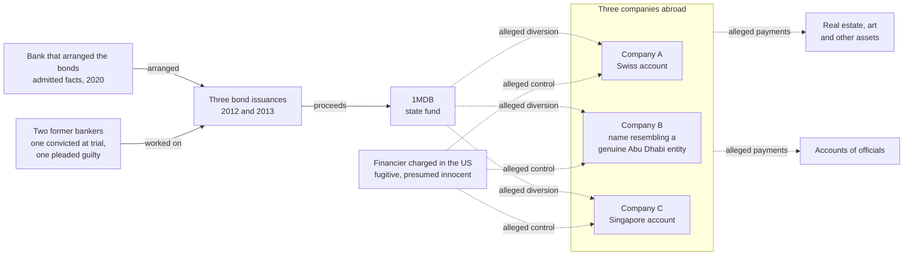

# 1MDB (2009 to 2015)

**Named as a wrongdoer:** Goldman Sachs, whose Malaysian subsidiary pleaded guilty and whose parent company admitted facts in a deferred prosecution agreement in the United States. **Named in other roles:** 1MDB, the fund from which, the US complaints allege, the money was taken; the US Department of Justice. **Described by role:** two former Goldman bankers (one convicted at trial, one who pleaded guilty; see "Status checked" for why they are not named), the financier charged in the United States, every official, and every company named in the complaints. Read [the case notes index](README.md) for how these notes are written.

## Summary

1Malaysia Development Berhad (1MDB) is a Malaysian sovereign wealth fund [doj_1mdb_2016]. The US Department of Justice announced its first civil forfeiture complaints about it in July 2016 [doj_1mdb_2016]. In those complaints, restated in 2025, it alleges that more than USD 4.5 billion was misappropriated from 1MDB between 2009 and 2015 and moved through accounts in Singapore, Switzerland, Luxembourg and the United States into real estate, art and other assets [doj_1mdb_complaint_2025]. These are allegations: the Justice Department states that they are not proven until a court awards judgment [doj_1mdb_complaint_2025]. Many assets were nonetheless forfeited by settlement, for example in a 2019 settlement covering more than USD 700 million in assets [doj_1mdb_settlement_2019].

Goldman Sachs underwrote three bond issuances for 1MDB in 2012 and 2013, which raised about USD 6.5 billion. In October 2020 its Malaysian subsidiary pleaded guilty, and the parent company entered a deferred prosecution agreement, for conspiracy to violate the US Foreign Corrupt Practices Act; Goldman agreed to pay more than USD 2.9 billion. The Justice Department's announcement says the scheme involved more than USD 1.6 billion in bribes [doj_goldman_2020].

## The structure as a graph

The 2025 complaint restates four phases [doj_1mdb_complaint_2025]. All of what follows is alleged:

1. **2009 to 2011.** More than USD 1 billion went to a Swiss account of a company that, the complaint says, was beneficially owned not by the fund's joint-venture partner or the joint venture but by the financier.
2. **2012.** About USD 1.367 billion of the proceeds of two bond issuances went to a company registered in the British Virgin Islands whose name resembled a genuine Abu Dhabi entity, but which, the complaint says, had no genuine affiliation with it.
3. **2013.** More than USD 1.26 billion of a USD 3 billion bond issuance went to a Singapore bank account of a third company.
4. **2014.** About USD 850 million, in what the complaint calls the options buyback phase.

From these companies, the complaints allege, the money fanned out to assets in the United States and to accounts of officials [doj_1mdb_complaint_2025].

Solid arrows are admitted or adjudicated; dotted arrows are allegations in the complaints.

## Typologies this structure illustrates

- `layering_chain`: money moved through a chain of companies and accounts in several countries before reaching assets.
- `fan_out_distribution`: a few accounts paying many destinations, here assets and other accounts.
- `shell_chain`: companies used, as alleged, to receive and pass on money, one with a name chosen to resemble a genuine entity.
- `pep_exposure`: payments alleged to reach accounts of officials. The glossary defines a [politically exposed person](../../glossary.md) [fatf_glossary]. FATF's guidance describes the measures for PEPs as preventive and notes that they do not mean all PEPs are involved in wrongdoing [fatf_peps_2013].

A typology names the graph pattern this alleged structure shows. It is not a finding about any company or person.

## Adjudicated or admitted

- **Goldman Sachs (United States, October 2020).** Its Malaysian subsidiary pleaded guilty, and the parent company entered a deferred prosecution agreement, for conspiracy to violate the US Foreign Corrupt Practices Act; Goldman agreed to pay more than USD 2.9 billion [doj_goldman_2020]. A deferred prosecution agreement includes admitted facts but is not a conviction of the parent company.
- **A former Goldman managing director.** Convicted by a jury at trial (first instance) in the United States in April 2022 and sentenced to 10 years [doj_ng_sentencing_2023].
- **A former Goldman partner.** Pleaded guilty in the United States in August 2018 [doj_goldman_2020].

## Alleged or unresolved

- Everything in the US civil forfeiture complaints: the misappropriation, the four phases, the control of the companies and the onward payments. They are not proven until a court awards judgment, even though many assets were forfeited by settlement [doj_1mdb_complaint_2025] [doj_1mdb_settlement_2019]. The 2019 settlement "does not release any entity or individual from filed or potential criminal charges" [doj_1mdb_settlement_2019].
- The financier was charged in the United States in 2018; the Justice Department describes him as a fugitive, and he is presumed innocent [doj_goldman_2020] [doj_1mdb_settlement_2019].
- The role of any official. Proceedings in Malaysia are not covered by this note; their status was not verified.

## Status checked

| Outcome | Source | Last checked | By |
|---|---|---|---|
| Goldman Sachs: subsidiary's guilty plea and parent's deferred prosecution agreement | [doj_goldman_2020] | 16 October 2026 | the research note `aml-domain.md` |
| Former managing director: convicted at trial (April 2022), sentenced to 10 years | [doj_ng_sentencing_2023] | 16 October 2026; appeal status not checked | the research note `aml-domain.md` |
| Former partner: guilty plea (August 2018) | [doj_goldman_2020] | 16 October 2026 | the research note `aml-domain.md` |
| The 2025 civil forfeiture complaint | [doj_1mdb_complaint_2025] | 21 October 2026 | milestone M1.10a (complaint re-opened) |

The build spec allows naming the two former bankers, as convicted individuals. This note describes them by role because the build could not re-check their court records on 21 October 2026 (justice.gov answered with a bot challenge). A person who re-checks the records in a browser, and writes the court level and the date checked, may name them. Re-check every row before publishing anything that quotes this note.

## Sources

- [doj_1mdb_2016] US Department of Justice, *United States Seeks to Recover More Than $1 Billion Obtained from Corruption Involving Malaysian Sovereign Wealth Fund*, 2016. <https://www.justice.gov/opa/pr/united-states-seeks-recover-more-1-billion-obtained-corruption-involving-malaysian-sovereign>
- [doj_1mdb_complaint_2025] US Department of Justice, *Verified complaint for forfeiture in rem, C.D. Cal. 2:25-cv-00474*, 2025. <https://www.justice.gov/opa/media/1385611/dl>
- [doj_1mdb_settlement_2019] US Department of Justice, *U.S. Reaches Settlement to Recover More Than $700 Million in Assets Allegedly Traceable to Corruption Involving Malaysian Sovereign Wealth Fund*, 2019. <https://www.justice.gov/usao-cdca/pr/us-reaches-settlement-recover-more-700-million-assets-allegedly-traceable-corruption>
- [doj_goldman_2020] US Department of Justice, *Goldman Sachs Charged in Foreign Bribery Case and Agrees to Pay Over $2.9 Billion*, 2020. <https://www.justice.gov/archives/opa/pr/goldman-sachs-charged-foreign-bribery-case-and-agrees-pay-over-29-billion>
- [doj_ng_sentencing_2023] US Department of Justice, *Former Goldman Sachs Investment Banker Sentenced for $2.7B Bribery and Money Laundering Scheme*, 2023. <https://www.justice.gov/opa/pr/former-goldman-sachs-investment-banker-sentenced-27b-bribery-and-money-laundering-scheme>
- [fatf_glossary] FATF, *FATF Glossary (web version of the General Glossary)*, living document. <https://www.fatf-gafi.org/glossary/>
- [fatf_peps_2013] FATF, *FATF Guidance: Politically Exposed Persons (Recommendations 12 and 22)*, 2013. <https://www.fatf-gafi.org/en/publications/Fatfrecommendations/Peps-r12-r22.html>
