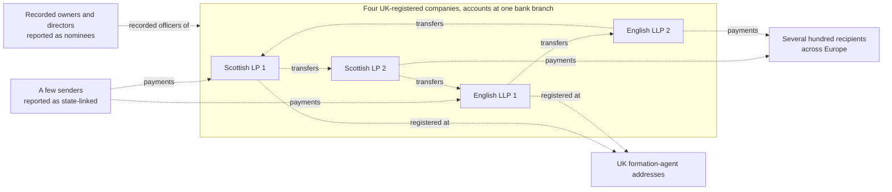

# The Azerbaijani Laundromat (2012 to 2014)

**Named as a wrongdoer:** nobody. **Named in other roles:** OCCRP and Berlingske (publishers), a court in Milan, the Parliamentary Assembly of the Council of Europe (the body a convicted person belonged to), and Danske Bank (the bank that held the accounts, which admitted facts in a separate case, see [the Danske Bank note](danske-bank-estonia.md)). **Described by role:** every company, sender, recipient, official and individual, including the one person convicted, because the appeal status of that conviction was not verified. Read [the case notes index](README.md) for how these notes are written.

## Summary

In September 2017 OCCRP and Berlingske reported that about EUR 2.5 billion (USD 2.9 billion) moved in more than 16,000 transactions over two years through four UK-registered companies: two Scottish limited partnerships and two English limited liability partnerships, all with accounts at Danske Bank's Estonian branch [occrp_azerbaijani_laundromat_2017]. This is journalistic reporting, not a court finding.

One court outcome is linked to the scheme: in January 2021 a court in Milan convicted a former member of the Parliamentary Assembly of the Council of Europe of bribery at first instance and sentenced him to four years; OCCRP reports that the payments to him were routed through British and offshore companies, including one of the four companies [occrp_pace_bribery_2021].

## The structure as a graph

OCCRP reports that the four companies were registered at UK formation-agent addresses with operating addresses abroad, that the beneficial owners and directors recorded for them "are not real", that much of the money came in from a few senders it links to the state, that the four companies moved money densely among themselves, and that the money went out to several hundred recipients across Europe [occrp_azerbaijani_laundromat_2017]. Every arrow below is reported, not adjudicated.

## Typologies this structure illustrates

- `shell_chain`: companies with nominee owners and directors and shared formation agents.
- `mass_registration_address`: companies registered at the address of a formation agent. The glossary defines a [mass registration address](../../glossary.md) [fatf_egmont_concealment_2018].
- `rapid_pass_through`: money received and sent on within the four accounts.
- `fan_out_distribution`: one group of accounts paying several hundred recipients.

A typology names the graph pattern this reported structure shows. It is not a finding about any company. The glossary explains [nominee](../../glossary.md) [fatf_egmont_concealment_2018].

## Adjudicated or admitted

- **One first-instance conviction (Italy, January 2021).** A court in Milan convicted a former member of the Parliamentary Assembly of the Council of Europe of bribery and sentenced him to four years [occrp_pace_bribery_2021]. This was a first-instance judgment; its appeal status was not verified, so this note describes him by role as "convicted at first instance".

## Documented by the bank's own investigation (not a court finding)

- Danske Bank's investigation found 75 customers of its Estonian branch linked by media reports to this scheme, and "two thirds of the 75 customers were LPs or LLPs incorporated in the U.K." [danske_bruun_hjejle_2018]. The report does not conclude that a crime occurred [danske_bruun_hjejle_2018].

## Alleged or unresolved

- The source and purpose of the funds.
- The involvement of any official or public body.
- The knowledge of any recipient.
- Who controlled the four companies.

None of the companies, senders or recipients is named here.

## Status checked

| Outcome | Source | Last checked | By |
|---|---|---|---|
| The first-instance conviction in Milan (January 2021) | [occrp_pace_bribery_2021] | 21 October 2026 (the report); appeal status not checked | milestone M1.10a re-opened the report; the research note `aml-domain.md` read it on 16 October 2026 |
| OCCRP's reporting of the scheme | [occrp_azerbaijani_laundromat_2017] | 21 October 2026 | milestone M1.10a (project page re-opened) |
| The bank's investigation | [danske_bruun_hjejle_2018] | 21 October 2026 | milestone M1.10a |

Re-check the conviction, including any appeal, before publishing anything that quotes this note.

## Sources

- [danske_bruun_hjejle_2018] Bruun & Hjejle for Danske Bank, *Report on the Non-Resident Portfolio at Danske Bank's Estonian branch*, 2018. <https://danskebank.com/news-and-insights/news-archive/press-releases/2018/pr19092018> (report: <https://danskebank.com/-/media/danske-bank-com/file-cloud/2018/9/report-on-the-non-resident-portfolio-at-danske-banks-estonian-branch.pdf>)
- [fatf_egmont_concealment_2018] FATF and Egmont Group, *Concealment of Beneficial Ownership*, 2018. <https://www.fatf-gafi.org/en/publications/Methodsandtrends/Concealment-beneficial-ownership.html>
- [occrp_azerbaijani_laundromat_2017] OCCRP, *The Azerbaijani Laundromat*, 2017. <https://www.occrp.org/en/project/the-azerbaijani-laundromat> ("The Core Companies": <https://occrp.org/en/project/the-azerbaijani-laundromat/the-core-companies>)
- [occrp_pace_bribery_2021] OCCRP, *Italian Court Sentences Former Council of Europe MP for Bribery*, 2021. <https://www.occrp.org/en/news/italian-court-sentences-former-council-of-europe-mp-for-bribery>
