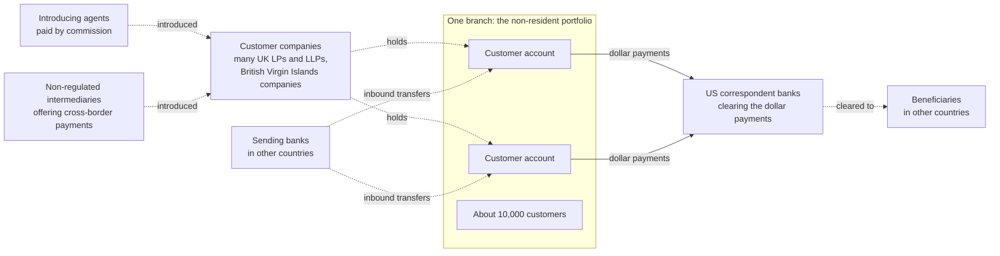

# Danske Bank, Estonian branch: the non-resident portfolio (2007 to 2015)

**Named as a wrongdoer:** Danske Bank, which admitted facts in a guilty plea in the United States. **Described by role:** every customer, introducing agent, intermediary and former employee. Read [the case notes index](README.md) for how these notes are written.

## Summary

Danske Bank's Estonian branch served a portfolio of non-resident customers. The bank's own investigation, carried out by Bruun & Hjejle and published by the bank in September 2018, describes about 10,000 non-resident customers (about 15,000 when every customer with a cross-border characteristic is counted) and about EUR 200 billion of payments through the portfolio from 2007 to 2015, in about 9.5 million payments [danske_bruun_hjejle_2018]. The report states that its findings do not allow a conclusion that money laundering or other crime actually occurred, and it does not name customers [danske_bruun_hjejle_2018].

In December 2022 Danske Bank pleaded guilty in the United States to conspiracy to commit bank fraud. It admitted that the branch processed about USD 160 billion through US banks on behalf of the non-resident portfolio while misrepresenting its anti-money-laundering controls to its US correspondent banks, and it agreed to forfeit about USD 2 billion [doj_danske_2022]. The charge was conspiracy to commit bank fraud against those US banks, not a money laundering offence [doj_danske_2022].

## The structure as a graph

Many customers were UK limited partnerships (LPs) and limited liability partnerships (LLPs), or entities from the British Virgin Islands. Many were introduced by agents who earned commissions, and some by "non-regulated entities acting as intermediaries providing cross-border payment solutions to unknown end-clients" [danske_bruun_hjejle_2018]. Transfers came in from banks in other countries, and the dollar payments out cleared through US correspondent banks to beneficiaries in other countries [danske_bruun_hjejle_2018] [doj_danske_2022].

Solid arrows: admitted in the bank's US guilty plea [doj_danske_2022]. Dotted arrows: documented by the bank's own investigation, not a court finding [danske_bruun_hjejle_2018].

## Typologies this structure illustrates

- [`rapid_pass_through`](../../typologies/rapid-pass-through.md): funds that come in from banks abroad and pass on to beneficiaries in other countries through correspondent banks. The glossary defines a [pass-through or transit account](../../glossary.md) [fatf_egmont_tbml_indicators_2021] and [correspondent banking](../../glossary.md) [wolfsberg_correspondent_2022].

A typology names the graph pattern this reported structure shows. It is not a finding about any customer.

## Adjudicated or admitted

- **Danske Bank's guilty plea (United States, December 2022).** The bank pleaded guilty to one count of conspiracy to commit bank fraud and admitted that its Estonian branch processed about USD 160 billion through US banks for the non-resident portfolio while misrepresenting its anti-money-laundering controls to its US correspondent banks; it agreed to forfeit about USD 2 billion [doj_danske_2022].

## Documented by the bank's own investigation (not a court finding)

- The size of the portfolio and the payments through it, as in the summary [danske_bruun_hjejle_2018].
- 177 customers potentially linked to a scheme reported as the Russian Laundromat, "the majority" of them limited partnerships, and 75 customers linked by media reports to the scheme in [the Azerbaijani Laundromat note](azerbaijani-laundromat.md), two thirds of them LPs or LLPs incorporated in the UK [danske_bruun_hjejle_2018].
- The report is the bank's admission that its controls failed, but it states that its findings do not allow a conclusion that money laundering or other crime occurred [danske_bruun_hjejle_2018].

## Alleged or unresolved

- Whether any specific customer committed a crime. The report names no customers, and no court finding about a customer appears in the sources cited here.
- The liability of any individual, including introducing agents, intermediaries and former employees. No court outcome for an individual appears in the sources cited here.

## Status checked

| Outcome | Source | Last checked | By |
|---|---|---|---|
| Danske Bank's guilty plea and forfeiture | [doj_danske_2022] | 16 October 2026 | the research note `aml-domain.md`; justice.gov answered the build with a bot challenge on 21 October 2026 |
| The bank's investigation and its findings | [danske_bruun_hjejle_2018] | 21 October 2026 | milestone M1.10a (press release and report re-opened) |

Re-check both before publishing anything that quotes this note.

## Sources

- [danske_bruun_hjejle_2018] Bruun & Hjejle for Danske Bank, *Report on the Non-Resident Portfolio at Danske Bank's Estonian branch*, 2018. <https://danskebank.com/news-and-insights/news-archive/press-releases/2018/pr19092018> (report: <https://danskebank.com/-/media/danske-bank-com/file-cloud/2018/9/report-on-the-non-resident-portfolio-at-danske-banks-estonian-branch.pdf>)
- [doj_danske_2022] US Department of Justice, *Danske Bank Pleads Guilty to Fraud on U.S. Banks in Multi-Billion Dollar Scheme to Access the U.S. Financial System*, 2022. <https://www.justice.gov/opa/pr/danske-bank-pleads-guilty-fraud-us-banks-multi-billion-dollar-scheme-access-us-financial>
- [fatf_egmont_tbml_indicators_2021] FATF and Egmont Group, *Trade-Based Money Laundering: Risk Indicators*, 2021. <https://www.fatf-gafi.org/en/publications/Methodsandtrends/Trade-based-money-laundering-indicators.html>
- [wolfsberg_correspondent_2022] Wolfsberg Group, *Financial Crime Principles for Correspondent Banking*, 2022. <https://wolfsberg-group.org/resources/203/91>
