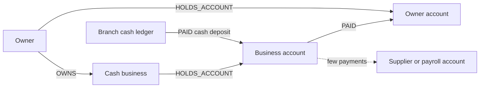

# Cash-intensive business commingling

> **Draft.** Slug `cash_commingling`, version 0.1.0, tier `extended`, synthetic support `medium`. Definition file: [`detect/typologies/cash_commingling.yaml`](../../detect/typologies/cash_commingling.yaml). A typology researcher checks this page against its sources before the definition is approved. Research entry: `docs/research/2026-10-16/aml-domain.md`, section 2 (l).

A structure that matches this pattern is not evidence of money laundering or of any other wrongdoing. There are ordinary reasons for almost every pattern described here; the [standing disclaimer](../wording.md#disclaimers) applies to everything NeonRadar shows. Among the legitimate reasons, the disclaimer names cash businesses.

## What it is

Some businesses take a lot of their revenue in cash. The FFIEC manual's examples of cash-intensive businesses include convenience stores, restaurants, retail and liquor stores, cigarette distributors, privately owned ATMs, vending operators and parking garages [ffiec_cash_intensive]. Commingling means mixing cash from crime with the genuine takings of such a business, so that the combined deposits look like ordinary revenue [ffiec_cash_intensive] [europol_efecta_2023].

Why the sources look at this:

- The FFIEC manual explains that "a criminal may own a cash-intensive business, such as a restaurant", and that the "volume of currency in a restaurant used to launder money will most likely be higher" [ffiec_cash_intensive].
- Europol writes that "Cash-intensive businesses are also often targeted, as they provide opportunities to mix licit and illicit proceeds", and that such businesses are "easily misused for money laundering", with car washes among the "common examples" [europol_efecta_2023].
- The Egmont Group's collection of 100 cases from financial intelligence units groups them under headings that include "Concealment within Business Structures" and "Misuse of Legitimate Businesses" [egmont_100_cases].
- FATF's report on professional money laundering describes cash controller networks, including cash controllers who deposit cash "in amounts below reporting thresholds" [fatf_pml_2018]. For the supply side of the cash, see the FATF and MENAFATF report on money laundering through the physical transportation of cash [fatf_cash_transport_2015].

Related typology: `structuring`, which looks at deposits split below a reporting threshold rather than at the total volume.

## How it looks in the graph

In the C2 graph schema ([contracts/C2-graph-schema.md](../../contracts/C2-graph-schema.md)) and the C1 record contract ([contracts/C1-record.md](../../contracts/C1-record.md)):

- **Cash deposits.** A cash deposit is a `PAID` relationship from a bank branch's `cash_ledger` account, with `channel = 'cash_deposit'`, into the business's `Account`. The business is the `:Company` that holds the account (`HOLDS_ACCOUNT`).
- **Far above its peers.** The total of those deposits over a window is far above that of peer companies with the same `sector` (and, where useful, the same `jurisdiction`). Card takings (`channel = 'card'`) give a second comparison: a business whose cash share is far above its peers' cash share.
- **Odd timing.** Deposits on days unrelated to trading. The graph stores each payment's time (`PAID.ts`) but not opening hours, so the generator has to define trading days for each synthetic business.
- **Where the money goes.** Outbound `PAID` relationships to accounts held by the company's owners (`OWNS`, `CONTROLS`), their relatives (`FAMILY_OF`) or related companies, rather than to suppliers and payroll. `PAID.purpose` can carry the purpose in synthetic data.
- **Links between cash businesses.** The research note also suggests looking at ownership links to other cash businesses with the same shape.

**Real data.** Real registry companies receive only synthetic background activity (guardrail G1), so a match next to a real company lies entirely in generated payments and says nothing about that company (the real data notice in [docs/wording.md](../wording.md#disclaimers)). The generator never plants this scenario on a real company.

## Red flags the sources list

| Red flag | Source | Visible in the C2 graph? |
|---|---|---|
| A volume of currency higher than the business would produce | [ffiec_cash_intensive] | Yes, against sector peers: `PAID` with `channel = 'cash_deposit'` |
| "The currency transaction patterns of a business show a sudden change inconsistent with normal activities" | [ffiec_appendix_f] | Yes: deposit volume over time |
| Risk factors to weigh: "Purpose of the account"; "Volume, frequency, and nature of currency transactions"; "Primary business activity, products, and services offered"; "Geographic locations and jurisdictions of operations" | [ffiec_cash_intensive] | Partly: volume, frequency, `sector` and `jurisdiction` are stored; the purpose of the account is not |

A red flag is a reason to look closer, not evidence [ffiec_appendix_f].

## Typical false positives

The FFIEC manual itself notes "the difficulty in identifying unusual activity" among cash-intensive businesses [ffiec_cash_intensive]. The Phase 3 generator must produce these look-alikes (PHASE-1.md 7.2):

- **A genuinely busy or growing business.** Look-alike: a synthetic business whose real takings rise steadily, with matching growth in supplier and payroll payments.
- **Seasonal peaks.** Look-alike: a synthetic business whose cash deposits rise in the same months every year.
- **A new branch or outlet.** Look-alike: a synthetic business whose cash deposits step up when it opens a new outlet.
- **The wrong peer group.** A business recorded under the wrong `sector` is compared with the wrong peers. Look-alike: a synthetic business whose `sector` value does not fit its activity.

## Can synthetic data show it?

Partly (synthetic support: medium). The generator can give each synthetic business a true revenue and add extra cash on top, which makes clean labels; labels live in separate label files, never in records (C1 rule R9). Realism depends on how ordinary cash deposits are calibrated by sector, and no source in the bibliography gives sector benchmarks, so the generator documents its calibration assumptions (PHASE-1.md 7.2). Planted scenarios use synthetic entities only (ids start with `syn-`, guardrail G1).

## Starting parameters

No source gives numbers, and PHASE-1.md 7.2 gives none either, so every value below is a starting point for the typology researcher to choose and document, not a fact from the sources:

- the comparison window;
- the peer group (`sector`, and possibly `jurisdiction` and size);
- how far above the peers counts (a ratio or a number of standard deviations);
- the cash-to-card comparison;
- the share of outflows to related parties that counts.

## Open questions

For the typology researcher:

1. Sector benchmarks: no source in the bibliography gives cash deposit volumes by sector. Decide which documented assumptions the generator uses.
2. The comparison window, the peer group and the threshold for "far above".
3. How the generator defines trading days, so that "deposits on days unrelated to trading" can be tested.
4. Whether the cash-to-card comparison is part of the pattern or only an explanation.
5. Whether a detector should combine this pattern with `structuring` when deposits are both high and split below a threshold.

## Sources

- [egmont_100_cases] Egmont Group, *FIUs in Action: 100 Cases from the Egmont Group*, no date printed (about 2000). <https://fincen.gov/sites/default/files/shared/fiuinaction.pdf>
- [europol_efecta_2023] Europol, *European Financial and Economic Crime Threat Assessment 2023: The Other Side of the Coin*, 2023. <https://www.europol.europa.eu/cms/sites/default/files/documents/The%20Other%20Side%20of%20the%20Coin%20-%20Analysis%20of%20Financial%20and%20Economic%20Crime%20(EN).pdf>
- [fatf_cash_transport_2015] FATF and MENAFATF, *Money Laundering Through the Physical Transportation of Cash*, 2015. <https://www.fatf-gafi.org/en/publications/Methodsandtrends/Ml-through-physical-transportation-of-cash.html>
- [fatf_pml_2018] FATF, *Professional Money Laundering*, 2018. <https://www.fatf-gafi.org/content/dam/fatf-gafi/reports/Professional-Money-Laundering.pdf.coredownload.pdf>
- [ffiec_appendix_f] FFIEC, *BSA/AML Examination Manual, Appendix F: Money Laundering and Terrorist Financing Red Flags*, living document. <https://bsaaml.ffiec.gov/manual/Appendices/07>
- [ffiec_cash_intensive] FFIEC, *BSA/AML Examination Manual: Cash-Intensive Businesses*, living document. <https://bsaaml.ffiec.gov/manual/RisksAssociatedWithMoneyLaunderingAndTerroristFinancing/26>
