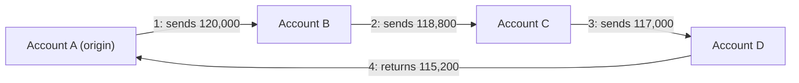

# Round-tripping or circular flows

> **Draft.** Slug `circular_flow`, version 0.1.0, tier `core`, synthetic support `high`. Definition file: [`detect/typologies/circular_flow.yaml`](../../detect/typologies/circular_flow.yaml). A typology researcher checks this page against its sources before the definition is approved.

A structure that matches this pattern is not evidence of money laundering or of any other wrongdoing. There are ordinary reasons for almost every pattern described here; the [standing disclaimer](../wording.md#disclaimers) applies to everything NeonRadar shows.

## What it is

NeonRadar's `circular_flow` typology covers money that leaves an account, passes through one or more other accounts and comes back to where it started, or to a party under the same control (project definition; see Open questions). In the sources, round-tripping means that payments are routed in a circle so that funds return to their origin [fatf_egmont_tbml_indicators_2021]. The trade-based money laundering indicators of the FATF and the Egmont Group put it in one line: "Payments are routed in a circle" [fatf_egmont_tbml_indicators_2021]. In the trade setting they describe, the funds leave a country and come back to it after passing through other jurisdictions [fatf_egmont_tbml_indicators_2021].

The FATF and Egmont Group report on concealed beneficial ownership lists cyclical "round-robin" transactions, in which "outgoing funds are being returned with little loss", among its indicators: the money that comes back is almost the same amount that went out [fatf_egmont_concealment_2018].

Circles also appear in the services that professional money launderers offer: the FATF describes "proxy networks" of company accounts through which clients' funds are moved, mixed and then returned, and notes that "The funds from different clients are mixed within the same accounts" [fatf_pml_2018].

## How it looks in the graph

In NeonRadar's graph (the C2 contract, `contracts/C2-graph-schema.md`), every bank account is an `:Account` node. Every payment is a `PAID` relationship from the payer's account to the beneficiary's account, with an `amount`, a `currency` and a timestamp `ts`. People and companies (`:LegalEntity` nodes) hold accounts through `HOLDS_ACCOUNT` relationships.

The pattern is a directed cycle of `PAID` relationships that starts and ends at the same `:Account`, or at two accounts held by the same `:LegalEntity`, where:

- the hops are in time order: each payment happens after the one before it;
- the amounts are nearly equal: the amount that comes back is close to the amount that left (the return ratio);
- the whole circle takes a short time.

The definition file measures a match with these metrics: `cycle_length` (the number of payments), `sent_amount` (the first payment), `returned_amount` (the last payment), `currency`, `duration_hours`, `duration_days` and `return_ratio` (returned amount divided by sent amount). An alert headline then reads, for example, "Funds returned to the originating account through 4 transfers within 7 days". It describes the structure and nothing else.

What the graph cannot show: why each payment was made. A `PAID` relationship can carry a `purpose`, but invoices, loan contracts and prices are not part of the graph, so the commercial reason for a circle stays outside it. The Phase 1 detector (milestone M1.9b) looks only for circles that return to the same account; the variant that returns to another account of the same holder is Phase 3 work.

## Red flags the sources list

- Payments that "are routed in a circle" [fatf_egmont_tbml_indicators_2021].
- Cyclical "round-robin" transactions in which "outgoing funds are being returned with little loss" [fatf_egmont_concealment_2018].
- Funds that move from one bank to another and are then moved back to the first bank [ffiec_appendix_f].
- When the circle is presented as trade: "A trade entity consistently displays unreasonably low profit margins", or its prices do not seem to be in line with commercial considerations [fatf_egmont_tbml_indicators_2021]. NeonRadar's graph holds no prices or margins, so these two cannot be checked here.

A red flag is a reason to look closer, not evidence. The FFIEC says its red flags "are not all-inclusive" and warns that a red flag alone does not prove criminal activity [ffiec_appendix_f].

## Typical false positives

Money goes round in circles in ordinary finance every day. The definition file and the project's look-alike list (PHASE-1.md 7.2) name these:

- **Refunds and payment reversals.** A payment goes out and the same amount comes back.
- **Loan drawdown followed by repayment.** A lender pays out a loan and the borrower pays it back, sometimes through another account.
- **Foreign exchange hedging legs.** The two legs of a currency hedge can send money out and bring it back.
- **Intra-group cash pooling and treasury sweeps.** Companies in one group move cash to a central account and back.

The shape alone cannot tell these apart from the pattern. What separates them is context the cycle does not show: the stated purpose of each payment, whether the parties are related, and whether the accounts in the middle belong to holders with any other business. The Phase 3 generator must produce benign cycles such as refunds and loans next to the planted scenarios, so that a detector cannot score well just by finding every circle.

## Can synthetic data show it?

Yes. The synthetic support is `high` (PHASE-1.md 7.2). A circle is defined entirely by accounts, payment amounts and timestamps, and the generator controls all three. The generator scenario for this typology is `round_trip`. Planted scenarios run only among synthetic entities (guardrail G1); real registry entities may receive synthetic background activity, never a scenario role.

What synthetic data cannot show is whether a real circle had a commercial reason. Detection rates measured on synthetic data say nothing about how NeonRadar would perform on real data (README, Limitations).

## Starting parameters

These come from the definition file. They are starting points for the typology researcher, not facts from the sources (PHASE-1.md 7.2).

| Parameter | Default | Allowed range | Meaning |
|---|---|---|---|
| `min_hops` | 2 | 2 to 8 | The fewest payments in a circle |
| `max_hops` | 6 | 2 to 8 | The most payments in a circle |
| `max_window_days` | 14 | 1 to 90 | The longest time from the first payment to the last |
| `min_return_ratio` | 0.8 | 0.0 to 1.0 | The smallest share of the sent amount that must come back |

## Open questions

- The research note describes round trips as often presented as investment, loan or trade payments, so that the returning money looks like revenue or foreign investment. The quoted source passages support only the trade presentation, so the investment and loan framing is left out until a source passage is found.
- The definition at the top of this page (a return to the originating account or to a party under the same control) is NeonRadar's project definition from PHASE-1.md 5.4. The sources quoted here describe payments routed in a circle and funds returned with little loss; the typology researcher confirms that the definition matches them.
- Confirm against the indicator list that the FATF and Egmont Group indicator itself describes funds leaving a country and returning to it (the sentence above follows the research note's reading of it).
- The research note says that public transaction generators emit a "simple cycle" pattern. Those generators have no bibliography entry, so the claim is left out.
- For the typology researcher: confirm the parameter defaults, and decide how "a party under the same control" should be modelled in Phase 3 (accounts held by the same `:LegalEntity`, or also by companies with the same owner), and whether foreign exchange hedging legs (in the PHASE-1.md 7.2 look-alike list and on this page) should join the definition file's `false_positives`, which keep the 5.4 text for now.

## Sources

- [fatf_egmont_concealment_2018] FATF and Egmont Group, *Concealment of Beneficial Ownership*, 2018. <https://www.fatf-gafi.org/en/publications/Methodsandtrends/Concealment-beneficial-ownership.html>
- [fatf_egmont_tbml_indicators_2021] FATF and Egmont Group, *Trade-Based Money Laundering: Risk Indicators*, 2021. <https://www.fatf-gafi.org/en/publications/Methodsandtrends/Trade-based-money-laundering-indicators.html>
- [fatf_pml_2018] FATF, *Professional Money Laundering*, 2018. <https://www.fatf-gafi.org/content/dam/fatf-gafi/reports/Professional-Money-Laundering.pdf.coredownload.pdf>
- [ffiec_appendix_f] FFIEC, *BSA/AML Examination Manual, Appendix F: Money Laundering and Terrorist Financing Red Flags*, living document. <https://bsaaml.ffiec.gov/manual/Appendices/07>
