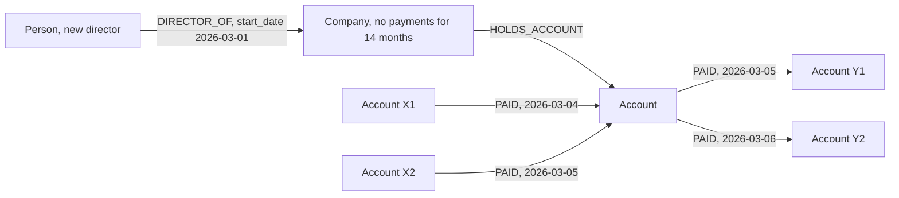

# Dormant account reactivation followed by high velocity

> **Draft.** Slug `dormant_reactivation`, version 0.1.0, tier `core`, synthetic support `high`. Definition file: [`detect/typologies/dormant_reactivation.yaml`](../../detect/typologies/dormant_reactivation.yaml). A typology researcher checks this page against its sources before the definition is approved.

A structure that matches this pattern is not evidence of money laundering or of any other wrongdoing. There are ordinary reasons for almost every pattern described here; the [standing disclaimer](../wording.md#disclaimers) applies to everything NeonRadar shows.

NeonRadar starts from this position (PHASE-1.md 7.2 look-alikes): dormant accounts, dormant companies and ready-made shelf companies are common and lawful; a quiet period followed by activity describes timing, not conduct.

## What it is

An account or a company that has been quiet for a long time suddenly starts to receive and send large amounts. NeonRadar's pattern also looks for a change of director, owner or account holder just before the burst: the sources describe directors or key shareholders replaced shortly after incorporation [fatf_egmont_concealment_2018] (Annex E, indicator 7), and a shelf company's directors resign when it is sold [star_puppet_masters_2011] (p. 37).

The FFIEC red flags for US bank examiners describe the account version: "an account with little activity may suddenly experience large deposit and withdrawal activity" [ffiec_appendix_f]. The FATF and Egmont Group indicators of concealed beneficial ownership describe the company version: legal persons that "have demonstrated a long period of inactivity following incorporation, followed by a sudden and unexplained increase in financial activities" [fatf_egmont_concealment_2018] (Annex E, indicator 4).

A **shelf company** is the corporate form of dormancy: an "incorporated company with inactive shareholders, directors, and secretary" that "is left dormant for a longer period even if a customer relationship has already been established" [fatf_egmont_concealment_2018] (executive summary). The Puppet Masters study explains that a shelf company sits "on a shelf" for the purpose of later being sold; on the sale, the shareholders transfer their shares and the directors and secretary resign, and "the purchaser may receive the company's credit and tax history" [star_puppet_masters_2011] (p. 37). Service providers "may hold a stock of shelf companies, purchased in bulk from a company wholesaler" [star_puppet_masters_2011] (p. 38). FATF's 2010 study of trust and company service providers (TCSPs) covers the sale of shelf companies among the services TCSPs provide [fatf_tcsp_2010].

The same signature can appear at the start of an account's life. FATF, INTERPOL and the Egmont Group report that some money mules "only allow their accounts to be used for a specific and limited period of time" [fatf_cyber_fraud_2023] (paragraph 29), and list as a risk indicator "Rapid or immediate, high or low value transactions after opening of an account, inconsistent with the purpose of the account" [fatf_cyber_fraud_2023] (Annex A).

## How it looks in the graph

In NeonRadar's graph (the [C2 graph schema](../../contracts/C2-graph-schema.md)), every bank account is an `:Account` node and every payment is a `PAID` relationship between two accounts, with an `amount`, a `currency`, a timestamp `ts` and a `channel`. People (`:Person` nodes) and companies hold accounts through `HOLDS_ACCOUNT`. Directors and owners link to companies through `DIRECTOR_OF` and `OWNS`, each with a `start_date` and an `end_date`, and a company has an `incorporation_date`.

The pattern:

- an `:Account` with no `PAID` relationships, inbound or outbound, for a long gap;
- then, within days, a burst of inbound and outbound `PAID`, by count or by total amount;
- sometimes just before the burst, a change on the holder: a new `DIRECTOR_OF` or `OWNS` relationship (its `start_date`), an old one ending (`end_date`), or a new `HOLDS_ACCOUNT` holder;
- the company variant: a `:Company` whose `incorporation_date` lies long before its first payment, or a newly incorporated company that receives large sums and passes them on soon afterwards.

The burst itself can have the shape of another typology, such as `fan_in_collection`, `rapid_pass_through` or `fan_out_distribution`.

What the graph cannot show: why an account was quiet. A gap may only mean that the loaded data does not cover that period. C2 stores no balance and no dormancy status for an account, only its `opening_date` and `closing_date`. A change of holder, director or owner shows only when the source gives a `start_date` for the new relationship.

## Red flags the sources list

- "an account with little activity may suddenly experience large deposit and withdrawal activity" [ffiec_appendix_f].
- "The currency transaction patterns of a business show a sudden change inconsistent with normal activities" [ffiec_appendix_f].
- Legal persons that "have demonstrated a long period of inactivity following incorporation, followed by a sudden and unexplained increase in financial activities" [fatf_egmont_concealment_2018] (Annex E, indicator 4).
- Legal persons that "receive large sums of capital funding quickly following incorporation/formation, which is spent or transferred elsewhere in a short period of time without commercial justification" [fatf_egmont_concealment_2018] (Annex E, indicator 4).
- "the resignation and replacement of directors or key shareholders shortly after incorporation" [fatf_egmont_concealment_2018] (Annex E, indicator 7).
- "Rapid or immediate, high or low value transactions after opening of an account, inconsistent with the purpose of the account" [fatf_cyber_fraud_2023] (Annex A).
- The Spanish FIU studied a money mule profile: bank accounts "opened by a single individual at three or more financial institutions within 20 days" [fatf_cyber_fraud_2023] (Box 23).

A red flag is a reason to look closer, not evidence. The FFIEC says its red flags "are not all-inclusive" and warns that a red flag alone does not prove criminal activity [ffiec_appendix_f]. The FATF and Egmont Group note that their list of indicators "is not exhaustive" [fatf_egmont_concealment_2018] (Annex E).

## Typical false positives

Many ordinary events wake up a quiet account. NeonRadar's catalog lists these look-alikes:

- seasonal businesses;
- account holders who return from abroad or after an illness;
- inheritances and the proceeds of a property sale;
- a dormant company restarted by new owners, and other genuine acquisitions;
- student accounts that come back to life at the start of term.

A change of control followed by a burst of activity is more specific than a burst alone, but a genuine takeover produces exactly that sequence. Buying a ready-made shelf company is also an ordinary way to get a company quickly [star_puppet_masters_2011] (p. 38). The Puppet Masters study gives the typical reason as "I need a company now, not in six weeks", and adds that this reason is "losing validity" where setting up a new company takes little more than a simple online form [star_puppet_masters_2011] (p. 38).

## Can synthetic data show it?

Yes. Synthetic support is `high`. The pattern is a timing pattern that the generator controls directly: a gap with no payments, then a burst. The generator can also produce the change of director, owner or account holder that comes before it. To measure precision honestly, it must also produce benign reactivations (the look-alikes above) and record their explanation as an attribute.

Planted reactivation scenarios run only among synthetic entities (ids that start with `syn-`). Real registry entities can receive synthetic background activity, never a scenario role (guardrail G1 in [PHASE-1.md](../build/PHASE-1.md) section 2.1).

## Starting parameters

None in the definition file yet. PHASE-1.md 7.2 suggests a quiet gap of 180 days. A detector would also need: the length of the burst window, the size of the burst, and how close a change of director, owner or account holder must be to count. These are starting points for the typology researcher, not facts from the sources.

## Open questions

- The statement that FATF's 2010 TCSP study covers the sale of shelf companies comes from the research note (section 2, entry j). The build could not open the FATF report (fatf-gafi.org blocks automated clients); confirm the page in a browser.
- The FFIEC quotes come from the research note (checked 16 October 2026); confirm them in a browser.
- Quotes that are not in the research note `docs/research/2026-10-16/aml-domain.md` were verified by the builder against the source on 21 Oct 2026; typology researcher to confirm before approval:
  - Annex E (Egmont copy): "have demonstrated a long period of inactivity following incorporation, …" and "receive large sums of capital funding quickly following incorporation/formation, …" (indicator 4; the research note has a shorter form of the second), "the resignation and replacement of directors or key shareholders shortly after incorporation" (indicator 7), "is not exhaustive" (introduction).
  - Executive summary (Egmont copy, p. 5): "incorporated company with inactive shareholders, directors, and secretary" and "is left dormant for a longer period …" (also in the glossary).
  - Puppet Masters: "the purchaser may receive the company's credit and tax history" (p. 37); "may hold a stock of shelf companies, …", "I need a company now, not in six weeks" and "losing validity" (p. 38).
  - FATF cyber-fraud report (mirror copy): "Rapid or immediate, high or low value transactions after opening of an account, …" (Annex A).

## Sources

- [fatf_cyber_fraud_2023] FATF, INTERPOL and Egmont Group, *Illicit Financial Flows from Cyber-Enabled Fraud*, 2023. <https://www.fatf-gafi.org/en/publications/Methodsandtrends/illicit-financial-flows-cyber-enabled-fraud.html>
- [fatf_egmont_concealment_2018] FATF and Egmont Group, *Concealment of Beneficial Ownership*, 2018. <https://www.fatf-gafi.org/en/publications/Methodsandtrends/Concealment-beneficial-ownership.html>
- [fatf_tcsp_2010] FATF, *Money Laundering Using Trust and Company Service Providers*, 2010. <https://www.fatf-gafi.org/en/publications/Methodsandtrends/Moneylaunderingusingtrustandcompanyserviceproviders.html>
- [ffiec_appendix_f] FFIEC, *BSA/AML Examination Manual, Appendix F: Money Laundering and Terrorist Financing Red Flags*, living document. <https://bsaaml.ffiec.gov/manual/Appendices/07>
- [star_puppet_masters_2011] StAR (World Bank and UNODC), *The Puppet Masters: How the Corrupt Use Legal Structures to Hide Stolen Assets and What to Do About It*, 2011. <https://star.worldbank.org/sites/star/files/puppetmastersv1.pdf>
