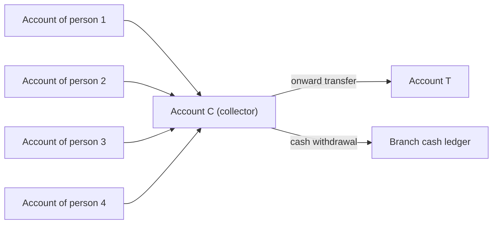

# Fan-in to a collection account

> **Draft.** Slug `fan_in_collection`, version 0.1.0, tier `core`, synthetic support `high`. Definition file: [`detect/typologies/fan_in_collection.yaml`](../../detect/typologies/fan_in_collection.yaml). A typology researcher checks this page against its sources before the definition is approved.

A structure that matches this pattern is not evidence of money laundering or of any other wrongdoing. There are ordinary reasons for almost every pattern described here; the [standing disclaimer](../wording.md#disclaimers) applies to everything NeonRadar shows.

## What it is

In NeonRadar's catalog (project definition), a fan-in is many people who do not know each other sending money to one account, which then passes it on or withdraws it as cash. The FFIEC lists a related red flag: "Multiple accounts are used to collect and funnel funds to a small number of foreign beneficiaries" [ffiec_appendix_f].

The FATF lists money mule networks among the services that professional money launderers offer [fatf_pml_2018]. Europol defines a mule: "A money mule is a person who receives money from a third party in their bank account and transfers it to another one" [europol_money_muling]. Not every mule knows what they are part of: the FATF says money mules "may be knowingly complicit in the laundering of funds or work unwittingly, or negligently" [fatf_pml_2018], and FinCEN describes them as people "used, wittingly or unwittingly, to transfer value" [fincen_fin_2025_a003]. The FATF also notes that mule accounts "serve as the initial layering stage in the laundering process" [fatf_pml_2018].

A 2023 report by the FATF, INTERPOL and the Egmont Group describes fraud proceeds being moved through mule accounts, and finds that money mules in cyber-enabled fraud "are more likely to be recruited online" [fatf_cyber_fraud_2023]. FinCEN's funnel account is the cash version of the same shape: an account that "receives multiple cash deposits", from which the money is withdrawn elsewhere soon after [fincen_fin_2014_a005].

Because the people sending money may not know what is going on, the graph can never show intent. NeonRadar's alert text never calls an account or a person a mule; the wording lint rejects the word, and an alert names the receiving account's role as, for example, `collector` ([docs/wording.md](../wording.md)).

## How it looks in the graph

In NeonRadar's graph (the C2 contract, `contracts/C2-graph-schema.md`), every bank account is an `:Account` node and every payment is a `PAID` relationship between two accounts, with an `amount`, a `currency`, a timestamp `ts` and a `channel`. People (`:Person` nodes) and companies hold accounts through `HOLDS_ACCOUNT`. An account has an `opening_date` and a `bank_name`.

The pattern centres on one collecting `:Account`:

- it receives `PAID` relationships from many accounts held by people;
- those accounts had no earlier payments to it, or to each other;
- the payments arrive within a short window;
- the sending accounts are often recently opened (their `opening_date` is close to the payments);
- afterwards the collected money moves on: onward transfers, or cash withdrawals (`channel = 'cash_withdrawal'`).

A ring variant looks at a whole group of accounts rather than one collector. PHASE-1.md 7.2 suggests finding such groups with graph algorithms over recent `PAID` relationships: weakly connected components (groups of accounts linked by any payment) or Louvain (groups that pay each other more than they pay outsiders), both from Neo4j's Graph Data Science library.

What the graph cannot show: occupations, devices and contact details. C2 stores no occupation for a person and has no device nodes, so several of the red flags below cannot be checked in Phase 1. It can show a person who holds accounts at several banks (different `bank_name` values) opened within days of each other.

## Red flags the sources list

- A customer who gives an occupation at onboarding such as student, retiree or housewife, yet "regularly deposits large volumes of cash or cashier's checks" or "receives numerous transfers or deposits, and has a significant number of withdrawals or transfers" [fincen_fin_2025_a003].
- Accounts "opened by a single individual at three or more financial institutions within 20 days", a profile used by the Spanish financial intelligence unit [fatf_cyber_fraud_2023].
- Account holders who "only allow their accounts to be used for a specific and limited period of time" [fatf_cyber_fraud_2023].
- The same device identifiers and foreign contact details shared across accounts [fatf_cyber_fraud_2023].
- "Multiple accounts are used to collect and funnel funds to a small number of foreign beneficiaries" [ffiec_appendix_f].

The Egmont Group's case book for 2021 to 2023 includes a money mule syndicate case (Case 7), which is useful further reading [egmont_best_cases_2024].

A red flag is a reason to look closer, not evidence. The FFIEC says its red flags "are not all-inclusive" and warns that a red flag alone does not prove criminal activity [ffiec_appendix_f].

## Typical false positives

Plenty of ordinary accounts receive money from many people who do not know each other. The definition file and the project's look-alike list (PHASE-1.md 7.2) name these:

- **Charities and donation drives.**
- **Crowdfunding campaigns.**
- **Landlords collecting rent.**
- **Clubs collecting membership fees.**
- **Small online sellers and tutors.**
- **School fee and utility accounts.**

The fan-in alone cannot tell these apart from the pattern. What separates them is the senders (how old their accounts are and what else they do), how long the money stays in the collecting account, and what happens to it next.

## Can synthetic data show it?

Yes. The synthetic support is `high` (PHASE-1.md 7.2). The generator controls who pays whom, when and how much, and it sets each account's opening date, so it can plant labelled collection patterns among synthetic entities only (guardrail G1).

For the labels to mean something, the Phase 3 generator must also produce the look-alikes above (charities, landlords, clubs) with many unrelated senders, and give sending accounts realistic opening dates in both the planted patterns and the look-alikes. Detection rates measured on synthetic data say nothing about how NeonRadar would perform on real data (README, Limitations).

## Starting parameters

None in the definition file yet, and PHASE-1.md 7.2 gives no default values. A detector would need at least: the time window, the smallest number of senders, how recent an account's opening date must be to count as new, and how soon the onward transfers or withdrawals must follow. The typology researcher sets the starting values.

## Open questions

- The research note says that some senders are fraud victims themselves. No quoted source passage supports this, so it is left out.
- The research note says that one public generator supports missing and noisy labels, which matches the fact that many mules are never identified. That generator has no bibliography entry, so the claim is left out.
- FinCEN's list of occupations is paraphrased here because the research note quotes the sentence in two slightly different forms; the reviewer should check the exact wording in the advisory before it is quoted.
- For the typology researcher: the starting parameter values, and whether the ring variant (GDS communities) is part of this typology or a separate one.

## Sources

- [egmont_best_cases_2024] Egmont Group, *Best Egmont Cases: Financial Analysis Cases 2021-2023*, 2024. <https://egmontgroup.org/wp-content/uploads/2024/09/EGMONT_2021-2023-BECA-III_FINAL.pdf>
- [europol_money_muling] Europol, *Money Muling*, living document. <https://europol.europa.eu/operations-services-and-innovation/public-awareness-and-prevention-guides/money-muling>
- [fatf_cyber_fraud_2023] FATF, INTERPOL and Egmont Group, *Illicit Financial Flows from Cyber-Enabled Fraud*, 2023. <https://www.fatf-gafi.org/en/publications/Methodsandtrends/illicit-financial-flows-cyber-enabled-fraud.html>
- [fatf_pml_2018] FATF, *Professional Money Laundering*, 2018. <https://www.fatf-gafi.org/content/dam/fatf-gafi/reports/Professional-Money-Laundering.pdf.coredownload.pdf>
- [ffiec_appendix_f] FFIEC, *BSA/AML Examination Manual, Appendix F: Money Laundering and Terrorist Financing Red Flags*, living document. <https://bsaaml.ffiec.gov/manual/Appendices/07>
- [fincen_fin_2014_a005] FinCEN, *FinCEN Advisory FIN-2014-A005: Update on U.S. Currency Restrictions in Mexico: Funnel Accounts and TBML*, 2014. <https://www.fincen.gov/resources/advisories/fincen-advisory-fin-2014-a005>
- [fincen_fin_2025_a003] FinCEN, *FinCEN Advisory FIN-2025-A003: Use of Chinese Money Laundering Networks by Mexico-Based Transnational Criminal Organizations*, 2025. <https://www.fincen.gov/system/files/2025-08/FinCEN-Advisory-CMLN-508.pdf>
