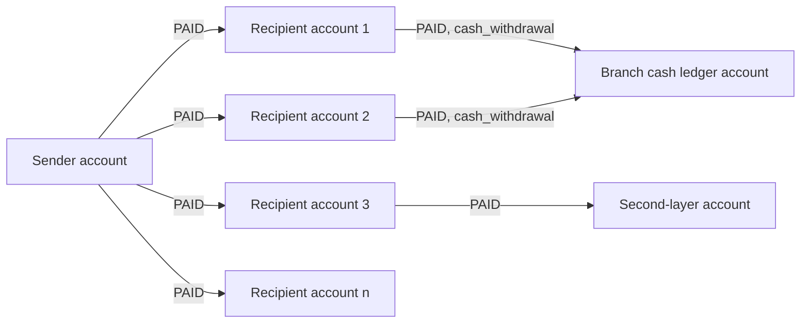

# Fan-out distribution from one account

> **Draft.** An AI agent wrote this explainer from the sources listed at the end; a person has not yet checked it against them. Typology file: [`detect/typologies/fan_out_distribution.yaml`](../../detect/typologies/fan_out_distribution.yaml) (slug `fan_out_distribution`, tier `core`, status `draft`). A pattern match is not evidence of money laundering or of any other wrongdoing; see [wording](../wording.md).

## What it is

Fan-out means that one account sends money to many other accounts within a short time. Each recipient then holds a small amount that draws little attention, and can withdraw it as cash or send it on.

FinCEN lists this shape among its indicators for shell companies: "An unusually large number and variety of beneficiaries receive wire transfers from one company" [fincen_fin_2006_g014]. The FFIEC red flags for US bank examiners include the same flag [ffiec_appendix_f].

The shape often appears in networks of money mules. A money mule is a person who receives money from a third party into their account and transfers it on, wittingly or unwittingly (see the [glossary](../glossary.md)). FATF describes money mule networks as one of the services professional money launderers offer, and notes that mule bank accounts "serve as the initial layering stage" [fatf_pml_2018]. In cyber-enabled fraud, FATF, INTERPOL and the Egmont Group describe proceeds that are "rapidly layered through a series of 'pass-through' transactions" [fatf_cyber_fraud_2023] (paragraph 28), and "hopping through accounts across different financial, remittance or payment service providers" [fatf_cyber_fraud_2023] (paragraph 29). In one case from France, funds were moved quickly "to one or several accounts", and splitting the amounts between accounts got around a payment provider's cash withdrawal limits and its internal monitoring thresholds [fatf_cyber_fraud_2023] (Box 17).

## How it looks in the graph

In NeonRadar's graph (the [C2 graph schema](../../contracts/C2-graph-schema.md)) the pattern is:

- one `:Account`, the sender, with outgoing `PAID` relationships to many different accounts within a short window;
- amounts that are similar to each other, or round;
- recipients that had no earlier `PAID` relationship with the sender, and usually none with each other;
- what happens next: the recipients withdraw cash (a `PAID` with `channel = 'cash_withdrawal'` to a bank branch's `cash_ledger` account) or forward the money to a second layer of accounts.

A fan-out often follows a fan-in to the same account: FinCEN's indicators for money mules include a customer who "receives numerous transfers or deposits, and has a significant number of withdrawals or transfers" [fincen_fin_2025_a003]. See also the typologies `fan_in_collection` and `rapid_pass_through`.

A detector will need parameters that the typology researcher sets: the smallest number of distinct recipients, the length of the window, how similar the amounts must be, and how long to follow the recipients afterwards. These are project choices, not figures from the sources.

## Red flags from the sources

- "An unusually large number and variety of beneficiaries receive wire transfers from one company" [fincen_fin_2006_g014]; the FFIEC list has the same flag [ffiec_appendix_f].
- "Payments have no stated purpose, do not reference goods or services, or identify only a contract or invoice number" [fincen_fin_2006_g014].
- "Frequent involvement of beneficiaries located in high-risk, offshore financial centers" [fincen_fin_2006_g014].
- On the recipient side: "Rapid or immediate cash withdrawals or transfers of large amounts following the receipt of a funds transfer in order to empty the account" [fatf_cyber_fraud_2023] (Annex A).
- At one account, fan-in and fan-out together: a customer who "receives numerous transfers or deposits, and has a significant number of withdrawals or transfers" [fincen_fin_2025_a003].

A red flag is a reason to look closer, not evidence. The FFIEC says its red flags "are not all-inclusive" and warns that a red flag alone does not prove criminal activity [ffiec_appendix_f]. The FATF cyber-fraud report says that a single indicator "may not alone warrant suspicion" but "could prompt further monitoring and examination as appropriate" [fatf_cyber_fraud_2023] (Annex A).

## Typical false positives

Ordinary business produces this shape every day. NeonRadar's catalog lists these look-alikes:

- payroll runs;
- supplier payment batches;
- dividend and interest distributions;
- government benefit payments;
- insurance claim payouts;
- marketplace and gig-platform payouts to sellers and workers;
- refunds after a cancelled event.

The shape alone cannot tell these apart from the typology. NeonRadar's generator will give its look-alikes the details that ordinary batches carry, such as a regular schedule, an invoice or employee reference and recipients with a payment history, so that a detector has to use more than the shape.

## Can synthetic data show it?

Yes. Synthetic support is `high`. The shape is easy to generate: one synthetic sender, many recipients, a time window and a rule for the amounts. The hard part is honesty: the generator must also produce the look-alikes above at a realistic volume, or a detector would learn that every batch payment is a finding.

Planted fan-out scenarios run only among synthetic entities (ids that start with `syn-`). Real registry entities can receive synthetic background activity, never a scenario role (guardrail G1 in [PHASE-1.md](../build/PHASE-1.md) section 2.1).

## Open questions

- The research note `docs/research/2026-10-16/aml-domain.md` (section 2, entry f) says that public synthetic generators such as AMLSim include a fan-out pattern. The bibliography has no entry for them, so this explainer does not say so; add an entry if the typology researcher wants that point made.
- The quotes from FFIEC Appendix F and FATF *Professional Money Laundering* come from the research note (checked 15 and 16 October 2026); the build could not reopen those sites, which block automated clients. Check them in a browser. The quotes from the FATF cyber-fraud report were checked on 21 October 2026 against a mirror copy of the report, because fatf-gafi.org blocks automated clients.

## Sources

- [fatf_cyber_fraud_2023] FATF, INTERPOL and Egmont Group, *Illicit Financial Flows from Cyber-Enabled Fraud*, 2023. <https://www.fatf-gafi.org/en/publications/Methodsandtrends/illicit-financial-flows-cyber-enabled-fraud.html>
- [fatf_pml_2018] FATF, *Professional Money Laundering*, 2018. <https://www.fatf-gafi.org/content/dam/fatf-gafi/reports/Professional-Money-Laundering.pdf.coredownload.pdf>
- [ffiec_appendix_f] FFIEC, *BSA/AML Examination Manual, Appendix F: Money Laundering and Terrorist Financing Red Flags*, living document. <https://bsaaml.ffiec.gov/manual/Appendices/07>
- [fincen_fin_2006_g014] FinCEN, *FinCEN Guidance FIN-2006-G014: Potential Money Laundering Risks Related to Shell Companies*, 2006. <https://www.fincen.gov/resources/statutes-regulations/guidance/potential-money-laundering-risks-related-shell-companies>
- [fincen_fin_2025_a003] FinCEN, *FinCEN Advisory FIN-2025-A003: Use of Chinese Money Laundering Networks by Mexico-Based Transnational Criminal Organizations*, 2025. <https://www.fincen.gov/system/files/2025-08/FinCEN-Advisory-CMLN-508.pdf>
