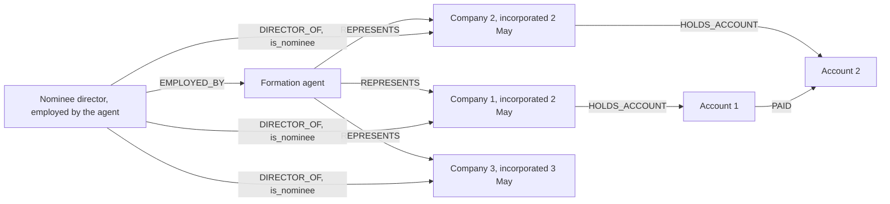

# Companies clustered around one formation agent

> **Draft.** Slug `formation_agent_cluster`, version 0.1.0, tier `extended`, synthetic support `medium`. Definition file: [`detect/typologies/formation_agent_cluster.yaml`](../../detect/typologies/formation_agent_cluster.yaml). A typology researcher checks this page against its sources before the definition is approved.

A structure that matches this pattern is not evidence of money laundering or of any other wrongdoing. There are ordinary reasons for almost every pattern described here; the [standing disclaimer](../wording.md#disclaimers) applies to everything NeonRadar shows.

NeonRadar starts from this position (PHASE-1.md 7.2): company formation is a lawful business, and most companies an agent forms are ordinary. This explainer names no real formation agent, firm or address, and none should be added. A cluster around an agent describes the agent's client list, not the agent's conduct.

## What it is

A formation agent forms companies for clients. It is one kind of trust and company service provider (TCSP): a business that, for third parties, forms legal persons, acts as or arranges directors and secretaries, provides a registered office or business address, and acts as or arranges nominee shareholders, among other services [fatf_glossary].

The typology is a group of companies formed through one agent that look alike in ways ordinary clients usually do not: they were incorporated in bursts, they share the agent's address and the same nominee directors or secretaries, and they pay each other. It shares signals with `shell_chain` (nominee directors) and `mass_registration_address` (a shared address).

What the sources found:

- In about 150 grand corruption cases reviewed by the Puppet Masters study, where ownership information was available, the corporate vehicle was in the vast majority of cases "established or managed by a professional intermediary" [star_puppet_masters_2011] (p. 2). Interviews with TCSPs for that study "showed that it is not expensive or time-consuming to establish an anonymous shell corporation", with additional services such as "nominee director or shareholder arrangements, filing of any annual documentation, or phone and mail forwarding" [star_puppet_masters_2011] (p. 35).
- In the FATF and Egmont Group study of 106 cases, "The majority of the case studies involved professional intermediaries", and "approximately half of all intermediaries involved were assessed as having been complicit", which shows that "professionals can be unwitting or negligent in their involvement" [fatf_egmont_concealment_2018] (executive summary, paragraph 6).
- In that sample, TCSPs were the professionals most often involved in setting up legal persons, legal arrangements and bank accounts, yet they "appear less likely to be the architect of schemes designed to obscure beneficial ownership"; their role "is more likely to be transactional in nature, operating at the behest of a client or other intermediary" [fatf_egmont_concealment_2018] (executive summary, paragraph 6). "When multiple TCSPs were exploited in a single scheme, almost all of the cases involved TCSPs in multiple jurisdictions" [fatf_egmont_concealment_2018] (executive summary, paragraph 7).
- FATF found that TCSPs "have often been used, wittingly or unwittingly, in the conduct of money laundering activities" [fatf_tcsp_2010], building on its 2006 study of the misuse of corporate vehicles and the role of TCSPs [fatf_corporate_vehicles_2006].
- FinCEN notes that agents, also called intermediaries or nominee incorporation services, "can play a central role" in creating and maintaining shell companies, and that incorporators may "provide the shell company with nominees for all offices that appear in public records" [fincen_fin_2006_g014].

## How it looks in the graph

In NeonRadar's graph (the [C2 graph schema](../../contracts/C2-graph-schema.md)) the pattern is:

- one agent, a `:LegalEntity`, with outgoing `REPRESENTS` relationships (agent to client) to many companies; ICIJ intermediaries arrive with `role = 'intermediary'`;
- or many companies with `HAS_ADDRESS` (`role = 'registered'`) to the agent's `:Address`;
- `incorporation_date` values on those companies that fall in bursts;
- the same persons as directors or secretaries of many of them (`DIRECTOR_OF`, often with `is_nominee = true`), sometimes persons `EMPLOYED_BY` the agent;
- and, the decisive part, `PAID` between accounts held by those companies (`HOLDS_ACCOUNT`).

Without the payments, the graph shows only that one agent served many clients, which is what agents do.

## Red flags the sources list

From the FATF and Egmont Group indicators of concealed beneficial ownership [fatf_egmont_concealment_2018] (Annex E; the list "is not exhaustive"):

- "employees of professional intermediary firms acting as nominee directors and shareholders" (indicator 7);
- formal nominees, who "may be 'mass' nominees who are nominated agents for a large number of shell companies" (indicator 10);
- "the resignation and replacement of directors or key shareholders shortly after incorporation" (indicator 7);
- "Address of mass registration (usually the address of a TCSP that manages a number of shell companies on behalf of its customers)" (indicator 11);
- a transaction that "involves two legal persons with similar or identical directors, shareholders, or beneficial owners" (indicator 22);
- individuals or legal persons who "request the formation of complex company structures without sufficient business rationale" (indicator 6).

FinCEN adds "Multiple high-value payments or transfers between shell companies with no apparent legitimate business purpose" [fincen_fin_2006_g014].

A red flag is a reason to look closer, not evidence; see [wording](../wording.md), documentation rule 5.

## Typical false positives

NeonRadar's catalog lists these look-alikes:

- formation agents and corporate service firms forming companies for many unrelated, ordinary clients;
- a corporate group setting up several subsidiaries at once through one agent;
- ready-made companies formed in batches and kept in stock for later sale: service providers "may hold a stock of shelf companies, purchased in bulk from a company wholesaler" [star_puppet_masters_2011] (p. 38);
- professional directors and company secretaries who hold many appointments.

The FATF and Egmont Group found TCSPs less likely to design schemes than to carry out a client's instructions [fatf_egmont_concealment_2018] (executive summary, paragraph 6), and most shell companies are formed for legitimate purposes [fincen_fin_2006_g014]. NeonRadar therefore treats a large client list as the normal state of a formation agent, not as a signal.

## Can synthetic data show it?

Partly. Synthetic support is `medium`. The generator can create synthetic agents, incorporation bursts, shared nominee directors and payments among client companies. What it cannot easily get right is the background: how many ordinary companies a real agent forms, how often its clients share directors, and how often they trade with each other. Without realistic base rates, a detector would flag every busy agent. The generator must therefore make most companies of every synthetic agent ordinary, and document its assumptions.

Planted scenarios use only synthetic agents, companies and people (ids that start with `syn-`). Real agents and intermediaries, for example those in the ICIJ Offshore Leaks Database or in company registers, never receive a scenario role (guardrail G1 in [PHASE-1.md](../build/PHASE-1.md) section 2.1); on real data, NeonRadar can only show how many companies an agent is linked to.

## Starting parameters

None in the definition file yet, and PHASE-1.md 7.2 gives no default values. A detector would need at least: the smallest number of companies linked to one agent, how close together incorporation dates must be to count as a burst, how many directors they must share, and the time window for payments among them. The typology researcher sets the starting values; they are project choices, not facts from the sources.

## Open questions

- The FATF 2010 TCSP study and the 2006 corporate vehicles study could not be opened by the build (fatf-gafi.org blocks automated clients); the statements citing them follow the research note `docs/research/2026-10-16/aml-domain.md` and the bibliography notes. Check them in a browser; quote the 2006 study only after a manual download.
- Which sources NeonRadar loads in Phase 2 record the agent that formed a company (beyond ICIJ intermediaries) is not settled; without that link, the address and shared-director signals carry the pattern.
- The Annex E, executive summary, FinCEN and Puppet Masters quotes were checked against the sources on 21 October 2026.

## Sources

- [fatf_corporate_vehicles_2006] FATF, *The Misuse of Corporate Vehicles, Including Trust and Company Service Providers*, 2006. <https://fatf-gafi.org/content/dam/fatf-gafi/reports/Misuse%20of%20Corporate%20Vehicles%20including%20Trusts%20and%20Company%20Services%20Providers.pdf.coredownload.inline.pdf>
- [fatf_egmont_concealment_2018] FATF and Egmont Group, *Concealment of Beneficial Ownership*, 2018. <https://www.fatf-gafi.org/en/publications/Methodsandtrends/Concealment-beneficial-ownership.html>
- [fatf_glossary] FATF, *FATF Glossary (web version of the General Glossary)*, living document. <https://www.fatf-gafi.org/glossary/>
- [fatf_tcsp_2010] FATF, *Money Laundering Using Trust and Company Service Providers*, 2010. <https://www.fatf-gafi.org/en/publications/Methodsandtrends/Moneylaunderingusingtrustandcompanyserviceproviders.html>
- [fincen_fin_2006_g014] FinCEN, *FinCEN Guidance FIN-2006-G014: Potential Money Laundering Risks Related to Shell Companies*, 2006. <https://www.fincen.gov/resources/statutes-regulations/guidance/potential-money-laundering-risks-related-shell-companies>
- [star_puppet_masters_2011] StAR (World Bank and UNODC), *The Puppet Masters: How the Corrupt Use Legal Structures to Hide Stolen Assets and What to Do About It*, 2011. <https://star.worldbank.org/sites/star/files/puppetmastersv1.pdf>
