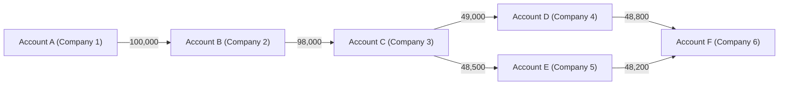

# Layering through chains of transfers

> **Draft.** Slug `layering_chain`, version 0.1.0, tier `core`, synthetic support `high`. Definition file: [`detect/typologies/layering_chain.yaml`](../../detect/typologies/layering_chain.yaml). A typology researcher checks this page against its sources before the definition is approved.

A structure that matches this pattern is not evidence of money laundering or of any other wrongdoing. There are ordinary reasons for almost every pattern described here; the [standing disclaimer](../wording.md#disclaimers) applies to everything NeonRadar shows.

## What it is

Money laundering is often described in three stages: placement, layering and integration [fatf_faq] (see the [glossary](../glossary.md)). Layering is the middle stage, in which the funds go through "a series of conversions or movements of the funds to distance them from their source" [fatf_faq]. Europol uses the same three stages and calls them "a simplified representation of a more complex reality" [europol_efecta_2023].

A layering chain is NeonRadar's simplest picture of that stage: money passes from account to account, each held by a different company or person, until the link to where it started is hard to follow. The FATF describes "proxy networks" run by professional money launderers that "consist of multiple layers of shell companies in different jurisdictions" [fatf_pml_2018]. In those networks, "The funds from different clients are mixed within the same accounts" [fatf_pml_2018]. The report also notes that "Bank accounts are chosen to make the activity appear legitimate, and to avoid suspicious transactions reporting" [fatf_pml_2018].

Europol reports that "Multiple layers of shell companies set up in various jurisdictions, sometimes offshore" are "regularly used for money laundering" [europol_efecta_2023]. The FATF and Egmont Group found that more than half of the case studies they analysed "made use of complicated ownership structures", and that more companies and more countries make timely identification harder [fatf_egmont_concealment_2018].

## How it looks in the graph

In NeonRadar's graph (the C2 contract, `contracts/C2-graph-schema.md`), every bank account is an `:Account` node and every payment is a `PAID` relationship between two accounts, with an `amount`, a `currency` and a timestamp `ts`. People and companies (`:LegalEntity` nodes) hold accounts through `HOLDS_ACCOUNT`, and companies can share an address (`HAS_ADDRESS`), an agent (`REPRESENTS`) or a director (`DIRECTOR_OF`).

The pattern is a path of payments:

- three or more `PAID` hops in time order, each through an account held by a different `:LegalEntity`;
- short dwell times: each account passes the money on soon after it arrives;
- amounts that shrink a little at each hop, or that are split into several payments and merged again;
- accounts in the middle whose holders have little other activity, such as no payroll or supplier payments;
- often, holders in the middle that share a registered address, an agent or a director.

NeonRadar assumes that the last point is what sets a chain apart from ordinary commerce (project assumption). Typologies planned for the catalog (PHASE-1.md 7.2) describe those shared links: `mass_registration_address`, `formation_agent_cluster`, `recycled_directors` and `shell_chain`.

What the graph cannot show: the information that travels with a real payment. The Wolfsberg Group's payment transparency standards expect originator and beneficiary information to travel with a payment along the chain, with the "entity initiating the payment flow" carrying "the primary obligation to ensure transparency" [wolfsberg_payment_transparency_2023]. NeonRadar's `PAID` relationship keeps no originator or beneficiary details: only the two accounts, the amount, the currency, the time, the channel and an optional purpose.

## Red flags the sources list

- "Multiple high-value payments or transfers between shell companies with no apparent legitimate business purpose" [fincen_fin_2006_g014].
- "Payments have no stated purpose, do not reference goods or services" [fincen_fin_2006_g014].
- "Frequent involvement of beneficiaries located in high-risk, offshore financial centers" [fincen_fin_2006_g014].
- Companies that "receive large sums of capital funding quickly following incorporation/formation", which is then "spent or transferred elsewhere in a short period of time without commercial justification" [fatf_egmont_concealment_2018].

A red flag is a reason to look closer, not evidence. The FFIEC says its red flags "are not all-inclusive" and warns that a red flag alone does not prove criminal activity [ffiec_appendix_f]. FinCEN itself notes that "Most shell companies are formed by individuals and businesses for legitimate purposes" [fincen_fin_2006_g014].

## Typical false positives

Long payment chains also occur in ordinary business. The definition file and the project's look-alike list (PHASE-1.md 7.2) name these:

- **Intra-group treasury flows.** Companies in one group pass cash between them.
- **Multi-tier supply chains.** Each supplier pays the next, and each tier adds its margin.
- **Correspondent banking hops.** A cross-border payment can pass through intermediary banks (see "correspondent banking" in the [glossary](../glossary.md)).
- **Fund-of-funds and securitisation structures.** Money passes through several vehicles by design.

What separates the pattern from these is the context around the chain: whether the companies in the middle trade, employ people and pay suppliers, and whether they share an address, an agent or a director.

## Can synthetic data show it?

Yes. The synthetic support is `high` (PHASE-1.md 7.2). A chain is defined by accounts, amounts and times, which the generator controls, and planted chains run only among synthetic entities (guardrail G1).

Realism needs more than payments. A chain looks like a layering chain mainly because of the companies around it: who owns them, where they are registered and who directs them. The Phase 3 generator should therefore create the company layer (companies, agents, addresses, directors) together with the payments, and also generate the look-alikes above. Detection rates measured on synthetic data say nothing about how NeonRadar would perform on real data (README, Limitations).

## Starting parameters

None in the definition file yet, and PHASE-1.md 7.2 gives no default values. A detector would need at least: the smallest number of hops (the pattern says three), the longest dwell time per hop, the time window for the whole chain, how much the amount may shrink per hop, and a measure of "little other activity" for the holders in the middle. The typology researcher sets the starting values.

## Open questions

- The research note says that public transaction generators produce chain and stacked-layer patterns. Those generators have no bibliography entry, so the claim is left out.
- For the typology researcher: whether split-and-merge paths (a narrow graph rather than a single path) belong to this typology or to a variant, and whether shared address, agent or director links are required or only strengthen a match.

## Sources

- [europol_efecta_2023] Europol, *European Financial and Economic Crime Threat Assessment 2023: The Other Side of the Coin*, 2023. <https://www.europol.europa.eu/cms/sites/default/files/documents/The%20Other%20Side%20of%20the%20Coin%20-%20Analysis%20of%20Financial%20and%20Economic%20Crime%20(EN).pdf>
- [fatf_egmont_concealment_2018] FATF and Egmont Group, *Concealment of Beneficial Ownership*, 2018. <https://www.fatf-gafi.org/en/publications/Methodsandtrends/Concealment-beneficial-ownership.html>
- [fatf_faq] FATF, *Frequently asked questions: How is money laundered?*, living document. <https://www.fatf-gafi.org/en/pages/frequently-asked-questions.html>
- [fatf_pml_2018] FATF, *Professional Money Laundering*, 2018. <https://www.fatf-gafi.org/content/dam/fatf-gafi/reports/Professional-Money-Laundering.pdf.coredownload.pdf>
- [ffiec_appendix_f] FFIEC, *BSA/AML Examination Manual, Appendix F: Money Laundering and Terrorist Financing Red Flags*, living document. <https://bsaaml.ffiec.gov/manual/Appendices/07>
- [fincen_fin_2006_g014] FinCEN, *FinCEN Guidance FIN-2006-G014: Potential Money Laundering Risks Related to Shell Companies*, 2006. <https://www.fincen.gov/resources/statutes-regulations/guidance/potential-money-laundering-risks-related-shell-companies>
- [wolfsberg_payment_transparency_2023] Wolfsberg Group, *Wolfsberg Group Payment Transparency Standards 2023*, 2023. <https://wolfsberg-group.org/news/50>
