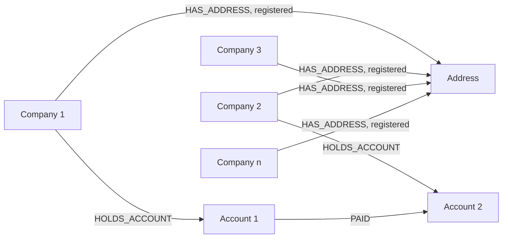

# Mass registration addresses

> **Draft.** An AI agent wrote this explainer from the sources listed at the end; a person has not yet checked it against them. Typology file: [`detect/typologies/mass_registration_address.yaml`](../../detect/typologies/mass_registration_address.yaml) (slug `mass_registration_address`, tier `core`, status `draft`). A pattern match is not evidence of money laundering or of any other wrongdoing; see [wording](../wording.md).

This explainer names no real address, agent or firm, and none should be added. Many lawful businesses exist to give companies a registered address. In entity-facing text, NeonRadar says only what the data shows, for example "shares a registered address with 14 other companies" ([wording](../wording.md)).

## What it is

Many companies list the same address as their registered address. The FATF and Egmont Group indicators of concealed beneficial ownership call this an "Address of mass registration (usually the address of a TCSP that manages a number of shell companies on behalf of its customers)" [fatf_egmont_concealment_2018] (Annex E, indicator 11).

A trust and company service provider (TCSP) is a business that, for third parties, forms companies, acts as or arranges directors and secretaries, and provides a registered office or business address, among other services [fatf_glossary]. So a crowded address is usually the address of a TCSP [fatf_egmont_concealment_2018], a business whose services include providing addresses [fatf_glossary]. FATF found that TCSPs "have often been used, wittingly or unwittingly, in the conduct of money laundering activities" [fatf_tcsp_2010]; that is a statement about how a service can be misused, not about any provider.

The address alone says little. FinCEN's indicator joins it to payments: "Transacting businesses share the same address, provide only a registered agent's address" [fincen_fin_2006_g014]. Companies that share an address and also pay each other are a more specific pattern than a crowded address.

## How it looks in the graph

In NeonRadar's graph (the [C2 graph schema](../../contracts/C2-graph-schema.md)) the pattern is:

- an `:Address` with many incoming `HAS_ADDRESS` relationships whose `role` is `registered` (the threshold is a parameter);
- stronger when companies registered at that address pay each other: `PAID` between accounts they hold through `HOLDS_ACCOUNT`;
- stronger again when those companies also share directors (see the typology `recycled_directors`) or were formed through the same agent (see `formation_agent_cluster`).

Two practical limits:

- **Address matching.** A cluster is only as good as the address matching behind it. In Phase 1, NeonRadar does not yet compute the normalised `address_key` (Phase 2 adds it, C2 graph schema), so the same building written two ways counts as two addresses, and a normalisation mistake can merge different buildings.
- **Type of premises.** The sources stress an address that does not fit the company, such as a residential building or a post box (see the red flags). C2 has no property for the type of premises, so a detector can count companies at an address but cannot yet compare that count with what the premises could plausibly hold.

The threshold for "many" is a project choice that the typology researcher sets, not a figure from the sources.

## Red flags from the sources

From the FATF and Egmont Group indicators [fatf_egmont_concealment_2018] (Annex E; the list "is not exhaustive"):

- legal persons "registered at an address that is also listed against numerous other companies or legal arrangements, indicating the use of a mailbox service" (indicator 4);
- legal persons "registered at an address that does not match the profile of the company" (indicator 4);
- "Address of mass registration (usually the address of a TCSP that manages a number of shell companies on behalf of its customers)" (indicator 11);
- "Only a post-box address (often used in the absence of professional TCSP services and in conjunction with informal nominees)" (indicator 12).

The FATF and Egmont Group trade-based indicators include "A trade entity is registered at an address that is likely to be a mass registration address", with a high-density residential building or a post-box address as examples [fatf_egmont_tbml_indicators_2021]. FinCEN lists "Transacting businesses share the same address, provide only a registered agent's address" [fincen_fin_2006_g014].

A red flag is a reason to look closer, not evidence; see [wording](../wording.md), documentation rule 5.

## Typical false positives

NeonRadar's catalog lists these look-alikes:

- registered agents and corporate service firms, whose service is to provide a registered office [fatf_glossary];
- serviced offices and business centres;
- law and accounting firms that act as registered office for their clients;
- clusters created by address normalisation errors, such as a missing unit number or two transliterations of the same street;
- errors in the source register: the Puppet Masters study notes that "virtually all company registry information is unverified information" [star_puppet_masters_2011] (p. 156).

Most shell companies are formed for legitimate purposes [fincen_fin_2006_g014], and NeonRadar's standing disclaimer names shared registered agents among the legitimate reasons for the structures it shows ([wording](../wording.md)).

## Can synthetic data show it?

Yes, with a caveat. Synthetic support is `high`. Counting companies at an address is easy to generate and to detect. The caveat: the generator must include legitimate mass registration addresses, such as synthetic service providers with many ordinary client companies, at a realistic frequency. Otherwise a detector learns that "registered agent" means "finding", which is false and would be unfair to real firms if the project ever overlays registry data.

Planted scenarios use only synthetic addresses and companies (ids that start with `syn-`). A real address from a registry never receives a scenario role (guardrail G1 in [PHASE-1.md](../build/PHASE-1.md) section 2.1); on real data, NeonRadar can only say how many companies list an address.

## Open questions

- The quotes from the FATF trade-based indicators and the FATF 2010 TCSP study come from the research note `docs/research/2026-10-16/aml-domain.md` (checked 15 and 16 October 2026); the build could not reopen them (fatf-gafi.org blocks automated clients). Check them in a browser. The Annex E, FinCEN and Puppet Masters quotes were checked against the sources on 21 October 2026.
- Should a detector weigh the count of companies against the type of premises? That needs a property C2 does not have; the typology researcher decides whether to raise it for a later schema version.

## Sources

- [fatf_egmont_concealment_2018] FATF and Egmont Group, *Concealment of Beneficial Ownership*, 2018. <https://www.fatf-gafi.org/en/publications/Methodsandtrends/Concealment-beneficial-ownership.html>
- [fatf_egmont_tbml_indicators_2021] FATF and Egmont Group, *Trade-Based Money Laundering: Risk Indicators*, 2021. <https://www.fatf-gafi.org/en/publications/Methodsandtrends/Trade-based-money-laundering-indicators.html>
- [fatf_glossary] FATF, *FATF Glossary (web version of the General Glossary)*, living document. <https://www.fatf-gafi.org/glossary/>
- [fatf_tcsp_2010] FATF, *Money Laundering Using Trust and Company Service Providers*, 2010. <https://www.fatf-gafi.org/en/publications/Methodsandtrends/Moneylaunderingusingtrustandcompanyserviceproviders.html>
- [fincen_fin_2006_g014] FinCEN, *FinCEN Guidance FIN-2006-G014: Potential Money Laundering Risks Related to Shell Companies*, 2006. <https://www.fincen.gov/resources/statutes-regulations/guidance/potential-money-laundering-risks-related-shell-companies>
- [star_puppet_masters_2011] StAR (World Bank and UNODC), *The Puppet Masters: How the Corrupt Use Legal Structures to Hide Stolen Assets and What to Do About It*, 2011. <https://star.worldbank.org/sites/star/files/puppetmastersv1.pdf>
