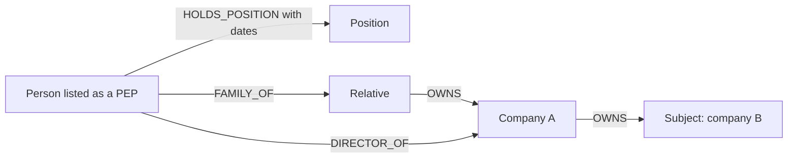

# Exposure to politically exposed persons through ownership, control, family or associates

> **Draft.** Slug `pep_exposure`, version 0.1.0, tier `extended`, synthetic support `high`. Definition file: [`detect/typologies/pep_exposure.yaml`](../../detect/typologies/pep_exposure.yaml). A typology researcher checks this page against its sources before the definition is approved. Research entry: `docs/research/2026-10-16/aml-domain.md`, section 2 (i).

A structure that matches this pattern is not evidence of money laundering or of any other wrongdoing. There are ordinary reasons for almost every pattern described here; the [standing disclaimer](../wording.md#disclaimers) applies to everything NeonRadar shows.

Being a politically exposed person (PEP), a relative or close associate of one, or being linked to one, is not wrongdoing. FATF describes the PEP requirements as preventive and says they do not mean that every PEP is involved in wrongdoing [fatf_peps_2013]. This pattern describes a structure: a path from a person whom a source lists as a PEP or as a relative or close associate of one, to the subject. It never says that the listed person, the subject or anyone else did anything wrong. A PEP flag in NeonRadar says only what a source published (C2), and NeonRadar is not a compliance system.

## What it is

- **PEP.** A person who is or has been entrusted with a prominent public function by a country (a foreign or domestic PEP) or by an international organisation; the definition does not cover middle-ranking or more junior officials [fatf_glossary] [fatf_peps_2013].
- **RCA.** FATF Recommendation 12 also covers the family members and close associates of PEPs [fatf_recommendations_2026] [fatf_peps_2013]. NeonRadar writes RCA, short for relatives and close associates ([glossary](../glossary.md)). The wording of Recommendation 12 has not been re-checked against the June 2026 edition.
- **Exposure.** A company or person linked to a listed PEP or RCA through ownership, control, a directorship, family or a close association. NeonRadar shows the structure and nothing more.

Why structure matters to the sources:

- FATF's PEP guidance names the "use of corporate vehicles to obscure ownership by PEPs" as a red flag [fatf_peps_2013].
- The FATF and Egmont indicators of concealed beneficial ownership name "informal nominees, such as children, spouses, relatives or associates" [fatf_egmont_concealment_2018].

## How it looks in the graph

In the C2 graph schema ([contracts/C2-graph-schema.md](../../contracts/C2-graph-schema.md)):

- **The listed person.** A `:Person` with the `:PEP` flag (the record's `topics` contain `role.pep` or a sub-topic `role.pep.*`) or the `:RCA` flag (`role.rca` or `role.rca.*`). The office itself, where a source records it, is a `:Position` reached by a `HOLDS_POSITION` relationship, which carries `start_date`, `end_date` and `status`.
- **The path.** At most 4 hops (a starting point from PHASE-1.md 7.2, not a figure from the sources) through `FAMILY_OF`, `ASSOCIATE_OF`, `OWNS`, `CONTROLS` or `DIRECTOR_OF` to the subject. `FAMILY_OF` and `ASSOCIATE_OF` run from one person to another in the source's direction, so a detector reads them in either direction; `OWNS`, `CONTROLS` and `DIRECTOR_OF` run from the owner, controller or director toward the company.

**What an alert would show (Phase 3, if built).** One alert per listed person and subject, so that every metric is a single value (C4: [contracts/C4-alert.md](../../contracts/C4-alert.md)). Candidate metrics for the typology researcher: the number of hops on the shortest path, the number of paths, and counts of family, ownership, control and directorship links on the path. Metrics are numbers or codes; they never contain names. Entity-facing text uses the [7.1 vocabulary](../wording.md#vocabulary-for-entity-facing-text): "listed in <dataset> as a politically exposed person" or "as a relative or close associate of a politically exposed person", never "corrupt official".

## Red flags the sources list

| Red flag | Source | Visible in the C2 graph? |
|---|---|---|
| "use of corporate vehicles to obscure ownership by PEPs" | [fatf_peps_2013] | Partly: the `OWNS` and `CONTROLS` chain is visible; whether it hides ownership is not |
| Information from the PEP "inconsistent with public information, such as asset declarations and published official salaries" | [fatf_peps_2013] | No: declarations and salaries are not in the graph |
| Business with PEPs connected to higher-risk countries or sectors | [fatf_peps_2013] | Partly: `countries`, `jurisdiction` and `sector` are stored; risk ratings of countries and sectors are not |
| "informal nominees, such as children, spouses, relatives or associates" | [fatf_egmont_concealment_2018] | Partly: the `FAMILY_OF` or `ASSOCIATE_OF` link is visible; whether the relative or associate acts for someone else is not |
| "family members with no role or involvement in the running of the business" | [fatf_egmont_concealment_2018] | Partly: the family link is visible, the lack of a role is not |

A red flag is a reason to look closer, not evidence [ffiec_appendix_f].

## Typical false positives

The Phase 3 generator must produce these look-alikes (PHASE-1.md 7.2):

- **Same or similar names.** "Many people and entities have the same or similar names" [icij_faq]. Look-alike: synthetic people whose names are variants or near-matches of a listed synthetic person, but who are different people.
- **People long out of office.** The definition covers people who are or have been entrusted with a prominent public function [fatf_glossary]. A source may keep the flag after someone leaves office (real data can mark this with sub-topics such as `role.pep.frmr`). `HOLDS_POSITION` dates let a detector say how long ago. Look-alike: a synthetic former office holder whose position ended many years before the period analysed. How long PEP measures should last after someone leaves office is an open question below.
- **Ordinary family relationships.** Look-alike: relatives of a listed synthetic person who run ordinary businesses with no ownership, control or directorship link to the person.

On real data, once a licence allows it: OpenSanctions includes politically exposed persons among the entities it publishes and says that its label "entity of interest" "does not imply wrongdoing" [opensanctions_glossary].

## Can synthetic data show it?

Yes (synthetic support: high), and in Phase 1 only synthetic data shows it.

- **No real PEP data.** NeonRadar's planned source of PEP and RCA data is OpenSanctions, whose data is licence-gated: `docs/build/project.yaml` records `access.opensanctions: none`, the OpenSanctions spike refuses to run before making any request (M1.8d), and no row derived from OpenSanctions is ever committed (guardrail G2; [ADR-0006](../decisions/0006-data-licensing.md)).
- **Synthetic flags instead.** The Phase 3 generator would write synthetic `Person` records in the `nr_synthetic` dataset with the topic `role.pep` or `role.rca`, which set the `:PEP` and `:RCA` flags (C1 rule R9 allows synthetic records only the topics `sanction`, `role.pep` and `role.rca`), plus synthetic `Position` and `Occupancy` records, family and associate links, and ownership. Path counts and hop lengths would be known by construction, so every fixture would have a known right answer. The generator could also add identity noise: name variants and missing dates of birth.
- **Synthetic only.** Planted structures use synthetic entities only (guardrail G1): a synthetic listed person never owns, controls or directs a real registry company, and no real PEP name is attached to synthetic activity. Synthetic person names follow the name denylist in PHASE-1.md 7.1, and fixture names are checked before they are committed (operator decision OD-12).
- **No real offices.** A synthetic position must not identify a real person: an office that only one real person holds (the minister of a named ministry, for example) would point at that person whatever name the synthetic record carries. Synthetic positions use invented offices, and never pair a title that only one person holds with a real `Position.country` (see Open questions).

## Starting parameters

Starting points from PHASE-1.md 7.2 for the typology researcher, not facts from the sources:

- at most 4 hops from the listed person to the subject;
- the relationship types on the path: `FAMILY_OF`, `ASSOCIATE_OF`, `OWNS`, `CONTROLS` and `DIRECTOR_OF`;
- both flags, `:PEP` and `:RCA`, as start nodes.

The research note quotes no source on how long after leaving office a match should still count (Open questions).

## Open questions

For the typology researcher:

1. How long after leaving office a person should still be treated as a PEP. Check EU Directive 2015/849 Art. 22 and the FATF 2013 PEP guidance on how long PEP treatment lasts after leaving office; add bibliography entries if cited.
2. Confirm the wording of Recommendation 12 on family members and close associates in the June 2026 edition.
3. The 4-hop limit is a starting point from PHASE-1.md 7.2, not from a source.
4. Whether real-data sub-topics (for example `role.pep.frmr`) should change how a match is reported. Synthetic records carry only `role.pep` and `role.rca`.
5. How the generator names synthetic offices and the bodies that grant them, so that none matches a real office.
6. Real data, once a licence route allows OpenSanctions: a run would place real listed people next to real registry companies. Whether and how to run this typology on real data, and how such `structural_pattern` alerts are shown, is a question for the typology researcher and the data steward.

## Sources

- [fatf_egmont_concealment_2018] FATF and Egmont Group, *Concealment of Beneficial Ownership*, 2018. <https://www.fatf-gafi.org/en/publications/Methodsandtrends/Concealment-beneficial-ownership.html>
- [fatf_glossary] FATF, *FATF Glossary (web version of the General Glossary)*, living document. <https://www.fatf-gafi.org/glossary/>
- [fatf_peps_2013] FATF, *FATF Guidance: Politically Exposed Persons (Recommendations 12 and 22)*, 2013. <https://www.fatf-gafi.org/en/publications/Fatfrecommendations/Peps-r12-r22.html>
- [fatf_recommendations_2026] FATF, *International Standards on Combating Money Laundering and the Financing of Terrorism and Proliferation: The FATF Recommendations*, 2026. <https://www.fatf-gafi.org/en/publications/Fatfrecommendations/Fatf-recommendations.html>
- [ffiec_appendix_f] FFIEC, *BSA/AML Examination Manual, Appendix F: Money Laundering and Terrorist Financing Red Flags*, living document. <https://bsaaml.ffiec.gov/manual/Appendices/07>
- [icij_faq] ICIJ, *Offshore Leaks Database: frequently asked questions*, living document. <https://offshoreleaks.icij.org/pages/faq>
- [opensanctions_glossary] OpenSanctions, *OpenSanctions glossary*, living document. <https://www.opensanctions.org/docs/glossary>
