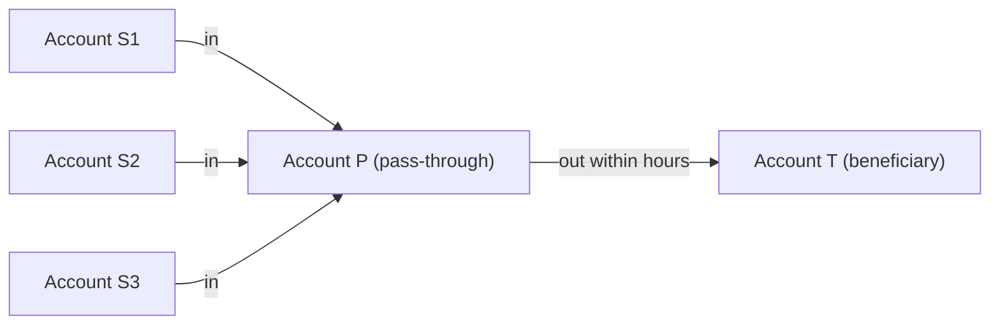

# Rapid pass-through (funnel or transit accounts)

> **Draft.** Slug `rapid_pass_through`, version 0.1.0, tier `core`, synthetic support `high`. Definition file: [`detect/typologies/rapid_pass_through.yaml`](../../detect/typologies/rapid_pass_through.yaml). A typology researcher checks this page against its sources before the definition is approved.

A structure that matches this pattern is not evidence of money laundering or of any other wrongdoing. There are ordinary reasons for almost every pattern described here; the [standing disclaimer](../wording.md#disclaimers) applies to everything NeonRadar shows.

## What it is

A pass-through account receives money and sends it on almost at once. Little money stays in it, so it works like a pipe rather than a place to keep money [fatf_egmont_tbml_indicators_2021]. The sources describe several versions of this shape.

- **Funnel accounts.** FinCEN describes a funnel account as "An individual or business account in one geographic area that receives multiple cash deposits", "often in amounts below the cash reporting threshold"; the funds are then withdrawn in a different geographic area, with "little time elapsing between the deposits and withdrawals" [fincen_fin_2014_a005].
- **Pay-through or transit accounts.** The trade-based money laundering indicators of the FATF and the Egmont Group list an account of a trade entity that "appears to be a 'pay-through' or 'transit' account", with funds moving through it quickly and little balance left at the end of the day [fatf_egmont_tbml_indicators_2021].
- **Transit companies.** The FATF and Egmont Group indicators of concealed beneficial ownership describe a company that "Exclusively facilitates transit transactions and does not appear to generate wealth or income" [fatf_egmont_concealment_2018].
- **Pass-through transactions in fraud cases.** A 2023 report by the FATF, INTERPOL and the Egmont Group describes fraud proceeds that are "rapidly layered through a series of 'pass-through' transactions", with "hopping through accounts across different financial, remittance or payment service providers" [fatf_cyber_fraud_2023].

## How it looks in the graph

In NeonRadar's graph (the C2 contract, `contracts/C2-graph-schema.md`), every bank account is an `:Account` node and every payment is a `PAID` relationship between two accounts, with an `amount`, a `currency`, a timestamp `ts` and a `channel` (for example `wire`, `cash_deposit` or `cash_withdrawal`). People and companies hold accounts through `HOLDS_ACCOUNT`.

The pattern centres on one `:Account`:

- money comes in through incoming `PAID` relationships, often from several accounts with no other link to each other;
- most of that money leaves again through outgoing `PAID` relationships within hours or a few days (the dwell time);
- the outgoing payments go to few beneficiaries;
- only a small residual stays behind, so the balance over time looks like a saw: up, then back to almost zero.

In the cash version (the funnel account), the incoming payments are cash deposits (`channel = 'cash_deposit'` from a branch's `cash_ledger` account) and the outgoing ones are withdrawals or transfers.

What the graph cannot show: a payment carries no place, so "deposited in one region, withdrawn in another" can only be estimated from the branches and holders involved. Nor does the graph know what activity to expect from an account holder; that needs the holder's type of business (the `sector` property of a company) and a profile of normal activity.

## Red flags the sources list

- "Almost immediately, all or most of the transfers or deposits are wired to another city or country" [ffiec_appendix_f].
- "Multiple accounts are used to collect and funnel funds to a small number of foreign beneficiaries" [ffiec_appendix_f].
- Deposits made "in a different geographic region from where the business operates" [fincen_fin_2014_a005].
- Debits that "do not appear to be related to the stated business activity of the account holder" [fincen_fin_2014_a005].
- Cheques "pre-signed but the payee and amount lines have been left blank" [fincen_fin_2014_a005].
- People making deposits who "may have no detailed knowledge" of the account [fincen_fin_2014_a005].

FinCEN warns that no single one of its red flags is conclusive [fincen_fin_2014_a005]. A red flag is a reason to look closer, not evidence. The FFIEC says its red flags "are not all-inclusive" and warns that a red flag alone does not prove criminal activity [ffiec_appendix_f].

## Typical false positives

Many lawful businesses exist to move other people's money quickly, and their accounts keep little balance by design. The definition file and the project's look-alike list (PHASE-1.md 7.2) name these:

- **Payment service providers and remittance aggregators**, which collect payments and pass them on.
- **Payroll bureaus**, which receive an employer's payroll and pay it out to staff.
- **Escrow and client accounts of law firms and estate agents**, which hold clients' money only until a deal completes.
- **Marketplace settlement accounts**, which collect buyers' payments and pay sellers.
- **Treasury sweep accounts**, which move a company's cash to a central account every day.

The flow shape alone cannot tell these apart from the pattern. What separates them is who holds the account and what activity to expect from it. A detector that sees only the shape will flag every intermediary.

## Can synthetic data show it?

Yes. The synthetic support is `high` (PHASE-1.md 7.2). Arrival times, departure times and amounts are all under the generator's control, so it can plant labelled pass-through accounts among synthetic entities only (guardrail G1).

Labelling is the harder part. The look-alikes above must be present in the synthetic population, with holders whose type of business is recorded, or a detector will learn to flag every account that moves money quickly. Detection rates measured on synthetic data say nothing about how NeonRadar would perform on real data (README, Limitations).

## Starting parameters

None in the definition file yet, and PHASE-1.md 7.2 gives no default values. A detector would need at least: the time window, the longest dwell time (hours to a few days), the largest residual share that may stay in the account, the smallest number of incoming accounts and the largest number of beneficiaries. The typology researcher sets the starting values.

## Open questions

- The research note summarises the FATF and Egmont Group indicator as a pay-through or transit account "with rapid movement and a small end-of-day balance". Only the words "pay-through" and "transit" are quoted from the source; the reviewer should confirm the rest against the indicator list.
- The research note says that public transaction generators produce a gather-scatter shape (many in, many out at one account). Those generators have no bibliography entry, so the claim is left out.
- For the typology researcher: the starting parameter values, and which holder attributes the Phase 3 generator must record so that payment service providers, payroll bureaus and client accounts can be told apart.

## Sources

- [fatf_cyber_fraud_2023] FATF, INTERPOL and Egmont Group, *Illicit Financial Flows from Cyber-Enabled Fraud*, 2023. <https://www.fatf-gafi.org/en/publications/Methodsandtrends/illicit-financial-flows-cyber-enabled-fraud.html>
- [fatf_egmont_concealment_2018] FATF and Egmont Group, *Concealment of Beneficial Ownership*, 2018. <https://www.fatf-gafi.org/en/publications/Methodsandtrends/Concealment-beneficial-ownership.html>
- [fatf_egmont_tbml_indicators_2021] FATF and Egmont Group, *Trade-Based Money Laundering: Risk Indicators*, 2021. <https://www.fatf-gafi.org/en/publications/Methodsandtrends/Trade-based-money-laundering-indicators.html>
- [ffiec_appendix_f] FFIEC, *BSA/AML Examination Manual, Appendix F: Money Laundering and Terrorist Financing Red Flags*, living document. <https://bsaaml.ffiec.gov/manual/Appendices/07>
- [fincen_fin_2014_a005] FinCEN, *FinCEN Advisory FIN-2014-A005: Update on U.S. Currency Restrictions in Mexico: Funnel Accounts and TBML*, 2014. <https://www.fincen.gov/resources/advisories/fincen-advisory-fin-2014-a005>
