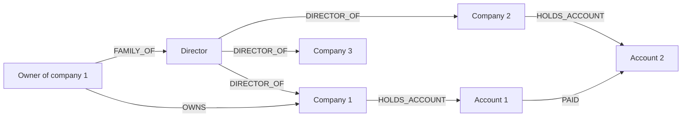

# Recycled and professional directors

> **Draft.** Slug `recycled_directors`, version 0.1.0, tier `extended`, synthetic support `high`. Definition file: `detect/typologies/recycled_directors.yaml`. A typology researcher checks this page against its sources before the definition is approved. Research entry: `docs/research/2026-10-16/aml-domain.md`, section 2 (h).

A structure that matches this pattern is not evidence of money laundering or of any other wrongdoing. There are ordinary reasons for almost every pattern described here; the [standing disclaimer](../wording.md#disclaimers) applies to everything NeonRadar shows. Among the legitimate reasons, the disclaimer names professional directors.

## What it is

A director is formally responsible for running a company. In this typology a few people (or companies) appear as directors of many companies at once, often for short periods, and the companies that share them pay each other. "Recycled" means the same names come back in company after company; "professional" means that someone acts as a director as a service.

Why the sources look at this:

- A nominee is a person who formally holds shares or a directorship for someone else whose identity is not disclosed [fatf_egmont_concealment_2018]. In the FATF and Egmont study of 106 cases, nominee arrangements "were identified in a large majority of case studies", and "The majority of the case studies involved professional intermediaries" [fatf_egmont_concealment_2018].
- Europol describes nominee directors as "strawmen that appear on the paperwork, but do not operate independently" [europol_shadow_money_2021].
- FinCEN notes that people who form companies may "provide the shell company with nominees for all offices that appear in public records" [fincen_fin_2006_g014].
- Nominees can be informal too: the FATF and Egmont indicators name "informal nominees, such as children, spouses, relatives or associates" [fatf_egmont_concealment_2018].
- Acting as a director or secretary of a company, or arranging for someone else to act as one, is one of the services in FATF's definition of a trust and company service provider (TCSP) [fatf_glossary]. FATF found that "TCSPs have often been used, wittingly or unwittingly, in the conduct of money laundering activities" [fatf_tcsp_2010]. FATF also lists TCSPs among the designated non-financial businesses and professions [fatf_glossary]: providing directors is a recognised business service, so this pattern also matches appointments made in the ordinary course of that business (see Typical false positives).

The research note treats shared registered addresses and recycled directors as one entry; NeonRadar splits them into this typology and `mass_registration_address` (PHASE-1.md 7.2). Related typologies: `shell_chain` (layered ownership with nominee directors) and `formation_agent_cluster` (companies clustered around one formation agent).

## How it looks in the graph

In the C2 graph schema ([contracts/C2-graph-schema.md](../../contracts/C2-graph-schema.md)):

- **Many directorships.** A `LegalEntity`, usually a `:Person`, with many outgoing `DIRECTOR_OF` relationships to `:Organization` nodes. `DIRECTOR_OF` can start at a company as well as a person, so corporate directors count too.
- **Bursts.** The `start_date` values of those appointments (and often the `end_date` values) cluster in short windows: many appointments that begin within days of each other and end together.
- **Family as directors.** A director linked by `FAMILY_OF` to a person who `OWNS` or `CONTROLS` the same company.
- **Payments between the companies.** `PAID` relationships between `Account` nodes held (`HOLDS_ACCOUNT`) by companies that share the director. Shared directors alone have many legitimate explanations (the standing disclaimer and Typical false positives); payments between the companies are what turn a list of appointments into a pattern worth a look.
- **Nominee status from the source.** Where a source records that a directorship is held by a nominee, C2 stores it as `DIRECTOR_OF.is_nominee`. When the source says nothing, the property is not set (C2 mapping decision 9), and NeonRadar never infers it.

**What an alert would say (Phase 3, if built).** One alert per director. Entity-facing text reports counts and dates in the [7.1 vocabulary](../wording.md#vocabulary-for-entity-facing-text), for example "director of 37 companies; 21 of these appointments started within 30 days; 4 pairs of these companies made payments to each other". It never calls a specific person a nominee or a strawman.

**Real registry data.** Companies House officers who are natural persons are real people, and their records are personal data ([ADR-0006](../decisions/0006-data-licensing.md)). On real registry data only the directorship part of the pattern comes from the source; any payment next to a real company is synthetic background activity (the real data notice in [docs/wording.md](../wording.md#disclaimers)), so the payment part says nothing about real companies. Count appointments by the source's officer identifier, not by name: "Many people and entities have the same or similar names" [icij_faq].

## Red flags the sources list

| Red flag | Source | Visible in the C2 graph? |
|---|---|---|
| Directors or owners who "are listed against the accounts of other legal persons or arrangements", "indicating the use of professional nominees" | [fatf_egmont_concealment_2018] | Yes: many `DIRECTOR_OF` or `OWNS` relationships from one node |
| "employees of professional intermediary firms acting as nominee directors and shareholders" | [fatf_egmont_concealment_2018] | Partly: `EMPLOYED_BY` to the firm, where a source records it |
| "agreements for nominee directors and shareholders" | [fatf_egmont_concealment_2018] | No: agreements are not in the graph; `is_nominee` only where the source sets it |
| "informal nominees, such as children, spouses, relatives or associates" | [fatf_egmont_concealment_2018] | Yes: `FAMILY_OF` or `ASSOCIATE_OF` from an owner to a director |
| "family members with no role or involvement in the running of the business" as directors | [fatf_egmont_concealment_2018] | Partly: the family link is visible, the lack of a role is not |
| "Multiple high-value payments or transfers between shell companies with no apparent legitimate business purpose" | [fincen_fin_2006_g014] | Partly: payments are visible, their business purpose is not |

A red flag is a reason to look closer, not evidence [ffiec_appendix_f].

## Typical false positives

FinCEN notes that "Most shell companies are formed by individuals and businesses for legitimate purposes" [fincen_fin_2006_g014]. The Phase 3 generator must produce these look-alikes (PHASE-1.md 7.2) so that precision can be measured honestly:

- **Professional directors and company secretaries.** Providing directors and secretaries is a TCSP service [fatf_glossary]. Look-alike: the staff of a synthetic company service provider hold many directorships in client companies that do not pay each other.
- **Directors shared by the companies of one group.** Look-alike: a synthetic parent company and its subsidiaries share directors and pay each other within the group; `CONSOLIDATES` relationships from the parent let a detector tell a group from unrelated companies.
- **Investment fund and special purpose vehicle structures.** PHASE-1.md 7.2 lists professional directors in fund jurisdictions as a look-alike. Look-alike: one synthetic director sits on the boards of many synthetic fund vehicles. The research note says that this is normal in fund jurisdictions but gives no source for that sentence, so this page does not repeat it (see Open questions).
- **Name collisions.** Counting by name joins different people who share a name [icij_faq].

## Can synthetic data show it?

Yes (synthetic support: high). Directorships and their dates are structure that the generator controls, so it can plant bursts of appointments, family links and payments among synthetic companies, with a known right answer for the fixture tests. The hard part is the benign population: the generator must include professional directors, company service providers and corporate groups at a realistic frequency. Otherwise a detector learns that every professional director matches the pattern, which is wrong and would be unfair to real firms if NeonRadar is ever run on registry data. Planted scenarios use synthetic entities only (ids start with `syn-`, guardrail G1); a real registry entity never receives a scenario role.

## Starting parameters

The sources give no numbers, and PHASE-1.md 7.2 gives none either, so every value below is a starting point for the typology researcher to choose and document, not a fact from the sources:

- the minimum number of directorships held by one director, and whether ended appointments count;
- the burst window and the number of appointments that must start (or end) within it;
- the window for payments between companies that share the director.

## Open questions

For the typology researcher:

1. Thresholds: the minimum number of directorships, the burst window and the payment window. No source in the bibliography gives values.
2. The research note says that professional directors are normal in fund jurisdictions and that professional directors and corporate secretaries legitimately hold many appointments. Neither sentence has a source in the bibliography, so this page states only what the TCSP definition supports. Add a source, or keep the look-alike without the claim.
3. Whether alert text may show the source's own `is_nominee` value, and how, given that the text never calls a person a nominee.
4. Whether corporate directors (a company as director) are counted with natural persons or separately.
5. Whether the detector should run on real Companies House officers who are natural persons at all, given that it would single out real people by how many appointments they hold (personal data, ADR-0006), and if so how those `structural_pattern` alerts are shown. A question for the typology researcher and the data steward.
6. The base rate for the generator: how many directorships a typical synthetic director holds. Registry statistics would come from Companies House data (Phase 2) and may be used only as aggregates, never as rows about people.

## Sources

- [europol_shadow_money_2021] Europol, *Shadow Money - The International Networks of Illicit Finance*, 2021. <https://www.europol.europa.eu/cms/sites/default/files/documents/Shadow%20money%20%E2%80%93%20the%20international%20networks%20of%20illicit%20finance_PUBLIC_0.pdf>
- [fatf_egmont_concealment_2018] FATF and Egmont Group, *Concealment of Beneficial Ownership*, 2018. <https://www.fatf-gafi.org/en/publications/Methodsandtrends/Concealment-beneficial-ownership.html>
- [fatf_glossary] FATF, *FATF Glossary (web version of the General Glossary)*, living document. <https://www.fatf-gafi.org/glossary/>
- [fatf_tcsp_2010] FATF, *Money Laundering Using Trust and Company Service Providers*, 2010. <https://www.fatf-gafi.org/en/publications/Methodsandtrends/Moneylaunderingusingtrustandcompanyserviceproviders.html>
- [ffiec_appendix_f] FFIEC, *BSA/AML Examination Manual, Appendix F: Money Laundering and Terrorist Financing Red Flags*, living document. <https://bsaaml.ffiec.gov/manual/Appendices/07>
- [fincen_fin_2006_g014] FinCEN, *FinCEN Guidance FIN-2006-G014: Potential Money Laundering Risks Related to Shell Companies*, 2006. <https://www.fincen.gov/resources/statutes-regulations/guidance/potential-money-laundering-risks-related-shell-companies>
- [icij_faq] ICIJ, *Offshore Leaks Database: frequently asked questions*, living document. <https://offshoreleaks.icij.org/pages/faq>
