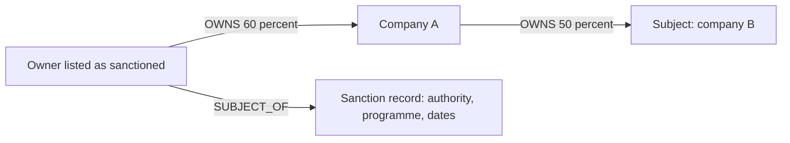

# Sanctions exposure through indirect ownership or control

> **Draft.** Slug `sanctions_exposure`, version 0.1.0, tier `core`, synthetic support `high`. Definition file: [`detect/typologies/sanctions_exposure.yaml`](../../detect/typologies/sanctions_exposure.yaml). A typology researcher checks this page against its sources before the definition is approved. Research entry: `docs/research/2026-10-16/aml-domain.md`, section 2 (i).

A structure that matches this pattern is not evidence of money laundering or of any other wrongdoing. There are ordinary reasons for almost every pattern described here; the [standing disclaimer](../wording.md#disclaimers) applies to everything NeonRadar shows.

This pattern describes a structure: an ownership or control path from a party that a source lists as sanctioned to a company that is not listed. It never says that the subject, the listed party or anyone else breached a sanction or did anything wrong. Being owned, controlled or directed by a party that a source lists as sanctioned, or being linked to one, is not in itself wrongdoing. A sanctions flag in NeonRadar says only what a source published (C2). NeonRadar is not a sanctions screening or compliance system, and this page is not legal advice.

## What it is

Authorities such as the United States Treasury's Office of Foreign Assets Control (OFAC) list people and companies whose property is blocked [ofac_50_percent_2014]. A company that is not on any list can still be owned or controlled by one that is, directly or through a chain of other companies. This typology finds those chains.

Why the sources look at this:

- **Ownership by listed parties.** Under OFAC's guidance, when blocked persons own 50 percent or more of an entity in the aggregate, "The property and interests in property of such an entity are blocked", "regardless of whether the entity itself is listed" [ofac_50_percent_2014]. How the test treats ownership held through other companies is a reading the typology researcher has yet to confirm (Open question 1). This is a United States rule; NeonRadar uses it to illustrate why indirect ownership matters, not as a test it applies.
- **Control without ownership.** The same guidance tells US persons to "act with caution when considering a transaction with a non-blocked entity" that blocked persons "may control by means other than a majority ownership interest" [ofac_50_percent_2014].
- **Looking through to people.** FATF's beneficial owner is "the natural person(s) who ultimately owns or controls a customer", including "those natural persons who exercise ultimate effective control over a legal person" [fatf_glossary]. Revised Recommendation 24 requires authorities to have access to "adequate, accurate and up-to-date information on the true owners of companies" [fatf_bo_legal_persons_2023]. In NeonRadar terms, only a natural person can be a beneficial owner; a company in the chain is a legal or intermediate owner ([glossary](../glossary.md)).
- **Hiding ownership.** FATF's 2025 report on proliferation financing and sanctions evasion describes four typologies, among them the use of intermediaries and "Obscuring beneficial ownership information to access the financial system" [fatf_pf_sanctions_evasion_2025]. In the FATF and Egmont case studies, legal persons, "principally shell companies, are a key feature in schemes designed to disguise beneficial ownership" [fatf_egmont_concealment_2018].

## How it looks in the graph

In the C2 graph schema ([contracts/C2-graph-schema.md](../../contracts/C2-graph-schema.md)):

- **The listed party.** An `:Entity` with the `:Sanctioned` flag. The loader sets it only when the record's `topics` include the value `sanction` itself; the related topics `sanction.linked`, `sanction.control` and `sanction.counter` do not set it. The listing itself is a `:Sanction` node, reached by `SUBJECT_OF`, with `authority`, `program`, `start_date` and `end_date` as the source published them.
- **The ownership path.** `OWNS` relationships from the listed party down to the subject, at most 6 hops (a starting point from PHASE-1.md 7.2, not a figure from the sources). Each `OWNS` carries a share band, `share_pct_min` to `share_pct_max`, so a source that gives a range rather than an exact figure is stored as it is.
- **Control on the way.** OFAC tells US persons to act with caution where blocked persons may control an entity by means other than majority ownership [ofac_50_percent_2014]. NeonRadar treats `CONTROLS` and `DIRECTOR_OF` relationships on the path as such control links, even where ownership is small or absent; that is a modelling choice from PHASE-1.md 7.2, not a statement of the sources.

**Effective share, a teaching metric.** For each listed owner, the effective share in the subject is the sum, over every ownership path from the owner to the subject, of the product of the shares along that path. Computing it once with `share_pct_min` and once with `share_pct_max` gives a range. In the picture, the listed owner's effective share in company B is 60 percent times 50 percent, which is 30 percent. A path with a hop that has no recorded share gives an unknown effective share, not zero.

**Why the effective share is not the OFAC test.** PHASE-1.md 7.2 reads the OFAC guidance [ofac_50_percent_2014] in two ways that the typology researcher has yet to confirm against the examples in the guidance (Open question 1):

1. The rule aggregates all blocked owners. Two listed owners that each hold 25 percent of a company together hold 50 percent, which meets the aggregate test, although each one's own share is only 25 percent.
2. An entity owned 50 percent or more by blocked persons is itself treated as blocked, so its holdings count in full rather than being multiplied down [ofac_50_percent_2014] (unconfirmed). In the picture, the listed owner holds 60 percent of company A, so A would be treated as blocked, and A's 50 percent of company B would then count in full. The multiplied 30 percent understates that result. An OFAC-style flag must therefore pass blocked status down the chain, from owner to owned entity, toward the subject. Like the effective share, an OFAC-style result is a teaching illustration: NeonRadar never presents it as a legal finding.

**What an alert would show (Phase 3).** One alert per listed owner, so that every metric is a single value (C4: [contracts/C4-alert.md](../../contracts/C4-alert.md)). Candidate metrics for the typology researcher: the number of `OWNS` hops on the shortest path, the number of paths, the effective share range (`effective_share_min`, `effective_share_max`) and the number of control links. Metrics are numbers or codes; they never contain names. Entity-facing text uses the [7.1 vocabulary](../wording.md#vocabulary-for-entity-facing-text): "listed in <dataset> as sanctioned", never "sanctioned criminal".

## Red flags the sources list

The sources give rules, typologies and indicators; the first column says which each item is.

| Rule, typology or indicator | Source | Visible in the C2 graph? |
|---|---|---|
| Rule: a non-listed entity owned 50 percent or more, in the aggregate, by blocked persons has its property blocked | [ofac_50_percent_2014] | Partly: `OWNS` paths from `:Sanctioned` nodes; whether a listing is an OFAC blocking depends on the `:Sanction` node's `authority` and `program` |
| Caution: control "by means other than a majority ownership interest" | [ofac_50_percent_2014] | Partly: `CONTROLS` and `DIRECTOR_OF`, where a source records them |
| Typologies: "Obscuring beneficial ownership information to access the financial system"; use of intermediaries | [fatf_pf_sanctions_evasion_2025] | Partly: long ownership chains and intermediate companies |
| Indicators: use of shell companies, and IP addresses inconsistent with a customer's stated location | [fatf_pf_sanctions_evasion_2025] | Partly: intermediate companies are visible, IP addresses are not |
| Indicator: "informal nominees, such as children, spouses, relatives or associates" | [fatf_egmont_concealment_2018] | Partly: the `FAMILY_OF` or `ASSOCIATE_OF` link is visible; whether the relative or associate acts for someone else is not |

A red flag is a reason to look closer, not evidence [ffiec_appendix_f].

## Typical false positives

The Phase 3 generator must produce these look-alikes (PHASE-1.md 7.2):

- **Name-matching errors.** "Many people and entities have the same or similar names" [icij_faq]. Once entity resolution (Phase 2) joins list records to registry records, a wrong match would put a flag next to the wrong company. Look-alike: synthetic owners whose names are variants or near-matches of a listed synthetic party, but who are different entities.
- **Minority stakes.** The OFAC rule concerns ownership of 50 percent or more in the aggregate [ofac_50_percent_2014]. Shares multiplied along a long chain become small; a small effective share is a model quantity, not a legal finding. Look-alike: a listed party with a small stake somewhere up a chain.
- **Listings that ended.** A `:Sanction` node carries `start_date` and `end_date`. A detector checks the dates as well as the flag. Look-alike: an owner whose synthetic listing ended years before the period analysed.
- **Widely spread shareholding.** Look-alike: a company owned by many small shareholders, one of them listed.
- **Lawful state ownership.** Look-alike: companies owned by a synthetic public body (`:PublicBody`) with no flag, so that state ownership alone is never treated as exposure.

On real data, once a licence allows it: OpenSanctions also includes people and companies that are not sanctioned; it says that its label "entity of interest" "does not carry a specific legal meaning, and does not imply wrongdoing" [opensanctions_glossary]. Only the exact topic `sanction` sets the `:Sanctioned` flag (C2).

## Can synthetic data show it?

Yes (synthetic support: high), and in Phase 1 only synthetic data shows it.

- **No real list data.** NeonRadar's planned source of sanctions lists is OpenSanctions, whose data is licence-gated: `docs/build/project.yaml` records `access.opensanctions: none`, the OpenSanctions spike refuses to run before making any request (M1.8d), and no row derived from OpenSanctions is ever committed (guardrail G2; [ADR-0006](../decisions/0006-data-licensing.md)).
- **Synthetic flags instead.** The Phase 3 generator would write synthetic `Person` and `Company` records in the `nr_synthetic` dataset with the topic `sanction`, which sets the `:Sanctioned` flag (C1 rule R9 allows synthetic records only the topics `sanction`, `role.pep` and `role.rca`), plus synthetic `Sanction` records linked with `SUBJECT_OF`. Synthetic `Sanction` records use invented authority and programme names, never a real authority's; Open question 5 settles the naming scheme.
- **Known answers.** Ownership chains with share bands are arithmetic that the generator would control, so every fixture would have a known effective share range and a known OFAC-style result. The generator could also add identity noise: name variants and missing dates of birth.
- **Synthetic only.** Planted structures use synthetic entities only (guardrail G1): a synthetic listed party never owns, controls or directs a real registry company, and no real sanctions-list name is attached to synthetic payments. The research note recommends that, if real list structure is ever needed to test name matching, it stays in a separate screening component that touches no synthetic activity.

## Starting parameters

Starting points from PHASE-1.md 7.2 for the typology researcher, not facts from the sources:

- at most 6 `OWNS` hops from the listed owner to the subject;
- the effective share computed twice, with `share_pct_min` and with `share_pct_max`, to give a range;
- `CONTROLS` and `DIRECTOR_OF` on the path counted as control links.

The research note quotes no source on a minimum effective share for an alert; the researcher chooses one, or none.

## Open questions

For the typology researcher:

1. Confirm both readings of the OFAC guidance against its examples: aggregation across blocked owners, and holdings of a blocked entity counting in full down the chain. Confirm too how the 50 percent test treats ownership held directly and through other companies; the research note does not quote the guidance's words on this.
2. Alerts are one per listed owner, so no single alert shows the aggregate across several owners. Decide whether Phase 3 adds a subject-level finding for the aggregate.
3. The 6-hop limit is a starting point from PHASE-1.md 7.2, not from a source.
4. How an alert reports a path with a hop that has no recorded share.
5. The naming scheme for the invented authority and programme names on synthetic `Sanction` records, so that none suggests that a real authority listed a synthetic party.
6. The research note quotes only the United States rule. Ownership and control tests of other regimes are not covered here and need sources before this page mentions them.
7. Real data, once a licence route allows OpenSanctions: a run would place real listed people and companies next to real registry companies. Whether and how to run this typology on real data, and how such `structural_pattern` alerts are shown, is a question for the typology researcher and the data steward.

## Sources

- [fatf_bo_legal_persons_2023] FATF, *Guidance on Beneficial Ownership of Legal Persons*, 2023. <https://www.fatf-gafi.org/en/publications/Fatfrecommendations/Guidance-Beneficial-Ownership-Legal-Persons.html>
- [fatf_egmont_concealment_2018] FATF and Egmont Group, *Concealment of Beneficial Ownership*, 2018. <https://www.fatf-gafi.org/en/publications/Methodsandtrends/Concealment-beneficial-ownership.html>
- [fatf_glossary] FATF, *FATF Glossary (web version of the General Glossary)*, living document. <https://www.fatf-gafi.org/glossary/>
- [fatf_pf_sanctions_evasion_2025] FATF, *Complex Proliferation Financing and Sanctions Evasion Schemes*, 2025. <https://www.fatf-gafi.org/en/publications/Financingofproliferation/complex-proliferation-financing-sanction-evasion-schemes.html>
- [ffiec_appendix_f] FFIEC, *BSA/AML Examination Manual, Appendix F: Money Laundering and Terrorist Financing Red Flags*, living document. <https://bsaaml.ffiec.gov/manual/Appendices/07>
- [icij_faq] ICIJ, *Offshore Leaks Database: frequently asked questions*, living document. <https://offshoreleaks.icij.org/pages/faq>
- [ofac_50_percent_2014] OFAC, US Treasury, *Revised Guidance on Entities Owned by Persons Whose Property and Interests in Property Are Blocked*, 2014. <https://ofac.treasury.gov/media/6186/download>
- [opensanctions_glossary] OpenSanctions, *OpenSanctions glossary*, living document. <https://www.opensanctions.org/docs/glossary>
