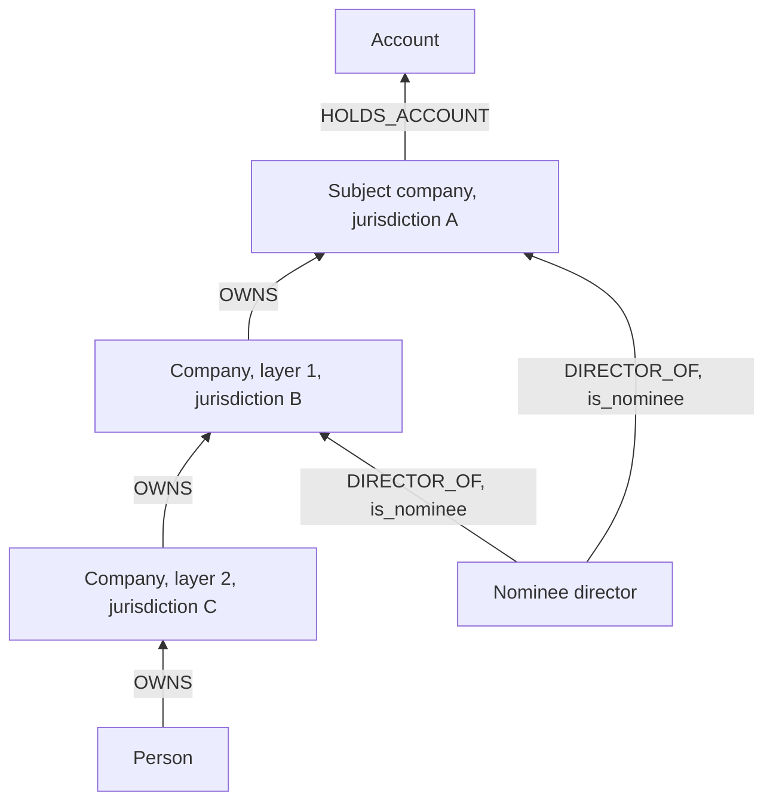

# Layered company ownership with nominee directors

> **Draft.** Slug `shell_chain`, version 0.1.0, tier `core`, synthetic support `medium`. Definition file: [`detect/typologies/shell_chain.yaml`](../../detect/typologies/shell_chain.yaml). A typology researcher checks this page against its sources before the definition is approved.

A structure that matches this pattern is not evidence of money laundering or of any other wrongdoing. There are ordinary reasons for almost every pattern described here; the [standing disclaimer](../wording.md#disclaimers) applies to everything NeonRadar shows.

This explainer uses the terms "shell company" and "nominee" to describe structures. Never use them as a label for a real, named company or person: describe the structure instead (documentation rule 4 in [wording](../wording.md)).

## What it is

Companies own other companies in several layers, often in different countries. The directors or shareholders on the public record are nominees who act for someone else. The natural person who controls the money, the beneficial owner, does not appear in any public record.

Two terms from the [glossary](../glossary.md):

- A **shell company** is an "incorporated company with no independent operations, significant assets, ongoing business activities, or employees" [fatf_egmont_concealment_2018] (executive summary, p. 5). FinCEN describes shell companies as "non-publicly traded corporations, limited liability companies (LLCs), and trusts that typically have no physical presence (other than a mailing address) and generate little to no independent economic value" [fincen_fin_2006_g014], and notes that "Most shell companies are formed by individuals and businesses for legitimate purposes" [fincen_fin_2006_g014].
- A **nominee** formally holds shares or a directorship for someone else, the nominator, whose identity is not disclosed [fatf_egmont_concealment_2018]. Europol describes nominee directors as "strawmen that appear on the paperwork, but do not operate independently and follow the instructions of the real owner" [europol_shadow_money_2021].

What the sources found:

- In 106 case studies, FATF and the Egmont Group found that "legal persons, principally shell companies, are a key feature in schemes designed to disguise beneficial ownership, while front companies and bearer shares are less frequently exploited" [fatf_egmont_concealment_2018] (executive summary, paragraph 3).
- "In a majority of cases, the beneficial owner used a combination of layering and direct ownership chains, as well as professional intermediaries and third parties exercising control on their behalf" [fatf_egmont_concealment_2018] (executive summary, paragraph 4).
- Nominee directors and shareholders "were identified in a large majority of case studies", although "the appointment of nominees is lawful in most countries" [fatf_egmont_concealment_2018] (executive summary, paragraph 5).
- In the vast majority of about 150 grand corruption cases reviewed by the Puppet Masters study, "a corporate vehicle was misused to hide the money trail", and the vehicle was "a company or corporation" [star_puppet_masters_2011] (p. 2). Shell companies used this way are "generally used in combination with additional mechanisms", including "adding layers of corporate vehicles" and placing the beneficial owners or their identifying information in another jurisdiction [star_puppet_masters_2011] (pp. 35 and 36).
- FinCEN describes incorporators who "provide the shell company with nominees for all offices that appear in public records" [fincen_fin_2006_g014].
- FATF found that trust and company service providers (TCSPs) "have often been used, wittingly or unwittingly, in the conduct of money laundering activities" [fatf_tcsp_2010], building on its 2006 study of the misuse of corporate vehicles [fatf_corporate_vehicles_2006].
- FATF's 2023 guidance explains how countries should put the revised Recommendation 24 on the beneficial ownership of legal persons into practice, including nominee arrangements and indirect ownership and control [fatf_bo_legal_persons_2023].

## How it looks in the graph

In NeonRadar's graph (the [C2 graph schema](../../contracts/C2-graph-schema.md)) the pattern is:

- an `OWNS` chain of two or more company layers above the subject, for example `(owner)-[:OWNS]->{2,6}(subject)`, often with companies in different `jurisdiction`s;
- a chain that ends at a `:Person`, at a company with no recorded owner, or loops back on itself;
- nominee directorships (`DIRECTOR_OF` with `is_nominee = true`), or directors with many appointments across unrelated companies (see the typology `recycled_directors`);
- companies in the chain that move money (`HOLDS_ACCOUNT` and `PAID`) but show no payroll or supplier payments;
- `CONTROLS` relationships, which give control without ownership.

## Red flags the sources list

From the FATF and Egmont Group indicators of concealed beneficial ownership [fatf_egmont_concealment_2018] (Annex E; the list "is not exhaustive"):

- "agreements for nominee directors and shareholders" (indicator 7);
- "employees of professional intermediary firms acting as nominee directors and shareholders" (indicator 7);
- formal nominees, who "may be 'mass' nominees who are nominated agents for a large number of shell companies", and "informal nominees, such as children, spouses, relatives or associates who do not appear to be involved in the running of the corporate enterprise" (indicator 10);
- a director, controlling shareholder or beneficial owner "listed against the accounts of other legal persons or arrangements, indicating the use of professional nominees" (indicator 4);
- "Complex corporate structures that do not appear to legitimately require that level of complexity or which do not make commercial sense" (indicator 8);
- "No real business activities undertaken", "No personnel (or only a single person as a staff member)" and "Does not have a physical presence" (indicators 13, 15 and 17);
- a transaction that "involves two legal persons with similar or identical directors, shareholders, or beneficial owners", or "the transfer of (bearer) shares in an off-market sale" (indicator 22).

FinCEN adds "Multiple high-value payments or transfers between shell companies with no apparent legitimate business purpose" [fincen_fin_2006_g014].

A red flag is a reason to look closer, not evidence. The Puppet Masters study warns that excessive complexity is a good red flag "but only if one has a good grasp on what constitutes 'excessive'" [star_puppet_masters_2011] (p. 55).

## Typical false positives

Layered ownership is normal. The Puppet Masters study says that chaining corporate vehicles together does not necessarily hide the beneficial owner, and gives state-owned structures, family businesses and listed groups with many subsidiaries as examples; for such structures the risk "will depend on where the corporate vehicle's assets come from and go to, on whose orders, and why" [star_puppet_masters_2011] (p. 55). It also shows a complex structure designed "to implement perfectly legitimate goals" [star_puppet_masters_2011] (p. 56, figure 3.1).

NeonRadar's catalog lists these look-alikes:

- holding companies and ordinary corporate groups;
- special purpose vehicles in securitisation and in aircraft or ship leasing;
- investment funds with corporate directors;
- joint ventures;
- start-ups that have not begun trading;
- professional directors in fund jurisdictions.

Most shell companies are formed for legitimate purposes, such as holding the stock or intangible assets of another business [fincen_fin_2006_g014], and appointing nominees is lawful in most countries [fatf_egmont_concealment_2018]. Structure alone cannot tell the typology apart from these look-alikes; NeonRadar treats a layered structure as a reason to look at the payments and the declared business, never as a finding on its own.

## Can synthetic data show it?

Partly. Synthetic support is `medium`. Ownership and directorship structures are easy to generate. Whether a structure is used to hide anyone depends on intent, which a generator can only assert by construction. The generator must therefore create a population of ordinary holding structures, groups and funds at a realistic rate, plant layered chains with nominee directors among them, and give the planted chains payments that match the indicators above.

Planted chains run only among synthetic entities (ids that start with `syn-`). Real companies and people from registries can receive synthetic background activity, never a scenario role (guardrail G1 in [PHASE-1.md](../build/PHASE-1.md) section 2.1). On real registry data, NeonRadar can show that a structure is layered; it never says why.

## Starting parameters

None in the definition file yet, and PHASE-1.md 7.2 gives no default values. A detector would need at least the smallest number of company layers and the longest chain to follow (NeonRadar's Cypher rules allow at most 8 hops). The Puppet Masters study reports an informal "three-layer complexity test" that one compliance officer used as "a quick-and-dirty rule of thumb": when more than three layers of legal entities or arrangements separate the natural persons from a bank account, the client carries "a particularly steep burden of proof" to show that the structure is legitimate and necessary [star_puppet_masters_2011] (p. 56). It is one practitioner's habit, not a standard. The typology researcher sets the starting values.

## Open questions

- The FATF 2010 and 2023 reports and the 2006 corporate vehicles study could not be opened by the build (fatf-gafi.org blocks automated clients). The statements citing them follow the research note `docs/research/2026-10-16/aml-domain.md` and the bibliography notes; the 2006 study should be quoted only after a manual download. Check them in a browser.
- The FinCEN, Annex E, executive summary and Puppet Masters quotes were checked against the sources on 21 October 2026.

## Sources

- [europol_shadow_money_2021] Europol, *Shadow Money - The International Networks of Illicit Finance*, 2021. <https://www.europol.europa.eu/cms/sites/default/files/documents/Shadow%20money%20%E2%80%93%20the%20international%20networks%20of%20illicit%20finance_PUBLIC_0.pdf>
- [fatf_bo_legal_persons_2023] FATF, *Guidance on Beneficial Ownership of Legal Persons*, 2023. <https://www.fatf-gafi.org/en/publications/Fatfrecommendations/Guidance-Beneficial-Ownership-Legal-Persons.html>
- [fatf_corporate_vehicles_2006] FATF, *The Misuse of Corporate Vehicles, Including Trust and Company Service Providers*, 2006. <https://fatf-gafi.org/content/dam/fatf-gafi/reports/Misuse%20of%20Corporate%20Vehicles%20including%20Trusts%20and%20Company%20Services%20Providers.pdf.coredownload.inline.pdf>
- [fatf_egmont_concealment_2018] FATF and Egmont Group, *Concealment of Beneficial Ownership*, 2018. <https://www.fatf-gafi.org/en/publications/Methodsandtrends/Concealment-beneficial-ownership.html>
- [fatf_tcsp_2010] FATF, *Money Laundering Using Trust and Company Service Providers*, 2010. <https://www.fatf-gafi.org/en/publications/Methodsandtrends/Moneylaunderingusingtrustandcompanyserviceproviders.html>
- [fincen_fin_2006_g014] FinCEN, *FinCEN Guidance FIN-2006-G014: Potential Money Laundering Risks Related to Shell Companies*, 2006. <https://www.fincen.gov/resources/statutes-regulations/guidance/potential-money-laundering-risks-related-shell-companies>
- [star_puppet_masters_2011] StAR (World Bank and UNODC), *The Puppet Masters: How the Corrupt Use Legal Structures to Hide Stolen Assets and What to Do About It*, 2011. <https://star.worldbank.org/sites/star/files/puppetmastersv1.pdf>
