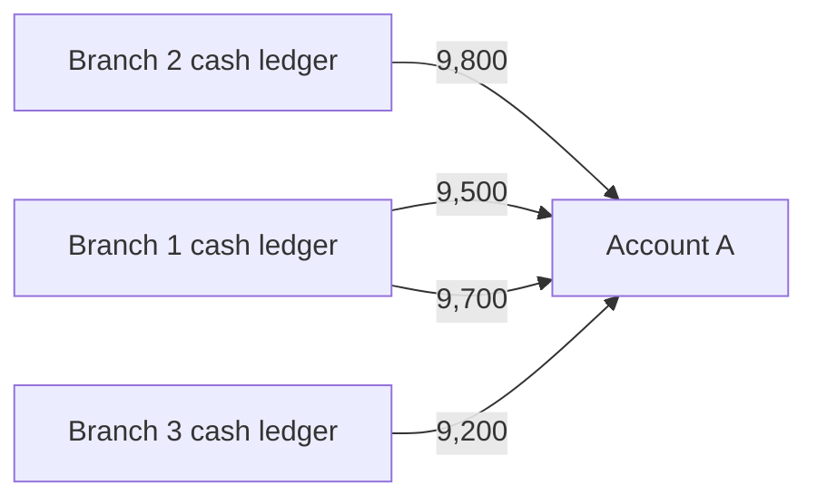

# Structuring (smurfing) below reporting thresholds

> **Draft.** Slug `structuring`, version 0.1.0, tier `core`, synthetic support `high`. Definition file: [`detect/typologies/structuring.yaml`](../../detect/typologies/structuring.yaml). A typology researcher checks this page against its sources before the definition is approved.

A structure that matches this pattern is not evidence of money laundering or of any other wrongdoing. There are ordinary reasons for almost every pattern described here; the [standing disclaimer](../wording.md#disclaimers) applies to everything NeonRadar shows.

## What it is

Under United States rules, structuring means conducting or attempting one or more currency transactions, in any amount or manner, for the purpose of evading reporting requirements [ffiec_appendix_g]. Breaking a sum above USD 10,000 into smaller transactions is one example, but the transactions do not have to exceed USD 10,000 at one bank on one day [ffiec_appendix_g]. Section 1010.314 also prohibits causing a domestic financial institution to omit a required report or file one with a material omission or misstatement, as well as structuring, assisting or attempting to structure [cfr_31_1010_314].

A person can act alone, together with other people or on their behalf, and structuring can happen before the funds reach a bank [ffiec_appendix_g]. FinCEN uses *smurfs* for teams that structure transactions to evade Currency Transaction Report filing [fincen_fin_2025_a003]. Europol uses *smurfing* for splitting illicit proceeds into smaller sums before placement in the financial system to avoid suspicious transaction reporting [europol_efecta_2023].

The FATF's report on professional money laundering describes a cash-controller scheme in which money is deposited below the reporting threshold to avoid detection [fatf_pml_2018]. FinCEN's funnel-account advisory describes multiple cash deposits that are often below the cash-reporting threshold and lists sub-USD-10,000 deposits by unidentified people outside the account's home region as a red flag [fincen_fin_2014_a005].

## How it looks in the graph

In NeonRadar's graph (the C2 contract, `contracts/C2-graph-schema.md`), every bank account is an `:Account` node and every payment is a `PAID` relationship between two accounts, with an `amount`, a `currency`, a timestamp `ts` and a `channel`. Cash is modelled as a payment too: a cash deposit is a `PAID` relationship with `channel = 'cash_deposit'` from a bank branch's `cash_ledger` account into the customer's account (the C1 contract, `contracts/C1-record.md`). People and companies hold accounts through `HOLDS_ACCOUNT`.

NeonRadar models one observable variant rather than the whole legal definition: a burst of cash deposits [ffiec_appendix_g].

- many `PAID` relationships with `channel = 'cash_deposit'` into one customer account, or into several accounts with the same holder;
- within a short time window;
- each amount just below a threshold (for example between 9,000 and 9,999 when the threshold is 10,000);
- often from the `cash_ledger` accounts of several branches;
- where an aggregate total near or above the threshold can strengthen the signal, but is not required [ffiec_appendix_g].

The cluster of amounts near the threshold, close together in time, warrants review; amounts alone cannot establish the purpose of the deposits [ffiec_appendix_g].

What the graph cannot show: who brought the cash to the branch. C2 does not store the payer of a payment, only the accounts, so the red flags about the people making deposits cannot be checked in Phase 1.

## Red flags the sources list

- Currency deposits or withdrawals just below identification or reporting thresholds [ffiec_appendix_f].
- Deposits made through multiple branches of the same bank, or by groups entering one branch together [ffiec_appendix_f].
- Multiple, frequent currency deposits to accounts described as unrelated [ffiec_appendix_f].
- Sub-USD-10,000 cash deposits by unidentified people at branches outside the account's home region [fincen_fin_2014_a005].

A red flag is a reason to look closer, not evidence. The FFIEC describes its list as non-exhaustive and says that the presence of a red flag is not, by itself, evidence of criminal activity [ffiec_appendix_f].

## Typical false positives

Ordinary customers can produce the same shape. The definition file and the project's look-alike list (PHASE-1.md 7.2) name these:

- **Cash businesses banking their daily takings.** A restaurant or a corner shop whose takings are often between 5,000 and 9,999 and are banked every evening makes many deposits below the threshold.
- **Deposit caps set by insurers or cash-in-transit contracts.** A contract may limit how much cash a customer carries to the bank at once.
- **Fixed weekly savings.** A person who saves the same round sum every week makes a regular series of similar deposits.

The FFIEC cautions that even two USD 9,900 deposits days apart do not necessarily establish structuring; prior account history and customer context need review [ffiec_appendix_g]. Rhythm and context can help distinguish the look-alikes: deposits consistent with trading days and the business's size at its usual branch differ from an unusual burst at several branches. A detector that sees only amounts risks flagging ordinary cash activity.

## Can synthetic data show it?

Yes. The synthetic support is `high` (PHASE-1.md 7.2). A threshold is a rule with explicit numbers, so the generator can plant labelled bursts of deposits just below it, among synthetic entities only (guardrail G1).

The risk lies the other way. If every deposit just below the threshold in the synthetic data belonged to a planted scenario, a detector could score perfectly with a trivial rule. The Phase 3 generator must therefore produce ordinary deposits just below the threshold (the look-alikes above) at realistic rates, and say how it chose those rates. Detection rates measured on synthetic data say nothing about how NeonRadar would perform on real data (README, Limitations).

## Starting parameters

None in the definition file yet. PHASE-1.md 7.2 suggests a starting point for the typology researcher, not a universal threshold: 10,000 with a 10 percent band, so deposits from 9,000 up to just under 10,000 count. That example follows the USD 10,000 figure used in FFIEC Appendix G and FinCEN's funnel-account red flag [ffiec_appendix_g] [fincen_fin_2014_a005]. A detector would also need a currency and jurisdiction, a time window, a minimum number of deposits and an aggregation rule.

## Open questions

- Which currency, jurisdiction and reporting rule should configure each detector run? The project contracts use EUR examples, while the cited US material uses USD.
- Should the first detector cover only cash deposits, or also withdrawals and monetary instruments described in FFIEC Appendix G?
- How should the detector handle activity structured before funds reach the bank when the graph does not record the person who presented the cash or bought the monetary instruments?

## Sources

- [cfr_31_1010_314] US Code of Federal Regulations (Legal Information Institute copy), *31 CFR 1010.314: Structured transactions*, living document. <https://www.law.cornell.edu/cfr/text/31/1010.314>
- [europol_efecta_2023] Europol, *European Financial and Economic Crime Threat Assessment 2023: The Other Side of the Coin*, 2023. <https://www.europol.europa.eu/cms/sites/default/files/documents/The%20Other%20Side%20of%20the%20Coin%20-%20Analysis%20of%20Financial%20and%20Economic%20Crime%20(EN).pdf>
- [fatf_pml_2018] FATF, *Professional Money Laundering*, 2018. <https://www.fatf-gafi.org/content/dam/fatf-gafi/reports/Professional-Money-Laundering.pdf.coredownload.pdf>
- [ffiec_appendix_f] FFIEC, *BSA/AML Examination Manual, Appendix F: Money Laundering and Terrorist Financing Red Flags*, living document. <https://bsaaml.ffiec.gov/manual/Appendices/07>
- [ffiec_appendix_g] FFIEC, *BSA/AML Examination Manual, Appendix G: Structuring*, living document. <https://bsaaml.ffiec.gov/manual/Appendices/08>
- [fincen_fin_2014_a005] FinCEN, *FinCEN Advisory FIN-2014-A005: Update on U.S. Currency Restrictions in Mexico: Funnel Accounts and TBML*, 2014. <https://www.fincen.gov/resources/advisories/fincen-advisory-fin-2014-a005>
- [fincen_fin_2025_a003] FinCEN, *FinCEN Advisory FIN-2025-A003: Use of Chinese Money Laundering Networks by Mexico-Based Transnational Criminal Organizations*, 2025. <https://www.fincen.gov/system/files/2025-08/FinCEN-Advisory-CMLN-508.pdf>
