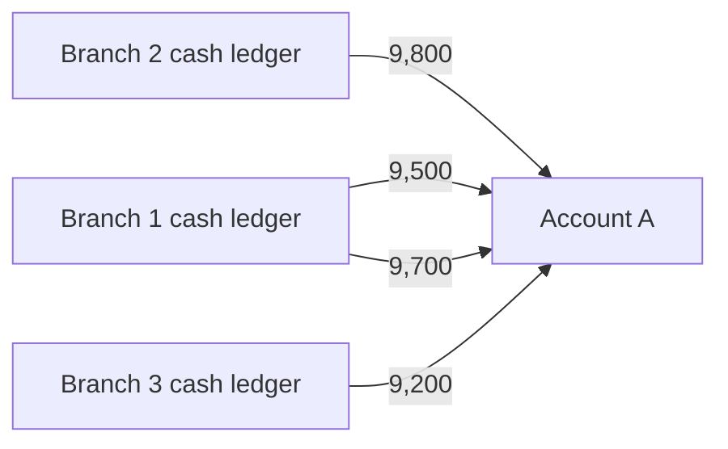

# Structuring (smurfing) below reporting thresholds

> **Draft.** Slug `structuring`, version 0.1.0, tier `core`, synthetic support `high`. Definition file: [`detect/typologies/structuring.yaml`](../../detect/typologies/structuring.yaml). A typology researcher checks this page against its sources before the definition is approved.

A structure that matches this pattern is not evidence of money laundering or of any other wrongdoing. There are ordinary reasons for almost every pattern described here; the [standing disclaimer](../wording.md#disclaimers) applies to everything NeonRadar shows.

## What it is

Structuring means splitting cash transactions into amounts below a reporting threshold to evade reporting requirements [cfr_31_1010_314] [ffiec_appendix_g]. In United States law, nobody may structure a transaction with a financial institution "for the purpose of evading the transactions in currency reporting requirements"; the same rule also covers helping someone else to structure, or trying to [cfr_31_1010_314].

A person can structure alone or together with, or on behalf of, other people, and structuring can happen before the cash ever reaches the bank [ffiec_appendix_g]. When teams do it, it is called smurfing: FinCEN describes "smurfs" as "teams of persons" who structure financial transactions, acting with or on behalf of other persons [fincen_fin_2025_a003]. Europol describes smurfing as splitting proceeds "into smaller sums" to avoid reporting [europol_efecta_2023].

The FATF's report on professional money laundering describes the same technique: deposits "in amounts under the reporting threshold to avoid detection", and cash controllers who deposit cash "in amounts below reporting thresholds" [fatf_pml_2018]. FinCEN's funnel account advisory describes cash deposits "often in amounts below the cash reporting threshold" and lists deposits "of less than $10,000" by unidentified persons as a red flag [fincen_fin_2014_a005].

## How it looks in the graph

In NeonRadar's graph (the C2 contract, `contracts/C2-graph-schema.md`), every bank account is an `:Account` node and every payment is a `PAID` relationship between two accounts, with an `amount`, a `currency`, a timestamp `ts` and a `channel`. Cash is modelled as a payment too: a cash deposit is a `PAID` relationship with `channel = 'cash_deposit'` from a bank branch's `cash_ledger` account into the customer's account (the C1 contract, `contracts/C1-record.md`). People and companies hold accounts through `HOLDS_ACCOUNT`.

The pattern is a burst of cash deposits:

- many `PAID` relationships with `channel = 'cash_deposit'` into one customer account, or into several accounts with the same holder;
- within a short time window;
- each amount just below a threshold (for example between 9,000 and 9,999 when the threshold is 10,000);
- often from the `cash_ledger` accounts of several branches;
- with a daily total above the threshold that each single deposit stayed below.

No single deposit stands out. The signal is the cluster: many amounts just under the threshold, close together in time.

What the graph cannot show: who brought the cash to the branch. C2 does not store the payer of a payment, only the accounts, so the red flags about the people making deposits cannot be checked in Phase 1.

## Red flags the sources list

- "Currency is deposited or withdrawn in amounts just below identification or reporting thresholds" [ffiec_appendix_f].
- "Deposits are structured through multiple branches of the same bank" [ffiec_appendix_f].
- A customer "makes multiple and frequent currency deposits to various accounts that are purportedly unrelated" [ffiec_appendix_f].
- Cash deposits "of less than $10,000 by unidentified persons" at "branches outside of the geographic region where the account is domiciled" [fincen_fin_2014_a005].

A red flag is a reason to look closer, not evidence. The FFIEC says its red flags "are not all-inclusive" and warns that a red flag alone does not prove criminal activity [ffiec_appendix_f].

## Typical false positives

Ordinary customers can produce the same shape. The definition file and the project's look-alike list (PHASE-1.md 7.2) name these:

- **Cash businesses banking their daily takings.** A restaurant or a corner shop whose takings are often between 5,000 and 9,999 and are banked every evening makes many deposits below the threshold.
- **Deposit caps set by insurers or cash-in-transit contracts.** A contract may limit how much cash a customer carries to the bank at once.
- **Fixed weekly savings.** A person who saves the same round sum every week makes a regular series of similar deposits.

What separates them is the rhythm and the context: deposits that follow trading days and the business's size, at the branch the customer normally uses, look different from a burst at several branches within hours. A detector that sees only amounts will flag every cash business.

## Can synthetic data show it?

Yes. The synthetic support is `high` (PHASE-1.md 7.2). A threshold is a rule with explicit numbers, so the generator can plant labelled bursts of deposits just below it, among synthetic entities only (guardrail G1).

The risk lies the other way. If every deposit just below the threshold in the synthetic data belonged to a planted scenario, a detector could score perfectly with a trivial rule. The Phase 3 generator must therefore produce ordinary deposits just below the threshold (the look-alikes above) at realistic rates, and say how it chose those rates. Detection rates measured on synthetic data say nothing about how NeonRadar would perform on real data (README, Limitations).

## Starting parameters

None in the definition file yet. PHASE-1.md 7.2 suggests a starting point for the typology researcher, not a fact from the sources: a threshold of 10,000 with a 10 percent band, so deposits from 9,000 up to just under 10,000 count, after the US threshold that FinCEN's funnel account advisory refers to [fincen_fin_2014_a005]. A detector would also need a time window, a minimum number of deposits and a daily total.

## Open questions

- The research note gives the US currency reporting threshold as USD 10,000. The bibliography has no source for the reporting rule itself (only the structuring rule and FinCEN's advisory, which refers to deposits "of less than $10,000"), so this page does not state the threshold as law.
- The research note adds that structuring can aim to stay below a bank's own monitoring thresholds. No quoted source passage supports this, so it is left out.
- The research note says that public transaction generators model cash placement. Those generators have no bibliography entry, so the claim is left out.
- For the typology researcher: which currency and which threshold the synthetic data should use (the examples use EUR; the threshold in the sources is in US dollars), and whether a daily total above the threshold is required or only strengthens a match.

## Sources

- [cfr_31_1010_314] US Code of Federal Regulations (Legal Information Institute copy), *31 CFR 1010.314: Structured transactions*, living document. <https://www.law.cornell.edu/cfr/text/31/1010.314>
- [europol_efecta_2023] Europol, *European Financial and Economic Crime Threat Assessment 2023: The Other Side of the Coin*, 2023. <https://www.europol.europa.eu/cms/sites/default/files/documents/The%20Other%20Side%20of%20the%20Coin%20-%20Analysis%20of%20Financial%20and%20Economic%20Crime%20(EN).pdf>
- [fatf_pml_2018] FATF, *Professional Money Laundering*, 2018. <https://www.fatf-gafi.org/content/dam/fatf-gafi/reports/Professional-Money-Laundering.pdf.coredownload.pdf>
- [ffiec_appendix_f] FFIEC, *BSA/AML Examination Manual, Appendix F: Money Laundering and Terrorist Financing Red Flags*, living document. <https://bsaaml.ffiec.gov/manual/Appendices/07>
- [ffiec_appendix_g] FFIEC, *BSA/AML Examination Manual, Appendix G: Structuring*, living document. <https://bsaaml.ffiec.gov/manual/Appendices/08>
- [fincen_fin_2014_a005] FinCEN, *FinCEN Advisory FIN-2014-A005: Update on U.S. Currency Restrictions in Mexico: Funnel Accounts and TBML*, 2014. <https://www.fincen.gov/resources/advisories/fincen-advisory-fin-2014-a005>
- [fincen_fin_2025_a003] FinCEN, *FinCEN Advisory FIN-2025-A003: Use of Chinese Money Laundering Networks by Mexico-Based Transnational Criminal Organizations*, 2025. <https://www.fincen.gov/system/files/2025-08/FinCEN-Advisory-CMLN-508.pdf>
