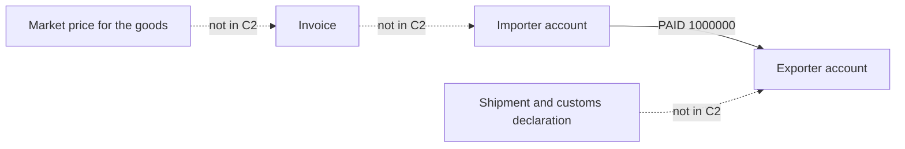

# Trade-based money laundering (over- and under-invoicing)

> **Draft.** Slug `trade_based_ml`, version 0.1.0, tier `explainer_only`, synthetic support `low`. Definition file: [`detect/typologies/trade_based_ml.yaml`](../../detect/typologies/trade_based_ml.yaml). A typology researcher checks this page against its sources before the definition is approved. Research entry: `docs/research/2026-10-16/aml-domain.md`, section 2 (k).

A structure that matches this pattern is not evidence of money laundering or of any other wrongdoing. There are ordinary reasons for almost every pattern described here; the [standing disclaimer](../wording.md#disclaimers) applies to everything NeonRadar shows.

This page teaches why payment data alone cannot show this typology. NeonRadar's graph holds payments, not trade documents, so it never reports a trade-based pattern.

## What it is

Trade-based money laundering (TBML) is "the process of disguising the proceeds of crime and moving value through the use of trade transactions" [fatf_egmont_tbml_2020]. The FATF and Egmont report describes the basic techniques [fatf_egmont_tbml_2020]:

- **Over- and under-invoicing:** "the misrepresentation of the price of the good or service, in order to transfer value".
- **Over- and under-shipment:** misrepresenting the quantity, including "'phantom shipments' where no product is moved at all".
- **Multiple invoicing:** using the same documents to justify several payments for one shipment.
- **Falsely described goods:** misrepresenting "the quality or type of a good or service".

An illustration, not from a source: an importer pays an exporter 1,000,000 for goods worth 100,000. The payment looks like trade, but 900,000 of value has moved from the importer's side to the exporter's side.

Other sources describe the same techniques in use. FATF's report on professional money laundering lists trade-based schemes, such as fake or inflated invoices and phantom shipments, among the services professional launderers offer [fatf_pml_2018]. FinCEN's 2014 advisory covers funnel accounts used to pay for goods exported to Mexico [fincen_fin_2014_a005], and its 2025 advisory mentions "Hong Kong registered trading companies with shell-like characteristics" [fincen_fin_2025_a003].

## How it looks in the graph

It does not. This section explains why.

- **The trade and the money are separate.** In open account trade there is "a disconnect between the movement of the underlying trade and the money used to finance it" [fatf_egmont_tbml_2020].
- **Banks do not see the goods.** Financial institutions "do not necessarily verify the documents", which are "not always standardised", and trade data is spread across several parties, so no single one sees the whole picture [fatf_egmont_tbml_2020].
- **C2 has no trade data.** A `PAID` relationship carries `amount`, `currency`, `ts`, `channel` and `purpose` ([contracts/C2-graph-schema.md](../../contracts/C2-graph-schema.md)). There are no invoices, shipments, customs declarations or market prices to compare the amount with. Adding them after Gate 1 would be a contract change.

That is why the illustration above cannot be seen in payment data: the payment of 1,000,000 looks the same whether the goods were worth 1,000,000 or 100,000.

### Payment-only signals, and why they are weak

The graph can show a few shapes that the sources list as indicators. None of them shows a misrepresented price, quantity or quality, which is what defines the typology [fatf_egmont_tbml_2020], so a match says very little on its own.

| Signal in the payment graph | Indicator in the sources | Where NeonRadar looks at the shape |
|---|---|---|
| A payment from someone with no other link to the buyer or the seller | "Payment for imported commodities is made by an entity other than the consignee" [fatf_egmont_tbml_indicators_2021] | Not a typology; C2 has no consignee |
| Payments that come back to where they started | "Payments are routed in a circle" [fatf_egmont_tbml_indicators_2021] | `circular_flow` |
| An account that passes money straight on | "An account of a trade entity appears to be a 'pay-through' or 'transit' account" [fatf_egmont_tbml_indicators_2021] | `rapid_pass_through` |
| Round amounts | "Payments are sent or received in large round amounts for trade in sectors where this is deemed as unusual" [fatf_egmont_tbml_indicators_2021] | Not a typology |
| Trading companies at one address | "A trade entity is registered at an address that is likely to be a mass registration address" [fatf_egmont_tbml_indicators_2021] | `mass_registration_address` |

## Red flags the sources list

All from the FATF and Egmont trade-based money laundering risk indicators [fatf_egmont_tbml_indicators_2021]:

| Red flag | Needs data that C2 lacks? |
|---|---|
| "Trade activity is inconsistent with the stated line of business of the entities involved" | Partly: `sector` is stored, the goods traded are not |
| "A trade entity consistently displays unreasonably low profit margins" | Yes: needs accounts and prices |
| "Inconsistencies across contracts, invoices or other trade documents" | Yes: needs trade documents |
| "Payment for imported commodities is made by an entity other than the consignee" | Yes: needs the consignee |
| "Shipments of commodities are routed through a number of jurisdictions without economic or commercial justification" | Yes: needs shipments |
| "Payments are sent or received in large round amounts for trade in sectors where this is deemed as unusual" | Partly: amounts and `sector` are stored, sector norms are not |

A red flag is a reason to look closer, not evidence [ffiec_appendix_f].

## Typical false positives

Over- and under-invoicing is a misrepresentation of the price [fatf_egmont_tbml_2020], so showing it needs a reference price for the goods; without one, a price difference is only a price that two parties agreed on. The research note lists ordinary trade that produces the same payment shapes; it gives no source for these, so they are listed here as NeonRadar's own look-alike categories (see Open questions):

- **Ordinary price differences:** for quality grades, delivery terms, volume discounts or exchange rate movements.
- **Transfer pricing** between companies of one group.
- **Third-party payments** made by a trade finance or factoring company on a buyer's behalf.
- **Goods shipped through a trading hub** on their way to the buyer.

## Can synthetic data show it?

Hardly (synthetic support: low). NeonRadar's generator (Phase 3) models accounts and payments, not trade documents, so it could label only the weak payment-only signals above. Showing this typology credibly would need simulated invoices, shipments, declared customs values and a market price series, with some trades priced wrongly on purpose. That is out of scope for NeonRadar, so this typology stays an explainer with no detector, no scenario and no alert.

## Starting parameters

None: this typology is explainer only and has no detector.

## Open questions

For the typology researcher:

1. The look-alike categories under "Typical false positives" come from the research note without a source in the bibliography. Find sources, or keep them as project categories.
2. Whether a later phase should model invoices and shipments. That would change the graph schema, which is frozen after Gate 1.
3. Whether the explainer should name the related payment-only typologies more strongly, or keep them as weak signals only.

## Sources

- [fatf_egmont_tbml_2020] FATF and Egmont Group, *Trade-Based Money Laundering: Trends and Developments*, 2020. <https://www.fatf-gafi.org/en/publications/Methodsandtrends/Trade-based-money-laundering-trends-and-developments.html>
- [fatf_egmont_tbml_indicators_2021] FATF and Egmont Group, *Trade-Based Money Laundering: Risk Indicators*, 2021. <https://www.fatf-gafi.org/en/publications/Methodsandtrends/Trade-based-money-laundering-indicators.html>
- [fatf_pml_2018] FATF, *Professional Money Laundering*, 2018. <https://www.fatf-gafi.org/content/dam/fatf-gafi/reports/Professional-Money-Laundering.pdf.coredownload.pdf>
- [ffiec_appendix_f] FFIEC, *BSA/AML Examination Manual, Appendix F: Money Laundering and Terrorist Financing Red Flags*, living document. <https://bsaaml.ffiec.gov/manual/Appendices/07>
- [fincen_fin_2014_a005] FinCEN, *FinCEN Advisory FIN-2014-A005: Update on U.S. Currency Restrictions in Mexico: Funnel Accounts and TBML*, 2014. <https://www.fincen.gov/resources/advisories/fincen-advisory-fin-2014-a005>
- [fincen_fin_2025_a003] FinCEN, *FinCEN Advisory FIN-2025-A003: Use of Chinese Money Laundering Networks by Mexico-Based Transnational Criminal Organizations*, 2025. <https://www.fincen.gov/system/files/2025-08/FinCEN-Advisory-CMLN-508.pdf>
